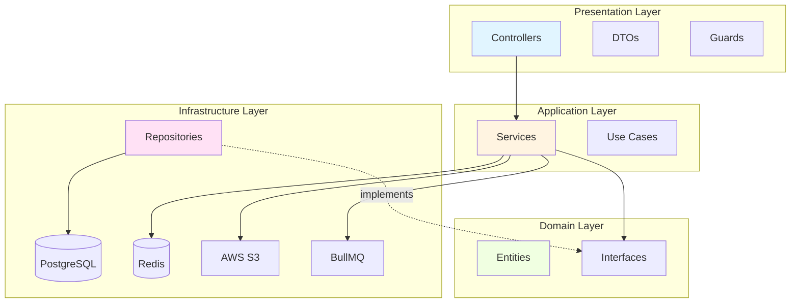

# Code & Structure - Tổng quan

Tài liệu này mô tả kiến trúc, cấu trúc code và các mẫu thiết kế được sử dụng trong dự án.

## Mục lục

1. [Kiến trúc tổng quan](#kiến-trúc-tổng-quan)
2. [Clean Architecture](#clean-architecture)
3. [Cấu trúc thư mục](#cấu-trúc-thư-mục)
4. [Các tầng ứng dụng](#các-tầng-ứng-dụng)
5. [Dependency Injection](#dependency-injection)
6. [Quản lý Module Nghiệp Vụ](#quản-lý-module-nghiệp-vụ)

## Kiến trúc tổng quan

Dự án áp dụng **Clean Architecture** với các nguyên tắc:

- **Separation of Concerns** - Phân tách trách nhiệm
- **Dependency Inversion** - Phụ thuộc hướng vào trong
- **Single Responsibility** - Mỗi class có một trách nhiệm
- **Open/Closed** - Mở rộng, không sửa đổi

## Clean Architecture



## Cấu trúc thư mục

```
src/
├── app.module.ts                    # Root module
├── main.ts                          # Entry point
│
├── configs/                         # Configuration
│   ├── configuration.config.ts      # Centralized config
│   ├── validation.schema.ts         # Joi validation
│   └── api-docs.config.ts           # Swagger config
│
├── decorators/                      # Custom decorators
│   ├── current-user.decorator.ts
│   ├── public.decorator.ts
│   └── roles.decorator.ts
│
├── filters/                         # Exception filters
│   └── http-exception.filter.ts
│
├── guards/                          # Guards
│   ├── jwt-access-token.guard.ts
│   ├── jwt-refresh-token.guard.ts
│   └── roles.guard.ts
│
├── health/                          # Health checks
│   └── health.controller.ts
│
├── modules/                         # Feature modules
│   ├── auth/                        # Authentication
│   ├── users/                       # User management
│   ├── user-roles/                  # RBAC
│   ├── media/                       # File upload
│   ├── queue/                       # Background jobs
│   ├── comments/                    # Comments
│   ├── checkin/                     # Check-in
│   ├── flash-cards/                 # Flash cards
│   ├── flash-cards-state/           # State machine
│   ├── collections/                 # Collections
│   └── topics/                      # Topics
│
├── observability/                   # Observability
│   ├── metrics/                     # Prometheus metrics
│   └── audit/                       # Audit logging
│
├── repositories/                    # Base repositories
│   └── base.repository.ts
│
├── shared/                          # Shared utilities
│   ├── errors/                      # Custom errors
│   ├── success/                     # Success messages
│   └── helpers/                     # Helper functions
│
└── database/                        # Database
    ├── data-source.ts               # TypeORM config
    └── migrations/                  # Migration files
```

## Các tầng ứng dụng

### 1. Presentation Layer (Controller + DTO + Guard)

**Trách nhiệm:**
- Tiếp nhận HTTP request
- Kiểm tra dữ liệu đầu vào (DTO)
- Thực thi xác thực và phân quyền
- Chuyển đổi dữ liệu response
- Tài liệu API (Swagger)

**Ví dụ:**
```typescript
@Controller('users')
@ApiTags('Users')
export class UsersController {
  constructor(private readonly usersService: UsersService) {}

  @Get('me')
  @UseGuards(JwtAccessTokenGuard)
  @ApiOperation({ summary: 'Get current user profile' })
  async getProfile(@CurrentUser() user: User) {
    return user;
  }
}
```

### 2. Application Layer (Service)

**Trách nhiệm:**
- Logic nghiệp vụ
- Điều phối các repository
- Quản lý transaction
- Tích hợp dịch vụ bên ngoài
- Xử lý domain events

**Ví dụ:**
```typescript
@Injectable()
export class UsersService {
  constructor(
    private readonly usersRepository: UsersRepository,
    private readonly queueService: QueueService,
  ) {}

  async createUser(dto: CreateUserDto): Promise<User> {
    const user = await this.usersRepository.create(dto);
    await this.queueService.addEmailJob({ to: user.email });
    return user;
  }
}
```

### 3. Domain Layer (Entity + Interface)

**Trách nhiệm:**
- Entity nghiệp vụ
- Ràng buộc business rules
- Interface repository
- Không phụ thuộc framework

**Ví dụ:**
```typescript
@Entity('users')
export class User {
  @PrimaryGeneratedColumn('uuid')
  id: string;

  @Column({ unique: true })
  email: string;

  @Column()
  @Exclude()
  password: string;

  @Column()
  first_name: string;
}
```

### 4. Infrastructure Layer (Repository + External Services)

**Trách nhiệm:**
- Triển khai repository
- Tích hợp database
- Tích hợp dịch vụ bên ngoài (S3, Redis, BullMQ)
- Quản lý cache

**Ví dụ:**
```typescript
@Injectable()
export class UsersRepository {
  constructor(
    @InjectRepository(User)
    private readonly repository: Repository<User>,
  ) {}

  async findByEmail(email: string): Promise<User | null> {
    return this.repository.findOne({ where: { email } });
  }
}
```

## Dependency Injection

NestJS sử dụng DI qua constructor:

```typescript
@Injectable()
export class UsersService {
  constructor(
    @InjectRepository(User)
    private readonly usersRepository: Repository<User>,
    private readonly configService: ConfigService,
    private readonly queueService: QueueService,
  ) {}
}
```

**Lợi ích:**
- Giảm phụ thuộc chặt
- Dễ test với mock
- Tăng khả năng bảo trì
- Rõ ràng các quan hệ

## Design Patterns

Các mẫu thiết kế được sử dụng:

1. **Repository Pattern** - Trừu tượng hóa data access
2. **Strategy Pattern** - State machine cho flash cards
3. **Decorator Pattern** - Custom decorators
4. **Factory Pattern** - State factory
5. **Observer Pattern** - Event emitters

## Quản lý Module Nghiệp Vụ

Dự án chia module thành 2 loại:

### Core Modules (Bắt buộc)

Luôn được đăng ký trong `app.module.ts`:
- **Auth** - Xác thực JWT/OAuth
- **Users** - Quản lý người dùng
- **UserRoles** - RBAC
- **Permissions** - Phân quyền chi tiết
- **Queue** - BullMQ background jobs
- **Media** - File upload (S3)
- **Audit** - Audit logging

### Domain Modules (Tùy chọn)

Được điều khiển qua **Feature Flags** trong `src/domains/domain-modules.module.ts`:
- **FlashCards** - Flash cards học tập
- **Collections** - Bộ sưu tập
- **Topics** - Phân loại chủ đề
- **Comments** - Bình luận phân cấp
- **Checkin** - Điểm danh hằng ngày
- **FlashCardsState** - Workflow phê duyệt

### DomainModulesModule

**File:** `src/domains/domain-modules.module.ts`

```typescript
const enabledModules = [];

if (process.env.ENABLE_FLASH_CARDS === 'true') {
  enabledModules.push(FlashCardsModule, TopicsModule);
}
if (process.env.ENABLE_COLLECTIONS === 'true') {
  enabledModules.push(CollectionsModule);
}
if (process.env.ENABLE_COMMENTS === 'true') enabledModules.push(CommentsModule);
if (process.env.ENABLE_CHECKIN === 'true') enabledModules.push(CheckinModule);
if (process.env.ENABLE_FLASH_CARD_STATES === 'true') {
  enabledModules.push(FlashCardsStateModule);
}

@Module({ imports: enabledModules })
export class DomainModulesModule {}
```

### Thêm Module Nghiệp Vụ Mới

Để thêm module mới (ví dụ: Blog, E-commerce):

1. Tạo cấu trúc module trong `src/modules/`
2. Tạo entity và migration
3. Tạo module với imports/exports
4. Thêm feature flag vào `.env`
5. Đăng ký trong `DomainModulesModule`
6. Thêm `@FeatureFlag` guard trong controller
7. Cập nhật validation schema

**Chi tiết:** Xem [Module Management](module-management.md)

### Bật/Tắt Module

Chỉ cần thay đổi biến môi trường:

```env
# Bắt module
ENABLE_BLOG=true

# Tắt module
ENABLE_BLOG=false
```

Restart application để áp dụng.

### Xóa Module Hoàn Toàn

Nếu không cần module nữa:

1. Tạo migration để xóa bảng database
2. Chạy migration
3. Xóa khỏi `DomainModulesModule`
4. Xóa feature flag khỏi validation schema
5. Xóa folder module
6. Xóa migration file cũ (optional)

## Quy tắc code

### Quy tắc chung

1. **Single Responsibility** - Mỗi class một trách nhiệm
2. **DRY** - Don't Repeat Yourself
3. **KISS** - Keep It Simple, Stupid
4. **YAGNI** - You Aren't Gonna Need It

### TypeScript

- Sử dụng strict mode
- Luôn khai báo types
- Tránh `any`
- Sử dụng interfaces cho public API
- Sử dụng types cho internal

### Naming conventions

- **Files**: kebab-case (`user.service.ts`)
- **Classes**: PascalCase (`UserService`)
- **Methods/Variables**: camelCase (`getUserById`)
- **Constants**: UPPER_SNAKE_CASE (`MAX_RETRY_COUNT`)
- **Interfaces**: PascalCase với `I` prefix (`IUserRepository`)

### Structure trong module

```
module-name/
├── dto/                    # Data Transfer Objects
│   ├── create-*.dto.ts
│   ├── update-*.dto.ts
│   └── query-*.dto.ts
├── entities/              # Database entities
│   └── *.entity.ts
├── repositories/          # Data access (optional)
│   └── *.repository.ts
├── *.controller.ts         # API endpoints
├── *.service.ts            # Business logic
├── *.module.ts             # Module definition
└── *.spec.ts               # Tests
```

## Tài liệu liên quan

- [Architecture](architecture.md)
- [Module Management](module-management.md)
- [Domain Modules](../03-CHUC-NANG/domain-modules.md)
- [Feature Flags](../05-CAU-HINH/feature-flags.md)
