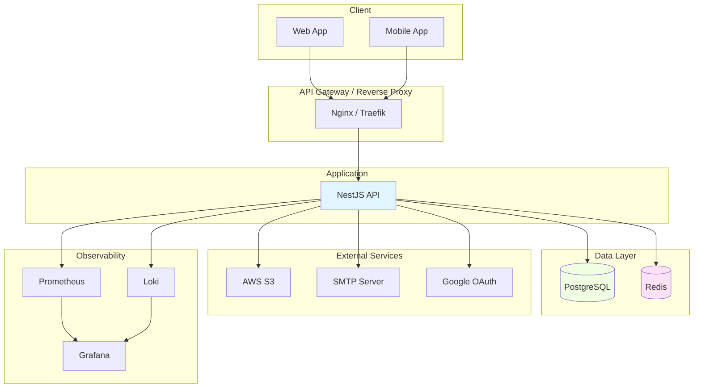
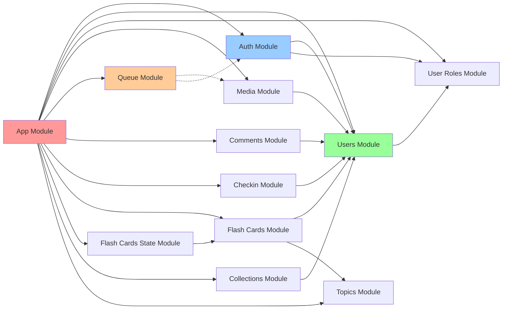
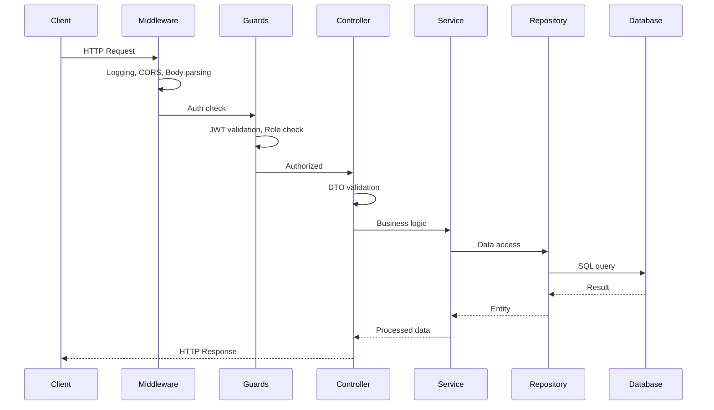
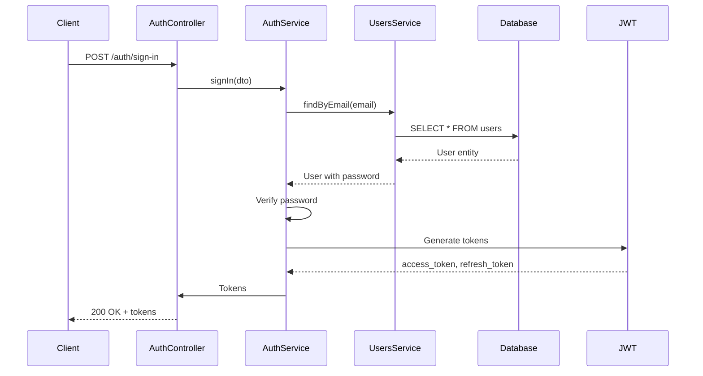
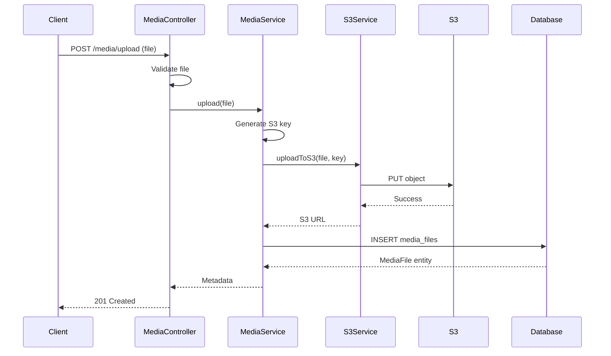
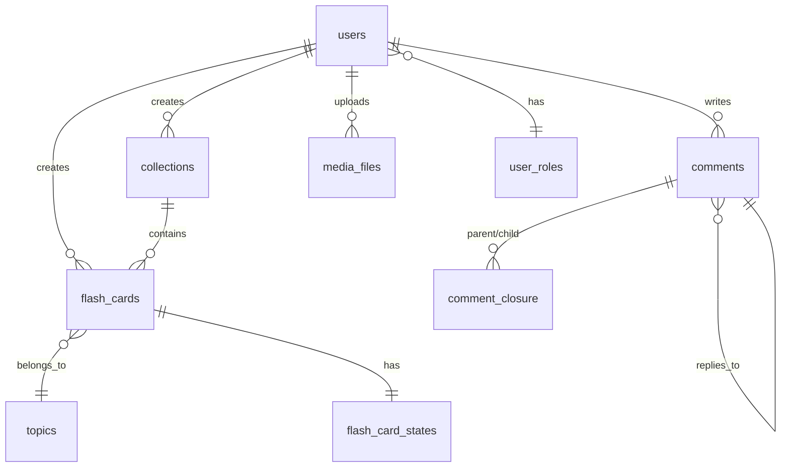
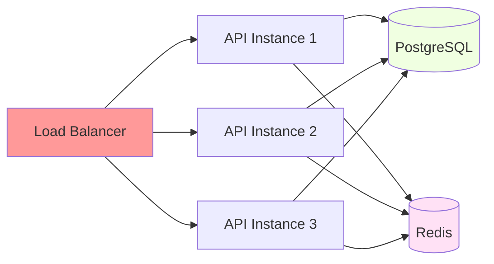

# Kiến trúc hệ thống

Mô tả chi tiết kiến trúc hệ thống, các thành phần và cách chúng tương tác.

## Tổng quan kiến trúc

Hệ thống theo kiến trúc **Clean Architecture** với 4 tầng chính:

1. **Presentation Layer** - HTTP API
2. **Application Layer** - Business logic
3. **Domain Layer** - Core entities
4. **Infrastructure Layer** - External services

## Sơ đồ kiến trúc



## Clean Architecture Layers

### Layer 1: Presentation Layer

**Thành phần:**
- Controllers
- DTOs (Data Transfer Objects)
- Guards (Authentication & Authorization)
- Interceptors
- Pipes (Validation)

**Trách nhiệm:**
- Tiếp nhận HTTP requests
- Validate input data
- Authentication & authorization
- Transform request/response
- API documentation (Swagger)

**Flow:**
```
HTTP Request → Middleware → Guards → Pipes → Controller → Service
```

### Layer 2: Application Layer

**Thành phần:**
- Services
- Use Cases
- Domain Events

**Trách nhiệm:**
- Business logic
- Workflow orchestration
- Transaction management
- External service integration
- Domain event handling

**Flow:**
```
Controller → Service → Repository → Database
              → External Service
              → Queue
```

### Layer 3: Domain Layer

**Thành phần:**
- Entities
- Value Objects
- Domain Services
- Repository Interfaces

**Trách nhiệm:**
- Core business rules
- Entity relationships
- Domain invariants
- Repository contracts

**Đặc điểm:**
- Không phụ thuộc framework
- Không phụ thuộc infrastructure
- Testable đơn giản

### Layer 4: Infrastructure Layer

**Thành phần:**
- Repository Implementations
- Database (PostgreSQL)
- Cache (Redis)
- Storage (AWS S3)
- Queue (BullMQ)
- External APIs

**Trách nhiệm:**
- Data persistence
- External service integration
- Caching
- File storage
- Background jobs

## Module Architecture

### Module Dependencies



### Module Categories

**Core Modules (Bắt buộc):**
- `auth` - Authentication & authorization
- `users` - User management
- `user-roles` - Role-based access control

**Feature Modules (Tùy chọn):**
- `media` - File upload & storage
- `queue` - Background jobs
- `comments` - Hierarchical comments
- `checkin` - Daily check-in
- `flash-cards` - Flash card CRUD
- `flash-cards-state` - State machine
- `collections` - Collections
- `topics` - Topics

## Request Flow

### HTTP Request Lifecycle



### Authentication Flow



### File Upload Flow



## Database Architecture

### Schema Overview



### Indexing Strategy

**Critical indexes:**
- `users.email` (unique)
- `users.username` (unique)
- `comments.post_id`
- `comments.author_id`
- `comment_closure.ancestor_id`
- `comment_closure.descendant_id`
- `media_files.uploaded_by`
- `media_files.status`

## Security Architecture

### Authentication Layers

1. **Transport Layer** - HTTPS/TLS
2. **Application Layer** - JWT + Refresh token
3. **API Layer** - Guards + Roles
4. **Resource Layer** - Ownership checks

### Authorization Flow

```
Request → Public Check → JWT Validation → Role Check → Resource Ownership → Access
          (404 if off)  (401 if fail)    (403 if fail)   (403 if fail)
```

## Scalability Architecture

### Horizontal Scaling



### Stateless Design

- JWT stateless authentication
- Session data in Redis
- File storage in S3
- Background jobs in queue

## Performance Considerations

### Database

- Connection pooling
- Query optimization
- Index usage
- N+1 query prevention

### Caching

- Redis for session data
- Application cache for frequent queries
- CDN for static assets

### Queue

- Async processing for heavy tasks
- Rate limiting
- Job retry with backoff

## Tài liệu liên quan

- [Module Structure](module-structure.md)
- [Design Patterns](design-patterns.md)
- [Database Schema](../05-CAU-HINH/)
