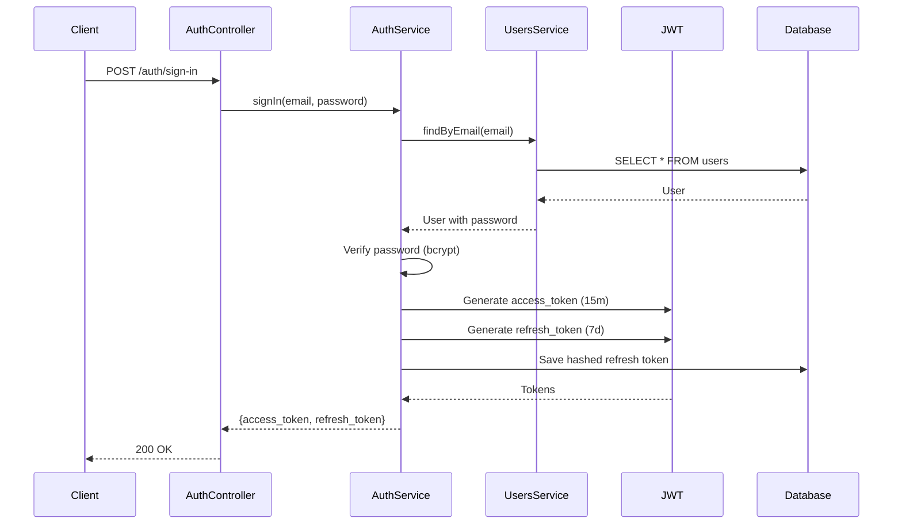

# Authentication

Hệ thống xác thực JWT với refresh token rotation và tùy chọn OAuth2.

## Tổng quan

Authentication module xử lý:

- Đăng ký email/password
- Đăng nhập JWT
- Refresh token rotation
- Logout và thu hồi token
- Google OAuth2 (tùy chọn)
- Email verification (tùy chọn)
- Password reset (tùy chọn)

## Architecture



## Endpoints

### POST /auth/sign-up

Đăng ký người dùng mới.

**Request:**
```json
{
  "email": "user@example.com",
  "password": "SecurePass123!",
  "first_name": "John",
  "last_name": "Doe"
}
```

**Validation:**
- Email: valid email format, unique
- Password: min 8 chars, uppercase, lowercase, number
- first_name: 2-60 chars
- last_name: 2-60 chars

**Response 201:**
```json
{
  "success": true,
  "message": "User registered successfully",
  "data": {
    "access_token": "eyJhbGciOiJIUzI1NiIsInR5cCI6IkpXVCJ9...",
    "refresh_token": "eyJhbGciOiJIUzI1NiIsInR5cCI6IkpXVCJ9...",
    "user": {
      "id": "uuid",
      "email": "user@example.com",
      "first_name": "John",
      "last_name": "Doe",
      "role": {
        "id": "uuid",
        "name": "User"
      }
    }
  }
}
```

**Errors:**
- `409 Conflict` - Email đã tồn tại
- `422 Unprocessable Entity` - Validation failed

### POST /auth/sign-in

Đăng nhập với email/password.

**Request:**
```json
{
  "email": "user@example.com",
  "password": "SecurePass123!"
}
```

**Response 200:**
```json
{
  "success": true,
  "data": {
    "access_token": "eyJhbGciOiJIUzI1NiIsInR5cCI6IkpXVCJ9...",
    "refresh_token": "eyJhbGciOiJIUzI1NiIsInR5cCI6IkpXVCJ9..."
  }
}
```

**Errors:**
- `401 Unauthorized` - Credentials không hợp lệ

### POST /auth/refresh

Làm mới access token bằng refresh token.

**Request:**
```json
{
  "refresh_token": "eyJhbGciOiJIUzI1NiIsInR5cCI6IkpXVCJ9..."
}
```

**Response 200:**
```json
{
  "success": true,
  "data": {
    "access_token": "eyJhbGciOiJIUzI1NiIsInR5cCI6IkpXVCJ9...",
    "refresh_token": "eyJhbGciOiJIUzI1NiIsInR5cCI6IkpXVCJ9..."
  }
}
```

**Errors:**
- `401 Unauthorized` - Refresh token không hợp lệ hoặc hết hạn

### POST /auth/logout

Đăng xuất và thu hồi refresh token.

**Request:**
```json
{
  "refresh_token": "eyJhbGciOiJIUzI1NiIsInR5cCI6IkpXVCJ9..."
}
```

**Response 200:**
```json
{
  "success": true,
  "message": "Logged out successfully"
}
```

### GET /auth/csrf-token

Lấy CSRF token cho cookie-based auth.

**Response 200:**
```json
{
  "success": true,
  "data": {
    "csrfToken": "token-string"
  }
}
```

**Cookies:**
- `csrf_token` được set

### GET /auth/google

Bắt đầu OAuth flow với Google.

**Query params:**
- `redirect_uri` (optional): Override callback URL

**Response:** Redirect đến Google OAuth consent screen

### GET /auth/google/callback

Xử lý OAuth callback từ Google.

**Query params:**
- `code`: Authorization code từ Google

**Response:** Redirect đến frontend với tokens

**Redirect URL:**
```
{FRONTEND_URL}/auth/callback?access_token=...&refresh_token=...
```

### POST /auth/password-reset/request

Yêu cầu reset password (email flow).

**Request:**
```json
{
  "email": "user@example.com"
}
```

**Response 200:**
```json
{
  "success": true,
  "message": "Password reset email sent if account exists"
}
```

**Lưu ý:** Luôn trả về success để tránh user enumeration

**Feature Flag:** `ENABLE_ACCOUNT_EMAIL_FLOWS=true`

### POST /auth/password-reset/confirm

Xác nhận reset password với token.

**Request:**
```json
{
  "token": "reset-token-from-email",
  "new_password": "NewSecurePass123!"
}
```

**Response 200:**
```json
{
  "success": true,
  "message": "Password reset successfully"
}
```

**Errors:**
- `400 Bad Request` - Token không hợp lệ hoặc hết hạn

**Feature Flag:** `ENABLE_ACCOUNT_EMAIL_FLOWS=true`

### POST /auth/email-verification/request

Yêu cầu gửi email xác minh.

**Request:**
```json
{
  "email": "user@example.com"
}
```

**Response 200:**
```json
{
  "success": true,
  "message": "Verification email sent if account exists"
}
```

**Feature Flag:** `ENABLE_ACCOUNT_EMAIL_FLOWS=true`

### POST /auth/email-verification/confirm

Xác minh email với token.

**Request:**
```json
{
  "token": "verification-token-from-email"
}
```

**Response 200:**
```json
{
  "success": true,
  "message": "Email verified successfully"
}
```

**Feature Flag:** `ENABLE_ACCOUNT_EMAIL_FLOWS=true`

## Token Configuration

### Access Token

- **Algorithm:** HS256
- **Expiration:** 15 minutes (configurable)
- **Payload:**
  ```json
  {
    "sub": "user-id",
    "email": "user@example.com",
    "role": "User"
  }
  ```

### Refresh Token

- **Algorithm:** HS256
- **Expiration:** 7 days (configurable)
- **Storage:** Hashed trong database
- **Rotation:** Mỗi lần refresh tạo token mới

## Configuration

### Environment Variables

```env
# JWT Secrets (phải khác nhau, >= 32 chars)
JWT_ACCESS_TOKEN_SECRET=<random-64-char>
JWT_REFRESH_TOKEN_SECRET=<different-random-64-char>

# Token Expiration
JWT_ACCESS_TOKEN_EXPIRATION=15m
JWT_REFRESH_TOKEN_EXPIRATION=7d

# Google OAuth (tùy chọn)
ENABLE_GOOGLE_OAUTH=false
GOOGLE_CLIENT_ID=<from-google-console>
GOOGLE_CLIENT_SECRET=<from-google-console>
GOOGLE_CALLBACK_URL=https://yourdomain.com/auth/google/callback

# Email Flows (tùy chọn)
ENABLE_ACCOUNT_EMAIL_FLOWS=false
REQUIRE_VERIFIED_EMAIL=false
SMTP_HOST=smtp.example.com
SMTP_PORT=587
SMTP_SECURE=false
SMTP_FROM_EMAIL=noreply@yourdomain.com
SMTP_FROM_NAME=Your App
SMTP_USER=<optional>
SMTP_PASSWORD=<optional>
```

## Guards

### JwtAccessTokenGuard

Bảo vệ routes yêu cầu authentication.

```typescript
@UseGuards(JwtAccessTokenGuard)
@Get('profile')
async getProfile(@CurrentUser() user: User) {
  return user;
}
```

### JwtRefreshTokenGuard

Bảo vệ endpoint refresh token.

```typescript
@UseGuards(JwtRefreshTokenGuard)
@Post('refresh')
async refresh(@Body() dto: RefreshTokenDto) {
  return this.authService.refresh(dto);
}
```

### @Public Decorator

Đánh dấu route công khai (không cần auth).

```typescript
@Public()
@Post('sign-up')
async signUp(@Body() dto: SignUpDto) {
  return this.authService.signUp(dto);
}
```

## Rate Limiting

Auth endpoints có rate limiting:

- `POST /auth/sign-up`: 5 requests/hour per IP
- `POST /auth/sign-in`: 10 requests/minute per IP
- `POST /auth/refresh`: 20 requests/minute per token

## Security Considerations

### Password Hashing

- Algorithm: bcrypt
- Salt rounds: 11
- Hash trong entity lifecycle

### Token Storage

- Access token: Client-side (localStorage/cookie)
- Refresh token: Hashed trong database
- Token rotation: Mỗi refresh tạo token mới

### Logout

- Xóa refresh token khỏi database
- Thu hồi access token (nếu dùng blacklist)

### Password Reset Flow

1. User yêu cầu reset
2. System sinh random token
3. Chỉ lưu hash trong database
4. Token có TTL (30 minutes)
5. Token chỉ dùng được 1 lần
6. Reset thành công → thu hồi tất cả refresh tokens

## Audit Events

Các authentication events được ghi log:

- `auth.sign_up` - User đăng ký
- `auth.sign_in` - User đăng nhập
- `auth.sign_in_failed` - Đăng nhập thất bại
- `auth.sign_out` - User đăng xuất
- `auth.password_reset_requested` - Yêu cầu reset password
- `auth.password_reset_completed` - Reset password thành công
- `auth.email_verified` - Email được xác minh

## Testing

### Unit Tests

```typescript
describe('AuthService', () => {
  it('should sign up new user', async () => {
    const dto = { email: 'test@example.com', password: 'Pass123!', first_name: 'Test', last_name: 'User' };
    const result = await authService.signUp(dto);
    expect(result.access_token).toBeDefined();
    expect(result.refresh_token).toBeDefined();
  });

  it('should sign in with valid credentials', async () => {
    const dto = { email: 'test@example.com', password: 'Pass123!' };
    const result = await authService.signIn(dto);
    expect(result.access_token).toBeDefined();
  });

  it('should fail with invalid credentials', async () => {
    const dto = { email: 'test@example.com', password: 'WrongPass' };
    await expect(authService.signIn(dto)).rejects.toThrow(UnauthorizedException);
  });
});
```

## Troubleshooting

### Token expired

- Client gọi `/auth/refresh` với refresh token
- Nếu refresh token cũng hết hạn → user phải đăng nhập lại

### CSRF token invalid

- Client gọi `/auth/csrf-token` để lấy token mới
- Gửi token trong header `x-csrf-token`

### OAuth callback failed

- Kiểm tra `GOOGLE_CLIENT_ID` và `GOOGLE_CLIENT_SECRET`
- Kiểm tra `GOOGLE_CALLBACK_URL` khớp với Google Console
- Kiểm tra CORS allowlist

## Tài liệu liên quan

- [User Management](user-management.md)
- [Configuration](../05-CAU-HINH/environment-variables.md)
- [API Reference](../04-API/api-reference.md)
