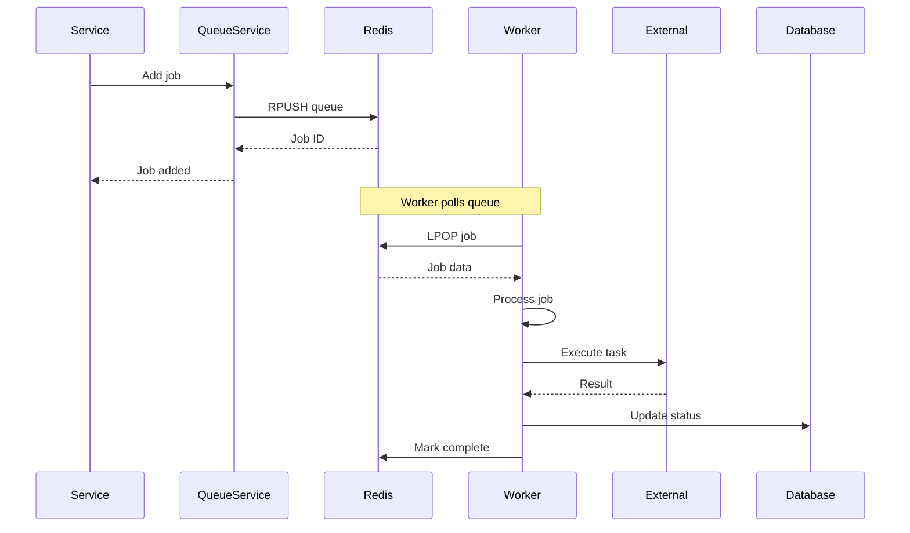

# Background Jobs

Xử lý tác vụ nền với BullMQ và Redis.

## Tổng quan

Queue module xử lý các tác vụ bất đồng bộ:

- Email queue
- Image processing queue
- Notification queue
- Job monitoring
- Retry with backoff
- Failed job handling

## Architecture



## BullMQ Setup

### Queue Configuration

```typescript
@Injectable()
export class QueueService {
  private emailQueue: Queue;
  private imageQueue: Queue;
  private notificationQueue: Queue;

  constructor(private configService: ConfigService) {
    const connection = {
      host: this.configService.get('REDIS_HOST'),
      port: this.configService.get('REDIS_PORT'),
      password: this.configService.get('REDIS_PASSWORD'),
    };

    this.emailQueue = new Queue('email', { connection });
    this.imageQueue = new Queue('image', { connection });
    this.notificationQueue = new Queue('notification', { connection });
  }

  async addEmailJob(data: EmailJobData) {
    return this.emailQueue.add('send-email', data, {
      attempts: 3,
      backoff: {
        type: 'exponential',
        delay: 2000,
      },
      removeOnComplete: 100,
      removeOnFail: 50,
    });
  }
}
```

### Worker Configuration

```typescript
@Processor('email')
export class EmailProcessor {
  private readonly logger = new Logger(EmailProcessor.name);

  constructor(private mailService: MailService) {}

  @Process('send-email')
  async handle(job: Job<EmailJobData>) {
    this.logger.log(`Processing email job ${job.id}`);

    try {
      await this.mailService.send(job.data);
      this.logger.log(`Email sent successfully to ${job.data.to}`);
    } catch (error) {
      this.logger.error(`Failed to send email: ${error.message}`);
      throw error;  // BullMQ will retry
    }
  }

  @OnQueueActive()
  onActive(job: Job) {
    this.logger.log(`Processing job ${job.id} of type ${job.name}`);
  }

  @OnQueueCompleted()
  onCompleted(job: Job, result: any) {
    this.logger.log(`Completed job ${job.id}`);
  }

  @OnQueueFailed()
  onFailed(job: Job, error: Error) {
    this.logger.error(`Failed job ${job.id}: ${error.message}`);
  }
}
```

## Queue Types

### 1. Email Queue

**Purpose:** Gửi email (transactional, marketing)

**Job Data:**
```typescript
interface EmailJobData {
  to: string;
  subject: string;
  template: string;
  context: Record<string, any>;
  attachments?: Attachment[];
}
```

**Example:**
```typescript
await queueService.addEmailJob({
  to: 'user@example.com',
  subject: 'Welcome to Our App',
  template: 'welcome',
  context: { name: 'John' },
});
```

### 2. Image Processing Queue

**Purpose:** Xử lý ảnh (resize, compress, watermark)

**Job Data:**
```typescript
interface ImageJobData {
  mediaFileId: string;
  operations: {
    resize?: { width: number; height: number };
    compress?: { quality: number };
    watermark?: { text: string };
  };
}
```

**Example:**
```typescript
await queueService.addImageJob({
  mediaFileId: 'media-uuid',
  operations: {
    resize: { width: 800, height: 600 },
    compress: { quality: 80 },
  },
});
```

### 3. Notification Queue

**Purpose:** Gửi thông báo (push, in-app, SMS)

**Job Data:**
```typescript
interface NotificationJobData {
  userId: string;
  type: 'push' | 'in-app' | 'sms';
  title: string;
  body: string;
  data?: Record<string, any>;
}
```

**Example:**
```typescript
await queueService.addNotificationJob({
  userId: 'user-uuid',
  type: 'push',
  title: 'New Message',
  body: 'You have a new message',
  data: { messageId: 'msg-123' },
});
```

## Endpoints

### GET /queues/:name/status

Lấy thống kê queue.

**Params:**
- `name`: Queue name (email, image, notification)

**Response 200:**
```json
{
  "success": true,
  "data": {
    "name": "email",
    "waiting": 5,
    "active": 2,
    "completed": 1000,
    "failed": 3,
    "delayed": 0,
    "paused": false
  }
}
```

**Auth:** Admin or Internal

### GET /queues/:name/jobs/:jobId

Lấy chi tiết job.

**Params:**
- `name`: Queue name
- `jobId`: Job ID

**Response 200:**
```json
{
  "success": true,
  "data": {
    "id": "job-id",
    "name": "send-email",
    "data": {
      "to": "user@example.com",
      "subject": "Welcome"
    },
    "opts": {
      "attempts": 3,
      "delay": 0
    },
    "progress": 100,
    "attemptsMade": 1,
    "failedReason": null,
    "processedOn": 1696944000000,
    "finishedOn": 1696944050000
  }
}
```

**Auth:** Admin or Internal

## Configuration

### Environment Variables

```env
# Redis Configuration
REDIS_HOST=localhost
REDIS_PORT=6379
REDIS_PASSWORD=
REDIS_DB=0

# Queue Configuration
QUEUE_DEFAULT_ATTEMPTS=3
QUEUE_DEFAULT_BACKOFF_DELAY=2000
QUEUE_REMOVE_ON_COMPLETE=100
QUEUE_REMOVE_ON_FAIL=50
```

### Redis Setup

Dùng Redis cho queue storage:

```yaml
# docker-compose.dev.yml
redis:
  image: redis:7-alpine
  ports:
    - "6379:6379"
  volumes:
    - redis_data:/data
  healthcheck:
    test: ["CMD", "redis-cli", "ping"]
    interval: 10s
    timeout: 5s
    retries: 5
```

## Job Options

### Retry Strategy

```typescript
{
  attempts: 3,  // Số lần retry
  backoff: {
    type: 'exponential',  // hoặc 'fixed'
    delay: 2000,  // Delay ban đầu (ms)
  },
}
```

### Backoff Types

| Type | Description | Delay Pattern |
|------|-------------|--------------|
| `fixed` | Fixed delay | 2000ms, 2000ms, 2000ms |
| `exponential` | Exponential | 2000ms, 4000ms, 8000ms |

### Retention Policy

```typescript
{
  removeOnComplete: 100,  // Giữ 100 job completed
  removeOnFail: 50,       // Giữ 50 job failed
}
```

## Monitoring

### Queue Dashboard

Sử dụng Bull Board để monitor:

```typescript
import { BullAdapter } from '@bull-board/api/bullAdapter';
import { ExpressAdapter } from '@bull-board/express';

const serverAdapter = new ExpressAdapter();
serverAdapter.setBasePath('/admin/queues');

const { createBullBoard } = require('@bull-board/api');
createBullBoard({
  queues: [
    new BullAdapter(emailQueue),
    new BullAdapter(imageQueue),
    new BullAdapter(notificationQueue),
  ],
  serverAdapter,
});

app.use('/admin/queues', serverAdapter.getRouter());
```

Access tại: `http://localhost:3000/admin/queues`

### Metrics

Queue metrics cho Prometheus:

```typescript
@OnQueueCompleted()
onCompleted(job: Job) {
  this.metricsService.increment('queue_job_completed', {
    queue: job.queueName,
    job: job.name,
  });
}

@OnQueueFailed()
onFailed(job: Job, error: Error) {
  this.metricsService.increment('queue_job_failed', {
    queue: job.queueName,
    job: job.name,
    error: error.name,
  });
}
```

## Best Practices

### 1. Idempotency

Jobs nên idempotent - chạy nhiều lần không gây side effect:

```typescript
@Process('send-email')
async handle(job: Job<EmailJobData>) {
  const { idempotencyKey } = job.data;

  // Check if already processed
  const processed = await this.redis.get(`email:${idempotencyKey}`);
  if (processed) {
    this.logger.log(`Email already sent: ${idempotencyKey}`);
    return;
  }

  // Process job
  await this.mailService.send(job.data);

  // Mark as processed
  await this.redis.setex(`email:${idempotencyKey}`, 86400, '1');
}
```

### 2. Error Handling

Handle errors gracefully:

```typescript
@Process('process-image')
async handle(job: Job<ImageJobData>) {
  try {
    const result = await this.imageService.process(job.data);
    return result;
  } catch (error) {
    if (error instanceof TemporaryError) {
      // Retry job
      throw error;
    } else if (error instanceof PermanentError) {
      // Don't retry, mark as failed
      this.logger.error(`Permanent error: ${error.message}`);
      return { error: error.message };
    }
    throw error;
  }
}
```

### 3. Progress Updates

Report progress for long-running jobs:

```typescript
@Process('process-video')
async handle(job: Job<VideoJobData>) {
  const totalFrames = 1000;

  for (let i = 0; i < totalFrames; i++) {
    await this.processFrame(i);
    job.updateProgress((i / totalFrames) * 100);
  }
}
```

### 4. Job Priorities

Assign priorities for important jobs:

```typescript
await queue.add('send-email', data, {
  priority: 1,  // 1 = highest, 10 = lowest
});
```

## Troubleshooting

### Jobs not processing

**Check:**
- Redis connection
- Worker is running
- Queue is not paused
- Job has valid data

### Jobs failing repeatedly

**Check:**
- Job data validity
- External service availability
- Retry configuration
- Error logs

### Redis memory full

**Solution:**
- Set `maxmemory-policy` in Redis
- Reduce `removeOnComplete`/`removeOnFail`
- Use Redis clustering

### High latency

**Optimize:**
- Increase worker concurrency
- Use job priorities
- Optimize job processing
- Use Redis persistence wisely

## Testing

### Unit Tests

```typescript
describe('EmailProcessor', () => {
  let processor: EmailProcessor;
  let mailService: MailService;

  beforeEach(() => {
    mailService = createMockMailService();
    processor = new EmailProcessor(mailService);
  });

  it('should send email successfully', async () => {
    const job = createMockJob({
      to: 'test@example.com',
      subject: 'Test',
      template: 'test',
    });

    await processor.handle(job);

    expect(mailService.send).toHaveBeenCalledWith(job.data);
  });

  it('should retry on failure', async () => {
    mailService.send.mockRejectedValue(new Error('SMTP error'));

    const job = createMockJob({ ...data });

    await expect(processor.handle(job)).rejects.toThrow();
    expect(job.opts.attempts).toBeGreaterThan(1);
  });
});
```

## Audit Events

Queue events được ghi log:

- `queue.job_added` - Job added to queue
- `queue.job_completed` - Job completed successfully
- `queue.job_failed` - Job failed after retries
- `queue.job_retried` - Job retried

## Tài liệu liên quan

- [Configuration](../05-CAU-HINH/environment-variables.md)
- [Observability - Monitoring](../06-OBSERVABILITY/monitoring.md)
- [BullMQ Documentation](https://docs.bullmq.io/)
