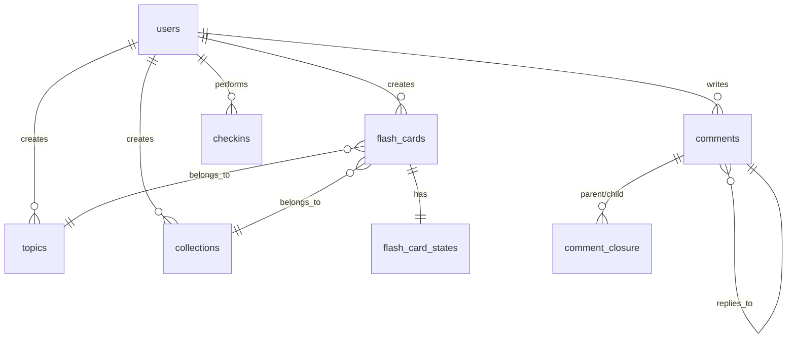

# Domain Modules

Các module domain mẫu có thể bật/tắt theo feature flags.

## Tổng quan

Dự án bao gồm các module domain mẫu để demo hoặc sử dụng lại:

- **Topics** - Phân loại theo chủ đề
- **Collections** - Bộ sưu tập
- **Flash Cards** - Flash card học tập
- **Flash Cards State** - Workflow phê duyệt
- **Comments** - Bình luận phân cấp
- **Check-in** - Điểm danh hằng ngày

## Feature Flags

```env
# Bật/tắt các module domain
ENABLE_TOPICS=false
ENABLE_COLLECTIONS=false
ENABLE_FLASH_CARDS=false
ENABLE_FLASH_CARD_STATES=false
ENABLE_COMMENTS=false
ENABLE_CHECKIN=false
ENABLE_STUDENT_CARD_UPLOADS=false
```

**Lưu ý quan trọng:**
- Feature flag chỉ ẩn route (trả 404)
- Không xóa module, entity, hoặc migration
- Để loại bỏ hoàn toàn: xóa code và migration

## 1. Topics

### Mô tả
Phân loại flash cards theo chủ đề.

### Entity

```typescript
@Entity('topics')
export class Topic {
  @PrimaryGeneratedColumn('uuid')
  id: string;

  @Column()
  name: string;

  @Column({ nullable: true })
  description: string;

  @Column({ default: 0 })
  flash_cards_count: number;

  @CreateDateColumn()
  created_at: Date;

  @UpdateDateColumn()
  updated_at: Date;
}
```

### Endpoints

| Method | Endpoint | Auth | Description |
|--------|----------|------|-------------|
| GET | `/topics` | Auth | Danh sách topics |
| POST | `/topics` | Auth | Tạo topic mới |
| GET | `/topics/:id` | Auth | Chi tiết topic |
| PATCH | `/topics/:id` | Auth | Cập nhật topic |
| DELETE | `/topics/:id` | Auth | Xóa topic |

### Example

**Tạo topic:**
```json
{
  "name": "JavaScript Basics",
  "description": "Core JavaScript concepts"
}
```

**Feature Flag:** `ENABLE_TOPICS`

---

## 2. Collections

### Mô tả
Bộ sưu tập flash cards theo user.

### Entity

```typescript
@Entity('collections')
export class Collection {
  @PrimaryGeneratedColumn('uuid')
  id: string;

  @Column()
  name: string;

  @Column({ nullable: true })
  description: string;

  @Column({ nullable: true })
  cover_image_url: string;

  @ManyToOne(() => User)
  @JoinColumn({ name: 'user_id' })
  user: User;

  @OneToMany(() => FlashCard, flashCard => flashCard.collection)
  flash_cards: FlashCard[];

  @CreateDateColumn()
  created_at: Date;

  @UpdateDateColumn()
  updated_at: Date;
}
```

### Endpoints

| Method | Endpoint | Auth | Description |
|--------|----------|------|-------------|
| GET | `/collections` | Auth | Danh sách collections |
| POST | `/collections` | Auth | Tạo collection mới |
| GET | `/collections/:id` | Auth | Chi tiết collection |
| PATCH | `/collections/:id` | Auth | Cập nhật collection |
| DELETE | `/collections/:id` | Auth | Xóa collection |

### Example

**Tạo collection:**
```json
{
  "name": "Frontend Fundamentals",
  "description": "HTML, CSS, JS basics"
}
```

**Feature Flag:** `ENABLE_COLLECTIONS`

---

## 3. Flash Cards

### Mô tả
Flash card học tập với câu hỏi/câu trả lời.

### Entity

```typescript
@Entity('flash_cards')
export class FlashCard {
  @PrimaryGeneratedColumn('uuid')
  id: string;

  @Column()
  question: string;

  @Column()
  answer: string;

  @ManyToOne(() => User)
  @JoinColumn({ name: 'user_id' })
  user: User;

  @ManyToOne(() => Topic)
  @JoinColumn({ name: 'topic_id' })
  topic: Topic;

  @ManyToOne(() => Collection, { nullable: true })
  @JoinColumn({ name: 'collection_id' })
  collection: Collection;

  @CreateDateColumn()
  created_at: Date;

  @UpdateDateColumn()
  updated_at: Date;
}
```

### Endpoints

| Method | Endpoint | Auth | Description |
|--------|----------|------|-------------|
| GET | `/flash-cards` | Auth | Danh sách flash cards |
| POST | `/flash-cards` | Auth | Tạo flash card mới |
| GET | `/flash-cards/:id` | Auth | Chi tiết flash card |
| PATCH | `/flash-cards/:id` | Auth | Cập nhật flash card |
| DELETE | `/flash-cards/:id` | Auth | Xóa flash card |

### Example

**Tạo flash card:**
```json
{
  "question": "What is closure in JavaScript?",
  "answer": "A function that has access to variables from its outer scope",
  "topic_id": "topic-uuid",
  "collection_id": "collection-uuid"
}
```

**Feature Flag:** `ENABLE_FLASH_CARDS`

---

## 4. Flash Cards State

### Mô tả
Workflow phê duyệt flash card với State Machine pattern.

### States

```
DRAFT → IN_REVIEW → APPROVED_ONE → APPROVED_TWO → PUBLISHED
         ↓                    ↓                    ↓
         DRAFT               DRAFT               DRAFT
```

### Entity

```typescript
@Entity('flash_card_states')
export class FlashCardState {
  @PrimaryGeneratedColumn('uuid')
  id: string;

  @OneToOne(() => FlashCard)
  @JoinColumn({ name: 'flash_card_id' })
  flash_card: FlashCard;

  @Column({
    type: 'enum',
    enum: FlashCardStateEnum,
    default: FlashCardStateEnum.DRAFT,
  })
  state: FlashCardStateEnum;

  @Column('jsonb', { default: [] })
  transition_history: TransitionHistory[];

  @CreateDateColumn()
  created_at: Date;

  @UpdateDateColumn()
  updated_at: Date;
}
```

### Endpoints

| Method | Endpoint | Auth | Description |
|--------|----------|------|-------------|
| GET | `/flash-cards-state` | Auth | Danh sách cards |
| POST | `/flash-cards-state` | Auth | Tạo draft mới |
| GET | `/flash-cards-state/:id` | Auth | Chi tiết card |
| PATCH | `/flash-cards-state/:id` | Auth | Cập nhật draft |
| POST | `/flash-cards-state/:id/submit` | Auth | Gửi review |
| POST | `/flash-cards-state/:id/approve` | Auth | Phê duyệt |
| POST | `/flash-cards-state/:id/reject` | Auth | Từ chối |
| POST | `/flash-cards-state/:id/publish` | Auth | Xuất bản |
| GET | `/flash-cards-state/:id/transitions` | Auth | Lịch sử |
| GET | `/flash-cards-state/:id/allowed-transitions` | Auth | State được phép |

### Transition Rules

| From State | To State | Roles Required |
|------------|----------|----------------|
| DRAFT | IN_REVIEW | Author |
| IN_REVIEW | APPROVED_ONE | Reviewer 1 |
| IN_REVIEW | DRAFT | Reviewer 1 |
| APPROVED_ONE | APPROVED_TWO | Reviewer 2 |
| APPROVED_ONE | DRAFT | Reviewer 2 |
| APPROVED_TWO | PUBLISHED | Admin |
| APPROVED_TWO | DRAFT | Admin |

### Example

**Tạo draft:**
```json
{
  "question": "What is React?",
  "answer": "A JavaScript library for building UIs"
}
```

**Submit for review:**
```bash
POST /flash-cards-state/{id}/submit
```

**Approve:**
```bash
POST /flash-cards-state/{id}/approve
{
  "comment": "Good content"
}
```

**Feature Flag:** `ENABLE_FLASH_CARD_STATES`

---

## 5. Comments

### Mô tả
Hệ thống bình luận phân cấp dùng Closure Table pattern.

### Architecture

Closure Table cho phép truy vấn hiệu quả:
- O(1) để lấy tất cả descendants
- O(1) để lấy tất cả ancestors
- Unlimited nesting depth

### Entity

```typescript
@Entity('comments')
export class Comment {
  @PrimaryGeneratedColumn('uuid')
  id: string;

  @Column('text')
  content: string;

  @Column({ default: 0 })
  depth: number;

  @ManyToOne(() => User)
  @JoinColumn({ name: 'author_id' })
  author: User;

  @Column()
  post_id: string;  // Resource being commented

  @Column({ default: 0 })
  likes_count: number;

  @CreateDateColumn()
  created_at: Date;

  @UpdateDateColumn()
  updated_at: Date;
}

@Entity('comment_closure')
export class CommentClosure {
  @Column()
  ancestor_id: string;

  @Column()
  descendant_id: string;

  @Column()
  depth: number;

  @PrimaryColumn()
  ancestor_descendant: string;
}
```

### Endpoints

| Method | Endpoint | Auth | Description |
|--------|----------|------|-------------|
| POST | `/comments/posts/:postId` | Auth | Tạo comment gốc |
| POST | `/comments/:commentId/replies` | Auth | Tạo reply |
| GET | `/comments/posts/:postId/tree` | Auth | Lấy cây comment |
| GET | `/comments/:id/ancestors` | Auth | Lấy ancestors |
| GET | `/comments/:id/descendants` | Auth | Lấy descendants |
| PATCH | `/comments/:id` | Auth | Cập nhật comment |
| DELETE | `/comments/:id` | Auth | Xóa comment |

### Example

**Tạo comment gốc:**
```bash
POST /comments/posts/post-123
{
  "content": "Great article!"
}
```

**Tạo reply:**
```bash
POST /comments/comment-456/replies
{
  "content": "I agree!"
}
```

**Lấy cây comment:**
```bash
GET /comments/posts/post-123/tree?offset=0&limit=10
```

**Feature Flag:** `ENABLE_COMMENTS`

---

## 6. Check-in

### Mô tả
Theo dõi điểm danh hằng ngày và streak.

### Entity

```typescript
@Entity('checkins')
export class Checkin {
  @PrimaryGeneratedColumn('uuid')
  id: string;

  @ManyToOne(() => User)
  @JoinColumn({ name: 'user_id' })
  user: User;

  @Column({ type: 'date' })
  checkin_date: Date;

  @Column({ default: 0 })
  streak_count: number;

  @Column({ default: 0 })
  total_checkins: number;

  @Column({ default: 0 })
  points_earned: number;

  @CreateDateColumn()
  created_at: Date;
}
```

### Endpoints

| Method | Endpoint | Auth | Description |
|--------|----------|------|-------------|
| POST | `/checkin` | Auth | Check-in hôm nay |
| GET | `/checkin/history` | Auth | Lịch sử check-in |
| GET | `/checkin/stats` | Auth | Thống kê streak |
| GET | `/checkin/status` | Auth | Trạng thái hôm nay |

### Logic

- Check-in: Tăng streak nếu ngày trước đã check-in
- Streak reset: Nếu có ngày bỏ sót
- Points: Tính dựa trên streak length
- Rewards: Milestone rewards (7, 30, 100 days)

### Example

**Check-in:**
```bash
POST /checkin
```

**Thống kê:**
```json
{
  "current_streak": 15,
  "longest_streak": 30,
  "total_checkins": 145,
  "points": 1500
}
```

**Feature Flag:** `ENABLE_CHECKIN`

---

## Relationships



## Khi nào sử dụng module nào

### Topics
- Khi cần phân loại nội dung
- Hierarchical classification (future)
- Tagging system

### Collections
- Khi cần nhóm nhiều items
- User-defined collections
- Shared collections (future)

### Flash Cards
- Learning/Quiz apps
- Q&A systems
- Knowledge base

### Flash Cards State
- Content approval workflow
- Multi-stage review
- Publishing pipeline

### Comments
- Discussion systems
- Feedback systems
- Nested conversations

### Check-in
- Habit tracking
- Daily challenges
- Gamification

## Loại bỏ module

Nếu không cần một module domain:

1. **Off feature flag** (để giữ code tham khảo):
   ```env
   ENABLE_FLASH_CARDS=false
   ```

2. **Xóa hoàn toàn** (không cần code):
   - Xóa thư mục module: `src/modules/flash-cards/`
   - Xóa entity migrations
   - Xóa khỏi `app.module.ts`
   - Xóa bảng database (migration mới)

**Lưu ý:** Migration xóa bảng phải review kỹ vì có data relationship.

## Tài liệu liên quan

- [Configuration - Feature Flags](../05-CAU-HINH/feature-flags.md)
- [Architecture](../02-CODE-CHUC-NANG/architecture.md)
- [API Reference](../04-API/api-reference.md)
