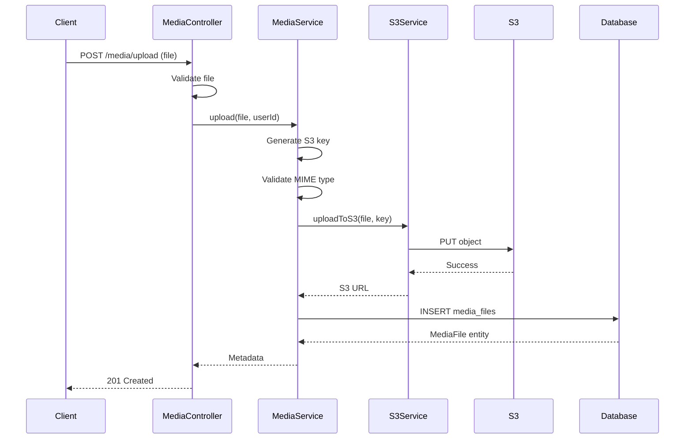

# File Upload

Tải lên và quản lý file media với AWS S3 integration.

## Tổng quan

Media module xử lý:

- Upload file multipart
- Validation file type/size
- Tích hợp AWS S3
- Presigned download URL
- Metadata tracking
- File ownership checks

## Architecture



## Entity Structure

### MediaFile Entity

```typescript
@Entity('media_files')
export class MediaFile {
  @PrimaryGeneratedColumn('uuid')
  id: string;

  @Column()
  filename: string;

  @Column({ unique: true })
  s3_key: string;

  @Column()
  mimetype: string;

  @Column('bigint')
  size: number;  // Bytes

  @Column({
    type: 'enum',
    enum: MediaFileStatus,
    default: MediaFileStatus.COMPLETED,
  })
  status: MediaFileStatus;

  @ManyToOne(() => User)
  @JoinColumn({ name: 'uploaded_by' })
  uploaded_by: User;

  @Column('jsonb', { nullable: true })
  metadata: Record<string, any>;

  @CreateDateColumn()
  uploaded_at: Date;

  @UpdateDateColumn()
  updated_at: Date;
}
```

### MediaFileStatus Enum

```typescript
export enum MediaFileStatus {
  PENDING = 'pending',
  PROCESSING = 'processing',
  COMPLETED = 'completed',
  FAILED = 'failed',
}
```

## Endpoints

### POST /media/upload

Upload file multipart.

**Request:** multipart/form-data

| Field | Type | Required | Description |
|-------|------|----------|-------------|
| `file` | File | Yes | File to upload |
| `metadata` | JSON | No | Optional metadata |

**Validation:**
- Max size: 10MB (configurable via `MAX_FILE_SIZE`)
- Allowed types: Configured via `ALLOWED_FILE_TYPES`
- MIME signature validation

**Response 201:**
```json
{
  "success": true,
  "message": "File uploaded successfully",
  "data": {
    "id": "uuid",
    "filename": "image.jpg",
    "s3_key": "uploads/uuid/image.jpg",
    "mimetype": "image/jpeg",
    "size": 1234567,
    "status": "completed",
    "uploaded_by": {
      "id": "uuid",
      "email": "user@example.com"
    },
    "uploaded_at": "2026-10-10T10:00:00.000Z"
  }
}
```

**Errors:**
- `413 Payload Too Large` - File quá lớn
- `415 Unsupported Media Type` - File type không được phép
- `422 Unprocessable Entity` - Validation failed

**Auth:** User (jwt-access-token)

### GET /media/:id

Lấy metadata file.

**Response 200:**
```json
{
  "success": true,
  "data": {
    "id": "uuid",
    "filename": "image.jpg",
    "s3_key": "uploads/uuid/image.jpg",
    "mimetype": "image/jpeg",
    "size": 1234567,
    "status": "completed",
    "metadata": {
      "width": 1920,
      "height": 1080
    },
    "uploaded_at": "2026-10-10T10:00:00.000Z"
  }
}
```

**Auth:** Owner or Admin

### GET /media/:id/download

Lấy presigned download URL.

**Response 200:**
```json
{
  "success": true,
  "data": {
    "download_url": "https://bucket.s3.amazonaws.com/key?signature=...",
    "expires_in": 3600
  }
}
```

**Lưu ý:**
- URL có expiry (default 1 hour)
- S3 phải được cấu hình
- URL signed với AWS credentials

**Auth:** Owner or Admin

### DELETE /media/:id

Xóa file.

**Response 204:** No Content

**Actions:**
- Xóa file khỏi S3
- Xóa record khỏi database
- Audit log

**Auth:** Owner or Admin

## Configuration

### Environment Variables

```env
# S3 Configuration
ENABLE_S3=false
AWS_REGION=us-east-1
AWS_S3_BUCKET=your-bucket-name
AWS_ACCESS_KEY_ID=<access-key>
AWS_SECRET_ACCESS_KEY=<secret-key>

# Upload Configuration
MAX_FILE_SIZE=10485760  # 10MB in bytes
ALLOWED_FILE_TYPES=image/jpeg,image/png,image/gif,video/mp4,video/webm

# S3 Presigned URL
S3_PRESIGNED_URL_EXPIRY=3600  # 1 hour in seconds
```

### File Type Validation

Allowed MIME types (configurable):

**Images:**
- `image/jpeg`
- `image/png`
- `image/gif`
- `image/webp`

**Videos:**
- `video/mp4`
- `video/webm`
- `video/quicktime`

**Documents:**
- `application/pdf`
- `application/msword`
- `application/vnd.openxmlformats-officedocument.wordprocessingml.document`

### File Size Limits

| Environment | Max Size |
|--------------|----------|
| Development | 10MB |
| Staging | 10MB |
| Production | 10MB (configurable) |

## S3 Integration

### S3 Service

```typescript
@Injectable()
export class S3Service {
  private s3Client: S3Client;
  private bucket: string;

  constructor(private configService: ConfigService) {
    this.s3Client = new S3Client({
      region: this.configService.get('AWS_REGION'),
      credentials: {
        accessKeyId: this.configService.get('AWS_ACCESS_KEY_ID'),
        secretAccessKey: this.configService.get('AWS_SECRET_ACCESS_KEY'),
      },
    });
    this.bucket = this.configService.get('AWS_S3_BUCKET');
  }

  async uploadFile(
    file: Express.Multer.File,
    key: string
  ): Promise<string> {
    const command = new PutObjectCommand({
      Bucket: this.bucket,
      Key: key,
      Body: file.buffer,
      ContentType: file.mimetype,
    });

    await this.s3Client.send(command);
    return `https://${this.bucket}.s3.amazonaws.com/${key}`;
  }

  async deleteFile(key: string): Promise<void> {
    const command = new DeleteObjectCommand({
      Bucket: this.bucket,
      Key: key,
    });

    await this.s3Client.send(command);
  }

  async getPresignedUrl(key: string, expiresIn: number): Promise<string> {
    const command = new GetObjectCommand({
      Bucket: this.bucket,
      Key: key,
    });

    return getSignedUrl(this.s3Client, command, { expiresIn });
  }
}
```

### S3 Key Generation

Pattern: `uploads/{userId}/{uuid}/{originalFilename}`

```typescript
generateS3Key(userId: string, file: Express.Multer.File): string {
  const uuid = randomUUID();
  const sanitized = file.originalname.replace(/[^a-zA-Z0-9.-]/g, '_');
  return `uploads/${userId}/${uuid}/${sanitized}`;
}
```

## Security

### File Validation

1. **MIME Type Check**
   - Validate Content-Type header
   - Verify file signature (magic bytes)
   - Reject if mismatch

2. **File Size Check**
   - Validate before upload
   - Reject if exceeds limit

3. **Filename Sanitization**
   - Remove special characters
   - Add UUID to prevent conflicts
   - Prevent path traversal

### Access Control

- **Upload:** Authenticated users only
- **Download:** Owner or Admin
- **Delete:** Owner or Admin
- **List:** Owner or Admin

### S3 Security

- **Bucket Policy:** Restrict public access
- **CORS:** Configure allowed origins
- **Presigned URLs:** Temporary access only
- **Encryption:** Server-side encryption (SSE-S3)

## Best Practices

### 1. Use Presigned URLs

```typescript
// ❌ DON'T: Proxy through API
router.get('/media/:id/download-proxy', async (req, res) => {
  const file = await s3.getObject(key);
  res.send(file.Body);
});

// ✅ DO: Use presigned URL
router.get('/media/:id/download', async (req, res) => {
  const url = await s3.getPresignedUrl(key);
  res.json({ download_url: url });
});
```

### 2. Async Processing

Queue large files for processing:

```typescript
async upload(file: Express.Multer.File) {
  // Save metadata first
  const mediaFile = await this.repository.create({
    filename: file.originalname,
    status: MediaFileStatus.PENDING,
  });

  // Queue for processing
  await this.queueService.add('process-media', {
    mediaFileId: mediaFile.id,
    file: file,
  });

  return mediaFile;
}
```

### 3. CDN Integration

Use CloudFront for distribution:

```typescript
async getPublicUrl(key: string): Promise<string> {
  const cloudfrontDomain = this.configService.get('CLOUDFRONT_DOMAIN');
  return `https://${cloudfrontDomain}/${key}`;
}
```

## Troubleshooting

### Upload failed

**Check:**
- S3 credentials valid
- Bucket exists and accessible
- IAM permissions correct
- Network connectivity

### MIME type mismatch

**Check:**
- File signature validation
- Content-Type header
- ALLOWED_FILE_TYPES config

### Presigned URL expired

**Solution:**
- Generate new URL
- Increase expiry time
- Cache URL client-side

### S3 costs high

**Optimize:**
- Use lifecycle policies
- Delete old files
- Use appropriate storage class
- Enable compression

## Audit Events

Media events được ghi log:

- `media.uploaded` - File uploaded
- `media.downloaded` - File downloaded
- `media.deleted` - File deleted
- `media.access_denied` - Access denied

## Testing

### Unit Tests

```typescript
describe('MediaService', () => {
  it('should upload file to S3', async () => {
    const file = createMockFile('test.jpg', 'image/jpeg');
    const result = await mediaService.upload(file, 'user-id');

    expect(result.s3_key).toBeDefined();
    expect(result.status).toBe(MediaFileStatus.COMPLETED);
  });

  it('should reject invalid file type', async () => {
    const file = createMockFile('test.exe', 'application/x-msdownload');

    await expect(
      mediaService.upload(file, 'user-id')
    ).rejects.toThrow(UnprocessableEntity);
  });

  it('should reject file too large', async () => {
    const file = createMockFile('large.jpg', 'image/jpeg', 20 * 1024 * 1024);

    await expect(
      mediaService.upload(file, 'user-id')
    ).rejects.toThrow(BadRequestException);
  });
});
```

## Tài liệu liên quan

- [Configuration - Third-party Integration](../05-CAU-HINH/third-party-integration.md)
- [Background Jobs](background-jobs.md)
- [AWS S3 Documentation](https://docs.aws.amazon.com/s3/)
