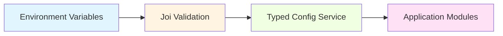

# Cấu hình - Tổng quan

Tài liệu mô tả cách cấu hình hệ thống NestJS Base.

## Tổng quan

Configuration được quản lý qua:

- Environment variables
- Joi validation schema
- Type-safe config service
- Feature flags
- Multi-environment support

## Configuration Files

```
src/configs/
├── configuration.config.ts      # Centralized config mapping
├── validation.schema.ts         # Joi validation rules
└── api-docs.config.ts           # Swagger/OpenAPI config
```

## Environment Files

```
.env.example          # Template (committed)
.env.dev              # Development (local, not committed)
.env                  # Default environment (not committed)
.env.prod             # Production (not committed)
.env.staging          # Staging (not committed)
```

## Configuration Flow



## Validation Schema

Configuration được validate bằng Joi tại runtime:

```typescript
// validation.schema.ts
export const validationSchema = Joi.object({
  NODE_ENV: Joi.string()
    .valid('development', 'staging', 'production', 'test')
    .default('development'),

  PORT: Joi.number().default(3000),

  DB_HOST: Joi.string().required(),
  DB_PORT: Joi.number().default(5432),
  DB_USERNAME: Joi.string().required(),
  DB_PASSWORD: Joi.string().required(),
  DB_DATABASE: Joi.string().required(),

  REDIS_HOST: Joi.string().default('localhost'),
  REDIS_PORT: Joi.number().default(6379),

  JWT_ACCESS_TOKEN_SECRET: Joi.string().min(32).required(),
  JWT_REFRESH_TOKEN_SECRET: Joi.string().min(32).required(),

  // ... more configs
});
```

## Type-safe Config Service

```typescript
@Injectable()
export class ConfigService extends NestConfigService {
  get isDevelopment(): boolean {
    return this.get('NODE_ENV') === 'development';
  }

  get isProduction(): boolean {
    return this.get('NODE_ENV') === 'production';
  }

  get jwt(): JwtConfig {
    return {
      accessSecret: this.get('JWT_ACCESS_TOKEN_SECRET'),
      refreshSecret: this.get('JWT_REFRESH_TOKEN_SECRET'),
      accessExpiration: this.get('JWT_ACCESS_TOKEN_EXPIRATION'),
      refreshExpiration: this.get('JWT_REFRESH_TOKEN_EXPIRATION'),
    };
  }

  get database(): DatabaseConfig {
    return {
      host: this.get('DB_HOST'),
      port: this.get('DB_PORT'),
      username: this.get('DB_USERNAME'),
      password: this.get('DB_PASSWORD'),
      database: this.get('DB_DATABASE'),
    };
  }
}
```

## Environment Selection

### Development

```powershell
# .env.dev
NODE_ENV=development
```

Application đọc `.env.dev` khi `NODE_ENV=development`.

### Staging

```powershell
# .env.staging
NODE_ENV=staging
```

Application đọc `.env` (không có `.env.staging`).

### Production

```powershell
# .env.prod
NODE_ENV=production
```

Application đọc `.env` trong container.

## Security Best Practices

### 1. Never commit secrets

```gitignore
# Environment files
.env
.env.dev
.env.prod
.env.staging
```

### 2. Use strong secrets

```bash
# Generate random secrets
node -e "console.log(require('crypto').randomBytes(48).toString('hex'))"
```

### 3. Separate secrets per environment

- Development: Local secrets
- Staging: Test secrets
- Production: Production secrets

### 4. Use secret manager in production

- AWS Secrets Manager
- HashiCorp Vault
- Azure Key Vault
- Google Secret Manager

## Quick Reference

### Database Config

| Variable | Required | Default | Description |
|----------|----------|---------|-------------|
| `DB_HOST` | Yes | - | PostgreSQL host |
| `DB_PORT` | No | 5432 | PostgreSQL port |
| `DB_USERNAME` | Yes | - | Database user |
| `DB_PASSWORD` | Yes | - | Database password |
| `DB_DATABASE` | Yes | - | Database name |
| `DB_POOL_SIZE` | No | 10 | Connection pool size |

### Redis Config

| Variable | Required | Default | Description |
|----------|----------|---------|-------------|
| `REDIS_HOST` | No | localhost | Redis host |
| `REDIS_PORT` | No | 6379 | Redis port |
| `REDIS_PASSWORD` | No | - | Redis password |
| `REDIS_DB` | No | 0 | Redis database number |

### JWT Config

| Variable | Required | Default | Description |
|----------|----------|---------|-------------|
| `JWT_ACCESS_TOKEN_SECRET` | Yes | - | Access token secret (min 32 chars) |
| `JWT_REFRESH_TOKEN_SECRET` | Yes | - | Refresh token secret (min 32 chars) |
| `JWT_ACCESS_TOKEN_EXPIRATION` | No | 15m | Access token TTL |
| `JWT_REFRESH_TOKEN_EXPIRATION` | No | 7d | Refresh token TTL |

## Tài liệu liên quan

- [Environment Variables](environment-variables.md)
- [Feature Flags](feature-flags.md)
- [Third-party Integration](third-party-integration.md)
