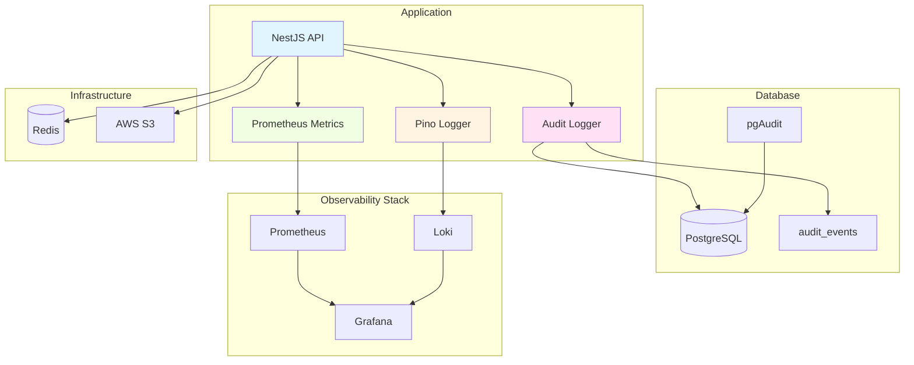

# Observability - Tổng quan

Tài liệu mô tả khả năng quan sát của hệ thống NestJS Base.

## Tổng quan

Observability cho phép:

- **Logging** - Ghi log có cấu trúc
- **Metrics** - Thu thập metrics Prometheus
- **Auditing** - Log audit events
- **Monitoring** - Giám sát health và performance
- **Tracing** - Tracking request lifecycle (future)

## Các thành phần

### 1. Logging

- **Framework**: Pino logger
- **Format**: JSON (production) / Pretty (development)
- **Level**: Fatal, Error, Warn, Info, Debug, Trace
- **Output**: Stdout
- **Context**: Request ID, User ID, etc.

**Chi tiết:** [Logging](logging.md)

### 2. Metrics

- **Framework**: Prometheus (tùy chọn)
- **Endpoint**: `/metrics`
- **Types**: Counters, Histograms, Gauges
- **Scope**: Process-local (reset on restart)
- **Feature Flag**: `ENABLE_METRICS=true`

**Chi tiết:** [Metrics](metrics.md)

### 3. Auditing

- **Database**: PostgreSQL `audit_events` table
- **Extension**: pgAudit (tùy chọn)
- **Events**: Auth, user lifecycle, admin actions
- **Access**: Admin only
- **Feature Flag**: `ENABLE_PGAUDIT=true`

**Chi tiết:** [Auditing](auditing.md)

### 4. Monitoring

- **Health Checks**: `/health/live`, `/health/ready`
- **Dependencies**: PostgreSQL, Redis
- **Docker Healthcheck**: Container health
- **Grafana/Loki**: Observability stack (tùy chọn)

**Chi tiết:** [Monitoring](monitoring.md)

## Architecture



## Event Types

### Audit Events

| Event Type | Description | Category |
|------------|-------------|----------|
| `auth.sign_up` | User registered | Authentication |
| `auth.sign_in` | User logged in | Authentication |
| `auth.sign_in_failed` | Login failed | Authentication |
| `auth.sign_out` | User logged out | Authentication |
| `auth.password_reset_requested` | Password reset requested | Authentication |
| `auth.password_reset_completed` | Password reset completed | Authentication |
| `auth.email_verified` | Email verified | Authentication |
| `user.created` | User created | User Management |
| `user.updated` | User updated | User Management |
| `user.deleted` | User deleted | User Management |
| `user.role_changed` | User role changed | User Management |
| `user.password_changed` | Password changed | User Management |
| `role.created` | Role created | RBAC |
| `role.updated` | Role updated | RBAC |
| `role.deleted` | Role deleted | RBAC |
| `checkin.completed` | Daily check-in | Check-in |
| `media.uploaded` | File uploaded | Media |
| `media.deleted` | File deleted | Media |

### Log Events

- HTTP requests (method, path, status, duration)
- Application errors (stack trace in dev)
- Database queries (if logging enabled)
- Queue job events (added, completed, failed)
- Third-party API calls

### Metrics

- HTTP request count (by method, route, status)
- HTTP request duration (histogram)
- Database query duration (histogram)
- Queue sizes (gauge)
- Cache hit/miss ratio (counter)

## Configuration

### Environment Variables

```env
# Logging
LOG_LEVEL=info
LOG_FORMAT=json

# Metrics
ENABLE_METRICS=false

# Audit
ENABLE_PGAUDIT=false

# Observability Stack (Grafana/Loki)
GRAFANA_ADMIN_USER=admin
GRAFANA_ADMIN_PASSWORD=<strong-password>
```

### Development vs Production

| Feature | Development | Production |
|---------|-------------|------------|
| Log Format | Pretty | JSON |
| Log Level | Debug | Info/Warn |
| Metrics | Optional | Recommended |
| pgAudit | Optional | Recommended |
| Grafana Stack | Optional | Recommended |

## Best Practices

### 1. Structured Logging

```typescript
// ❌ DON'T: Unstructured logs
console.log('User logged in: ' + user.email);

// ✅ DO: Structured logs
this.logger.info('User logged in', {
  userId: user.id,
  email: user.email,
  ip: request.ip,
});
```

### 2. Contextual Logging

```typescript
// Add request context
this.logger.setContext('requestId', request.id);
this.logger.info('Processing request');
```

### 3. Sensitive Data

```typescript
// ❌ DON'T: Log sensitive data
this.logger.info('User login', { password: user.password });

// ✅ DO: Redact sensitive data
this.logger.info('User login', { 
  userId: user.id, 
  email: user.email 
});
```

### 4. Metrics Naming

```typescript
// Use consistent naming
http_request_duration_seconds
http_request_total
queue_size
cache_hit_total
```

### 5. Audit Trail

```typescript
// Log all state changes
this.auditService.log({
  eventType: 'user.updated',
  userId: user.id,
  changes: diff(oldUser, newUser),
  actorId: currentUser.id,
});
```

## Integration with Tools

### Loki (Log Aggregation)

Logs từ Pino được gửi đến Loki:

```typescript
// pino.config.ts
import pino from 'pino';

export const logger = pino({
  level: process.env.LOG_LEVEL || 'info',
  transport: process.env.LOG_FORMAT === 'pretty'
    ? pino.transport({ target: 'pino-pretty' })
    : undefined,
  formatters: {
    level: (label) => ({ level: label }),
  },
});
```

### Prometheus (Metrics Collection)

Prometheus scrap `/metrics` endpoint:

```typescript
// metrics.controller.ts
@Controller('metrics')
export class MetricsController {
  @Get()
  @Header('Content-Type', 'text/plain')
  metrics() {
    return this.registry.metrics();
  }
}
```

### Grafana (Visualization)

Dashboard tích hợp Loki, Prometheus:

- Request latency chart
- Error rate chart
- Request rate chart
- Queue size gauge
- Database connection pool

## Troubleshooting

### Logs not appearing

**Check:**
- Log level configuration
- Logger instance creation
- Console output in container

### Metrics not updating

**Check:**
- `ENABLE_METRICS=true`
- Prometheus scraping interval
- Endpoint accessible
- Metrics registry initialization

### Audit events missing

**Check:**
- Audit service called
- Database connection
- Table exists
- pgAudit extension enabled

### Grafana no data

**Check:**
- Loki/Prometheus data sources configured
- Logs/metrics being sent
- Dashboard queries correct
- Time range selected

## Tài liệu liên quan

- [Logging](logging.md)
- [Metrics](metrics.md)
- [Auditing](auditing.md)
- [Monitoring](monitoring.md)
- [Configuration](../05-CAU-HINH/environment-variables.md)
