# HƯỚNG DẪN THÊM TÍNH NĂNG MỚI

**Phiên bản:** 1.0.0  
**Cập nhật lần cuối:** 2026-09-05  
**Thời gian đọc:** 45 phút

---

## 📚 Mục lục

1. [Tổng quan](#1-tổng-quan)
2. [Hướng dẫn từng bước](#2-hướng-dẫn-từng-bước)
3. [Ví dụ đầy đủ: module Products](#3-ví-dụ-đầy-đủ-module-products)
4. [Thực hành tốt](#4-thực-hành-tốt)
5. [Mẫu thường dùng](#5-mẫu-thường-dùng)
6. [Kiểm thử tính năng](#6-kiểm-thử-tính-năng)
7. [Xử lý sự cố](#7-xử-lý-sự-cố)

---

## 1. Tổng quan

### 1.1 Quy trình phát triển

```mermaid
graph LR
    A[Lên kế hoạch tính năng] --> B[Tạo module]
    B --> C[Tạo entity]
    C --> D[Tạo migration]
    D --> E[Tạo DTO]
    E --> F[Tạo service]
    F --> G[Tạo controller]
    G --> H[Thêm validation]
    H --> I[Thêm tài liệu Swagger]
    I --> J[Viết test]
    J --> K[Hoàn tất tính năng]
    
    style A fill:#e1f5ff
    style K fill:#d4f4dd
```



### 1.2 Cấu trúc tệp tiêu chuẩn

Mỗi module tuân theo cấu trúc thống nhất sau:

```
module-name/
├── dto/
│   ├── create-*.dto.ts       # Dữ liệu tạo mới
│   ├── update-*.dto.ts       # Dữ liệu cập nhật
│   ├── query-*.dto.ts        # Bộ lọc truy vấn (tùy chọn)
│   └── response-*.dto.ts     # Cấu trúc response (tùy chọn)
├── entities/
│   └── *.entity.ts           # Entity TypeORM
├── *.controller.ts           # Endpoint HTTP
├── *.service.ts              # Logic nghiệp vụ
├── *.module.ts               # Khai báo module
├── *.controller.spec.ts      # Test controller
└── *.service.spec.ts         # Test service
```

---

## 2. Hướng dẫn từng bước

### Bước 1: Tạo module

Dùng NestJS CLI để tạo bộ khung CRUD:

```bash
nest g resource modules/products
```

**Các câu hỏi tương tác:**
```
? Bạn sử dụng tầng truyền tải nào? 
❯ REST API
  GraphQL (code first)
  GraphQL (schema first)
  Microservices (non-HTTP)
  WebSockets
  
? Bạn có muốn tạo các điểm truy cập CRUD không? (Y/n)
❯ Yes
```

**Các tệp được tạo:**
```
CREATE src/modules/products/products.controller.spec.ts
CREATE src/modules/products/products.controller.ts
CREATE src/modules/products/products.module.ts
CREATE src/modules/products/products.service.spec.ts
CREATE src/modules/products/products.service.ts
CREATE src/modules/products/dto/create-product.dto.ts
CREATE src/modules/products/dto/update-product.dto.ts
CREATE src/modules/products/entities/product.entity.ts
UPDATE src/app.module.ts
```

✅ **Kiểm tra:** Các tệp đã được tạo và module được đăng ký trong `app.module.ts`.

---

### Bước 2: Định nghĩa entity

Chỉnh sửa `src/modules/products/entities/product.entity.ts`:

```typescript
import {
  Entity,
  Column,
  PrimaryGeneratedColumn,
  CreateDateColumn,
  UpdateDateColumn,
  DeleteDateColumn,
  ManyToOne,
  JoinColumn,
  Index,
} from 'typeorm';
import { User } from '@modules/users/entities/user.entity';

@Entity('products')
export class Product {
  @PrimaryGeneratedColumn('uuid')
  id: string;

  @Column()
  name: string;

  @Column('text', { nullable: true })
  description: string;

  @Column('decimal', { precision: 10, scale: 2 })
  price: number;

  @Column({ default: 0 })
  stock: number;

  @Column({ default: true })
  is_active: boolean;

  @ManyToOne(() => User, { eager: false })
  @JoinColumn({ name: 'created_by' })
  created_by: User;

  @CreateDateColumn()
  created_at: Date;

  @UpdateDateColumn()
  updated_at: Date;

  @DeleteDateColumn()
  deleted_at: Date; // Xóa mềm support
}
```

**Thực hành tốt khi thiết kế entity:**
- ✅ Dùng `uuid` làm khóa chính.
- ✅ Thêm `created_at`, `updated_at`, `deleted_at`.
- ✅ Dùng `@Index()` cho các cột thường được truy vấn.
- ✅ Khai báo quan hệ với tùy chọn cascade phù hợp.
- ✅ Dùng enum cho các trường trạng thái.

✅ **Kiểm tra:** Entity đã khai báo đầy đủ các trường cần thiết.

---

### Bước 3: Tạo migration

Tạo migration từ các thay đổi của entity:

```bash
npm run migration:generate -- src/database/migrations/CreateProductTable
```

**Ví dụ migration được tạo:**
```typescript
// src/database/migrations/1234567890-CreateProductTable.ts
import { MigrationInterface, QueryRunner } from 'typeorm';

export class CreateProductTable1234567890 implements MigrationInterface {
  name = 'CreateProductTable1234567890';

  public async up(queryRunner: QueryRunner): Promise<void> {
    await queryRunner.query(`
      CREATE TABLE "products" (
        "id" uuid NOT NULL DEFAULT uuid_generate_v4(),
        "name" character varying NOT NULL,
        "description" text,
        "price" numeric(10,2) NOT NULL,
        "stock" integer NOT NULL DEFAULT 0,
        "is_active" boolean NOT NULL DEFAULT true,
        "created_by" uuid,
        "created_at" TIMESTAMP NOT NULL DEFAULT now(),
        "updated_at" TIMESTAMP NOT NULL DEFAULT now(),
        "deleted_at" TIMESTAMP,
        CONSTRAINT "PK_products" PRIMARY KEY ("id"),
        CONSTRAINT "FK_products_created_by" FOREIGN KEY ("created_by") 
          REFERENCES "users"("id") ON DELETE SET NULL
      )
    `);
    
    await queryRunner.query(`
      CREATE INDEX "IDX_products_name" ON "products" ("name")
    `);
  }

  public async down(queryRunner: QueryRunner): Promise<void> {
    await queryRunner.query(`DROP INDEX "IDX_products_name"`);
    await queryRunner.query(`DROP TABLE "products"`);
  }
}
```

**Chạy migration:**
```bash
npm run migration:run
```

✅ **Kiểm tra:** Bảng database đã được tạo.

---

### Bước 4: Tạo DTO

#### 4.1 Tạo DTO

Chỉnh sửa `src/modules/products/dto/create-product.dto.ts`:

```typescript
import { ApiProperty } from '@nestjs/swagger';
import {
  IsString,
  IsNotEmpty,
  IsNumber,
  IsOptional,
  Min,
  MaxLength,
  IsBoolean,
} from 'class-validator';

export class CreateProductDto {
  @ApiProperty({
    description: 'Product name',
    example: 'iPhone 15 Pro',
    maxLength: 255,
  })
  @IsString()
  @IsNotEmpty()
  @MaxLength(255)
  name: string;

  @ApiProperty({
    description: 'Product description',
    example: 'Latest iPhone model with A17 Pro chip',
    required: false,
  })
  @IsString()
  @IsOptional()
  description?: string;

  @ApiProperty({
    description: 'Product price in USD',
    example: 999.99,
    minimum: 0,
  })
  @IsNumber({ maxDecimalPlaces: 2 })
  @Min(0)
  price: number;

  @ApiProperty({
    description: 'Available stock quantity',
    example: 50,
    minimum: 0,
    default: 0,
  })
  @IsNumber()
  @Min(0)
  @IsOptional()
  stock?: number;

  @ApiProperty({
    description: 'Whether product is active',
    example: true,
    default: true,
  })
  @IsBoolean()
  @IsOptional()
  is_active?: boolean;
}
```

#### 4.2 DTO cập nhật

Chỉnh sửa `src/modules/products/dto/update-product.dto.ts`:

```typescript
import { PartialType } from '@nestjs/swagger';
import { CreateProductDto } from './create-product.dto';

export class UpdateProductDto extends PartialType(CreateProductDto) {}
```

**PartialType tự động đặt tất cả các trường thành tùy chọn!**

#### 4.3 DTO truy vấn (tùy chọn)

Tạo `src/modules/products/dto/query-product.dto.ts`:

```typescript
import { ApiPropertyOptional } from '@nestjs/swagger';
import { Type } from 'class-transformer';
import {
  IsOptional,
  IsNumber,
  Min,
  IsString,
  IsBoolean,
} from 'class-validator';

export class QueryProductDto {
  @ApiPropertyOptional({
    description: 'Page number',
    minimum: 1,
    default: 1,
  })
  @Type(() => Number)
  @IsNumber()
  @Min(1)
  @IsOptional()
  page?: number = 1;

  @ApiPropertyOptional({
    description: 'Items per page',
    minimum: 1,
    maximum: 100,
    default: 10,
  })
  @Type(() => Number)
  @IsNumber()
  @Min(1)
  @IsOptional()
  limit?: number = 10;

  @ApiPropertyOptional({
    description: 'Search by name',
  })
  @IsString()
  @IsOptional()
  search?: string;

  @ApiPropertyOptional({
    description: 'Filter by active status',
  })
  @Type(() => Boolean)
  @IsBoolean()
  @IsOptional()
  is_active?: boolean;

  @ApiPropertyOptional({
    description: 'Minimum price',
  })
  @Type(() => Number)
  @IsNumber()
  @IsOptional()
  min_price?: number;

  @ApiPropertyOptional({
    description: 'Maximum price',
  })
  @Type(() => Number)
  @IsNumber()
  @IsOptional()
  max_price?: number;
}
```

✅ **Mốc kiểm tra:** Đã tạo DTO kèm kiểm tra dữ liệu

---

### Bước 5: Triển khai service

Chỉnh sửa `src/modules/products/products.service.ts`:

```typescript
import {
  Injectable,
  NotFoundException,
  BadRequestException,
} from '@nestjs/common';
import { InjectRepository } from '@nestjs/typeorm';
import { Repository } from 'typeorm';
import { Product } from './entities/product.entity';
import { CreateProductDto } from './dto/create-product.dto';
import { UpdateProductDto } from './dto/update-product.dto';
import { QueryProductDto } from './dto/query-product.dto';

@Injectable()
export class ProductsService {
  constructor(
    @InjectRepository(Product)
    private readonly productRepository: Repository<Product>,
  ) {}

  async create(
    createProductDto: CreateProductDto,
    userId: string,
  ): Promise<Product> {
    // Kiểm tra tồn kho
    if (createProductDto.stock < 0) {
      throw new BadRequestException('Stock cannot be negative');
    }

    // Tạo sản phẩm
    const product = this.productRepository.create({
      ...createProductDto,
      created_by: { id: userId },
    });

    return this.productRepository.save(product);
  }

  async findAll(query: QueryProductDto): Promise<{
    data: Product[];
    meta: {
      page: number;
      limit: number;
      total: number;
      totalPages: number;
    };
  }> {
    const { page, limit, search, is_active, min_price, max_price } = query;

    const queryBuilder = this.productRepository
      .createQueryBuilder('product')
      .leftJoinAndSelect('product.created_by', 'created_by');

    // Lọc theo từ khóa
    if (search) {
      queryBuilder.andWhere(
        '(product.name ILIKE :search OR product.description ILIKE :search)',
        { search: `%${search}%` },
      );
    }

    // Lọc theo trạng thái hoạt động
    if (is_active !== undefined) {
      queryBuilder.andWhere('product.is_active = :is_active', { is_active });
    }

    // Lọc theo khoảng giá
    if (min_price !== undefined) {
      queryBuilder.andWhere('product.price >= :min_price', { min_price });
    }
    if (max_price !== undefined) {
      queryBuilder.andWhere('product.price <= :max_price', { max_price });
    }

    // Phân trang
    const [data, total] = await queryBuilder
      .skip((page - 1) * limit)
      .take(limit)
      .orderBy('product.created_at', 'DESC')
      .getManyAndCount();

    return {
      data,
      meta: {
        page,
        limit,
        total,
        totalPages: Math.ceil(total / limit),
      },
    };
  }

  async findOne(id: string): Promise<Product> {
    const product = await this.productRepository.findOne({
      where: { id },
      relations: ['created_by'],
    });

    if (!product) {
      throw new NotFoundException(`Product with ID ${id} not found`);
    }

    return product;
  }

  async update(
    id: string,
    updateProductDto: UpdateProductDto,
  ): Promise<Product> {
    const product = await this.findOne(id);

    // Kiểm tra tồn kho if provided
    if (updateProductDto.stock !== undefined && updateProductDto.stock < 0) {
      throw new BadRequestException('Stock cannot be negative');
    }

    // Cập nhật sản phẩm
    Object.assign(product, updateProductDto);
    return this.productRepository.save(product);
  }

  async remove(id: string): Promise<void> {
    const product = await this.findOne(id);
    
    // Xóa mềm
    await this.productRepository.softDelete(id);
  }

  async decreaseStock(id: string, quantity: number): Promise<Product> {
    const product = await this.findOne(id);

    if (product.stock < quantity) {
      throw new BadRequestException('Insufficient stock');
    }

    product.stock -= quantity;
    return this.productRepository.save(product);
  }

  async increaseStock(id: string, quantity: number): Promise<Product> {
    const product = await this.findOne(id);
    product.stock += quantity;
    return this.productRepository.save(product);
  }
}
```

✅ **Mốc kiểm tra:** Đã triển khai service với logic nghiệp vụ

---

### Bước 6: Triển khai controller

Chỉnh sửa `src/modules/products/products.controller.ts`:

```typescript
import {
  Controller,
  Get,
  Post,
  Body,
  Patch,
  Param,
  Delete,
  Query,
  UseGuards,
} from '@nestjs/common';
import {
  ApiTags,
  ApiOperation,
  ApiResponse,
  ApiBearerAuth,
} from '@nestjs/swagger';
import { ProductsService } from './products.service';
import { CreateProductDto } from './dto/create-product.dto';
import { UpdateProductDto } from './dto/update-product.dto';
import { QueryProductDto } from './dto/query-product.dto';
import { JwtAccessTokenGuard } from '@guards/jwt-access-token.guard';
import { RolesGuard } from '@guards/roles.guard';
import { Roles } from '@decorators/roles.decorator';
import { CurrentUser } from '@decorators/current-user.decorator';
import { User } from '@modules/users/entities/user.entity';

@ApiTags('Products')
@Controller('products')
export class ProductsController {
  constructor(private readonly productsService: ProductsService) {}

  @Post()
  @UseGuards(JwtAccessTokenGuard, RolesGuard)
  @Roles('admin', 'user')
  @ApiBearerAuth()
  @ApiOperation({ summary: 'Create a new product' })
  @ApiResponse({
    status: 201,
    description: 'Product created successfully',
  })
  @ApiResponse({
    status: 400,
    description: 'Bad request - validation failed',
  })
  @ApiResponse({
    status: 401,
    description: 'Unauthorized',
  })
  async create(
    @Body() createProductDto: CreateProductDto,
    @CurrentUser() user: User,
  ) {
    return this.productsService.create(createProductDto, user.id);
  }

  @Get()
  @ApiOperation({ summary: 'Get all products with filters' })
  @ApiResponse({
    status: 200,
    description: 'Products retrieved successfully',
  })
  async findAll(@Query() query: QueryProductDto) {
    return this.productsService.findAll(query);
  }

  @Get(':id')
  @ApiOperation({ summary: 'Get product by ID' })
  @ApiResponse({
    status: 200,
    description: 'Product found',
  })
  @ApiResponse({
    status: 404,
    description: 'Product not found',
  })
  async findOne(@Param('id') id: string) {
    return this.productsService.findOne(id);
  }

  @Patch(':id')
  @UseGuards(JwtAccessTokenGuard, RolesGuard)
  @Roles('admin')
  @ApiBearerAuth()
  @ApiOperation({ summary: 'Update product' })
  @ApiResponse({
    status: 200,
    description: 'Product updated successfully',
  })
  @ApiResponse({
    status: 404,
    description: 'Product not found',
  })
  @ApiResponse({
    status: 403,
    description: 'Forbidden - admin only',
  })
  async update(
    @Param('id') id: string,
    @Body() updateProductDto: UpdateProductDto,
  ) {
    return this.productsService.update(id, updateProductDto);
  }

  @Delete(':id')
  @UseGuards(JwtAccessTokenGuard, RolesGuard)
  @Roles('admin')
  @ApiBearerAuth()
  @ApiOperation({ summary: 'Delete product (soft delete)' })
  @ApiResponse({
    status: 204,
    description: 'Product deleted successfully',
  })
  @ApiResponse({
    status: 404,
    description: 'Product not found',
  })
  async remove(@Param('id') id: string) {
    await this.productsService.remove(id);
  }

  @Patch(':id/stock/decrease')
  @UseGuards(JwtAccessTokenGuard)
  @ApiBearerAuth()
  @ApiOperation({ summary: 'Decrease product stock' })
  @ApiResponse({
    status: 200,
    description: 'Stock decreased',
  })
  @ApiResponse({
    status: 400,
    description: 'Insufficient stock',
  })
  async decreaseStock(
    @Param('id') id: string,
    @Body('quantity') quantity: number,
  ) {
    return this.productsService.decreaseStock(id, quantity);
  }

  @Patch(':id/stock/increase')
  @UseGuards(JwtAccessTokenGuard)
  @ApiBearerAuth()
  @ApiOperation({ summary: 'Increase product stock' })
  async increaseStock(
    @Param('id') id: string,
    @Body('quantity') quantity: number,
  ) {
    return this.productsService.increaseStock(id, quantity);
  }
}
```

✅ **Mốc kiểm tra:** Đã triển khai controller với xác thực và tài liệu Swagger

---

### Bước 7: Đăng ký module

Chỉnh sửa `src/modules/products/products.module.ts`:

```typescript
import { Module } from '@nestjs/common';
import { TypeOrmModule } from '@nestjs/typeorm';
import { ProductsService } from './products.service';
import { ProductsController } from './products.controller';
import { Product } from './entities/product.entity';

@Module({
  imports: [TypeOrmModule.forFeature([Product])],
  controllers: [ProductsController],
  providers: [ProductsService],
  exports: [ProductsService], // Xuất nếu module khác cần dùng
})
export class ProductsModule {}
```

**NestJS CLI đã đăng ký module này trong `app.module.ts`!**

✅ **Mốc kiểm tra:** Module đã được đăng ký

---

### Bước 8: Kiểm thử API

**Khởi động máy chủ:**
```bash
npm run start:dev
```

**Mở Swagger:**
http://localhost:3333/api

**Quy trình kiểm thử:**
1. POST /auth/register → Lấy access token
2. Nhấn "Authorize" → Nhập `Bearer <token>`
3. POST /products → Tạo sản phẩm
4. GET /products → Liệt kê sản phẩm
5. GET /products/:id → Lấy sản phẩm cụ thể
6. PATCH /products/:id → Cập nhật sản phẩm
7. DELETE /products/:id → Xóa sản phẩm

✅ **Mốc kiểm tra:** API hoạt động như mong đợi

---

## 3. Ví dụ đầy đủ: module Products

Bạn có thể xem mã nguồn đầy đủ ở các bước 2–7 phía trên.

**Tóm tắt module:**
- ✅ Entity có các quan hệ
- ✅ DTO kèm kiểm tra dữ liệu
- ✅ Service chứa logic nghiệp vụ
- ✅ Controller tích hợp xác thực và Swagger
- ✅ Migration cơ sở dữ liệu
- ✅ Hỗ trợ xóa mềm
- ✅ Phân trang và lọc dữ liệu
- ✅ Endpoint tùy chỉnh (quản lý tồn kho)

---

## 4. Thực hành tốt

### 4.1 Thiết kế entity

✅ **NÊN LÀM:**
- Dùng UUID làm khóa chính
- Thêm dấu thời gian (`created_at`, `updated_at`)
- Thêm trường xóa mềm (`deleted_at`)
- Tạo chỉ mục cho các cột thường được truy vấn
- Khai báo rõ ràng các quan hệ
- Dùng enum cho các trường trạng thái

❌ **KHÔNG NÊN:**
- Dùng ID tự tăng (hãy dùng UUID)
- Quên tạo chỉ mục
- Dùng `synchronize: true` trong môi trường production
- Lưu dữ liệu nhạy cảm mà không mã hóa

### 4.2 Kiểm tra DTO

✅ **NÊN LÀM:**
- Kiểm tra tất cả dữ liệu đầu vào
- Dùng decorator phù hợp (`@IsString`, `@IsNumber`, v.v.)
- Bổ sung tài liệu API (`@ApiProperty`)
- Dùng `PartialType` cho DTO cập nhật
- Chuyển đổi kiểu bằng `@Type()`

❌ **KHÔNG NÊN:**
- Bỏ qua bước kiểm tra dữ liệu
- Quên xử lý các trường tùy chọn
- Dùng object thông thường thay vì DTO

### 4.3 Tầng service

✅ **NÊN LÀM:**
- Đặt logic nghiệp vụ trong service
- Dùng mẫu Repository
- Xử lý lỗi bằng HTTP exception
- Dùng transaction cho thao tác gồm nhiều bước
- Ghi log các thao tác quan trọng

❌ **KHÔNG NÊN:**
- Đặt logic nghiệp vụ trong controller
- Để lộ repository trực tiếp
- Trả về lỗi cơ sở dữ liệu nguyên gốc
- Quên xử lý các trường hợp ngoại lệ

### 4.4 Tầng controller

✅ **NÊN LÀM:**
- Dùng guard để xác thực
- Bổ sung tài liệu Swagger
- Dùng decorator (`@CurrentUser`, `@Roles`)
- Trả về cấu trúc response nhất quán
- Dùng mã trạng thái HTTP phù hợp

❌ **KHÔNG NÊN:**
- Đặt logic nghiệp vụ trong controller
- Bỏ qua xác thực hoặc phân quyền
- Quên bổ sung tài liệu Swagger
- Trả về response không nhất quán

---

## 5. Mẫu thường dùng

### 5.1 Quan hệ giữa entity

**Nhiều-một (Many-to-One):**
```typescript
@ManyToOne(() => User)
@JoinColumn({ name: 'user_id' })
user: User;
```

**Một-nhiều (One-to-Many):**
```typescript
@OneToMany(() => Order, (order) => order.product)
orders: Order[];
```

**Nhiều-nhiều (Many-to-Many):**
```typescript
@ManyToMany(() => Category)
@JoinTable({
  name: 'product_categories',
  joinColumn: { name: 'product_id' },
  inverseJoinColumn: { name: 'category_id' },
})
categories: Category[];
```

### 5.2 Phân trang

```typescript
async findAll(page: number = 1, limit: number = 10) {
  const [data, total] = await this.repository
    .createQueryBuilder()
    .skip((page - 1) * limit)
    .take(limit)
    .getManyAndCount();

  return {
    data,
    meta: {
      page,
      limit,
      total,
      totalPages: Math.ceil(total / limit),
    },
  };
}
```

### 5.3 Tìm kiếm và lọc

```typescript
const queryBuilder = this.repository.createQueryBuilder('entity');

if (search) {
  queryBuilder.andWhere('entity.name ILIKE :search', {
    search: `%${search}%`,
  });
}

if (status) {
  queryBuilder.andWhere('entity.status = :status', { status });
}

return queryBuilder.getMany();
```

### 5.4 Transaction

```typescript
async createWithDetails(data: CreateDto): Promise<Entity> {
  return this.dataSource.transaction(async (manager) => {
    // Bước 1
    const entity = manager.create(Entity, data);
    await manager.save(entity);

    // Bước 2
    const details = manager.create(Details, { entity });
    await manager.save(details);

    return entity;
  });
}
```

---

## 6. Kiểm thử tính năng

### 6.1 Unit test

```typescript
// products.service.spec.ts
describe('ProductsService', () => {
  let service: ProductsService;
  let repository: Repository<Product>;

  beforeEach(async () => {
    const module: TestingModule = await Test.createTestingModule({
      providers: [
        ProductsService,
        {
          provide: getRepositoryToken(Product),
          useValue: {
            create: jest.fn(),
            save: jest.fn(),
            findOne: jest.fn(),
            // ... giả lập các phương thức khác
          },
        },
      ],
    }).compile();

    service = module.get<ProductsService>(ProductsService);
    repository = module.get<Repository<Product>>(getRepositoryToken(Product));
  });

  it('should create a product', async () => {
    const createDto: CreateProductDto = {
      name: 'Test Product',
      price: 99.99,
      stock: 10,
    };

    const mockProduct = { id: '1', ...createDto };
    jest.spyOn(repository, 'create').mockReturnValue(mockProduct as any);
    jest.spyOn(repository, 'save').mockResolvedValue(mockProduct as any);

    const result = await service.create(createDto, 'user-id');

    expect(result).toEqual(mockProduct);
    expect(repository.create).toHaveBeenCalledWith({
      ...createDto,
      created_by: { id: 'user-id' },
    });
  });
});
```

### 6.2 E2E test

```typescript
// products.e2e-spec.ts
describe('Products (e2e)', () => {
  let app: INestApplication;
  let authToken: string;

  beforeAll(async () => {
    const moduleFixture: TestingModule = await Test.createTestingModule({
      imports: [AppModule],
    }).compile();

    app = moduleFixture.createNestApplication();
    await app.init();

    // Lấy token xác thực
    const response = await request(app.getHttpServer())
      .post('/auth/login')
      .send({ email: 'test@example.com', password: 'Test123!' });
    authToken = response.body.access_token;
  });

  it('/products (POST)', () => {
    return request(app.getHttpServer())
      .post('/products')
      .set('Authorization', `Bearer ${authToken}`)
      .send({
        name: 'Test Product',
        price: 99.99,
        stock: 10,
      })
      .expect(201)
      .expect((res) => {
        expect(res.body).toHaveProperty('id');
        expect(res.body.name).toBe('Test Product');
      });
  });

  it('/products (GET)', () => {
    return request(app.getHttpServer())
      .get('/products')
      .expect(200)
      .expect((res) => {
        expect(res.body).toHaveProperty('data');
        expect(res.body).toHaveProperty('meta');
      });
  });
});
```

---

## 7. Xử lý sự cố

### 7.1 Lỗi thường gặp

**Lỗi: "Cannot find module '@decorators/...'"**
```bash
# Check tsconfig.json paths
{
  "compilerOptions": {
    "paths": {
      "@decorators/*": ["src/decorators/*"],
      "@guards/*": ["src/guards/*"],
      "@modules/*": ["src/modules/*"]
    }
  }
}
```

**Lỗi: "QueryFailedError: relation does not exist"**
```bash
# Run migrations
npm run migration:run
```

**Lỗi: "DTO validation failed"**
- Kiểm tra đã cung cấp đầy đủ các trường bắt buộc
- Xác minh kiểu dữ liệu của trường khớp với decorator trong DTO
- Kiểm tra lỗi chính tả trong tên trường

### 7.2 Mẹo gỡ lỗi

**Bật ghi log SQL:**
```typescript
// app.module.ts
TypeOrmModule.forRoot({
  // ...
  logging: true, // See all SQL queries
});
```

**Gỡ lỗi kiểm tra dữ liệu:**
```typescript
// Thêm console.log trong controller
@Post()
async create(@Body() dto: CreateDto) {
  console.log('Received DTO:', dto);
  return this.service.create(dto);
}
```

---

## 📚 Tài liệu liên quan

- [Hướng dẫn module](./MODULE_GUIDE.md) - Tìm hiểu từ các module hiện có
- [Tổng quan hệ thống](./SYSTEM_OVERVIEW.md) - Tìm hiểu kiến trúc
- [Hướng dẫn cấu hình](./CONFIGURATION_GUIDE.md) - Thiết lập và cấu hình

---

**Cập nhật lần cuối:** 2026-09-05
**Phiên bản:** 1.0.0
**Được duy trì bởi:** Nhóm phát triển

---

*Hết hướng dẫn thêm tính năng*
