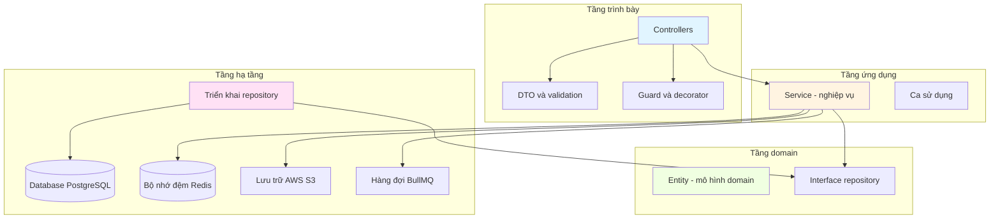
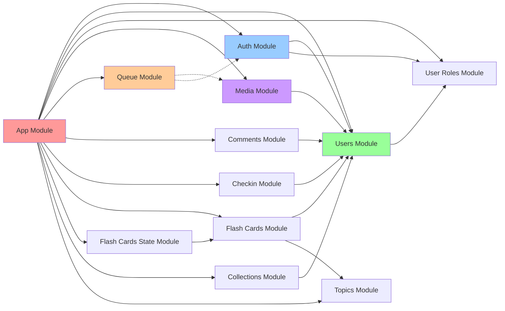
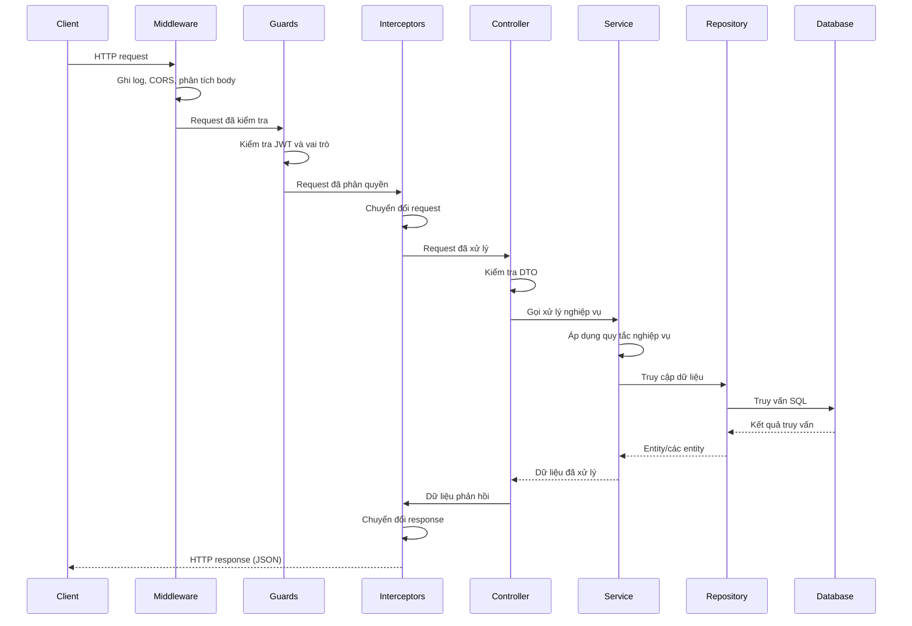
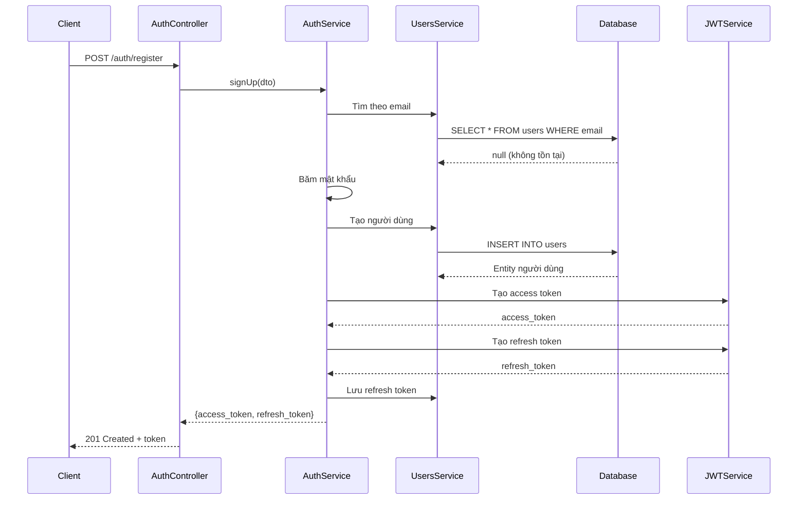
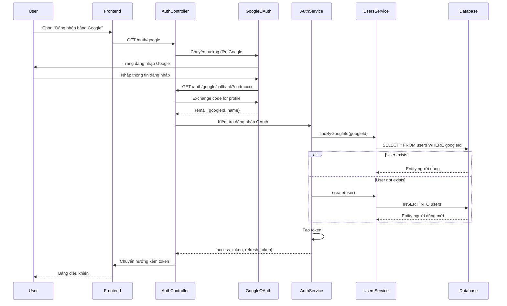
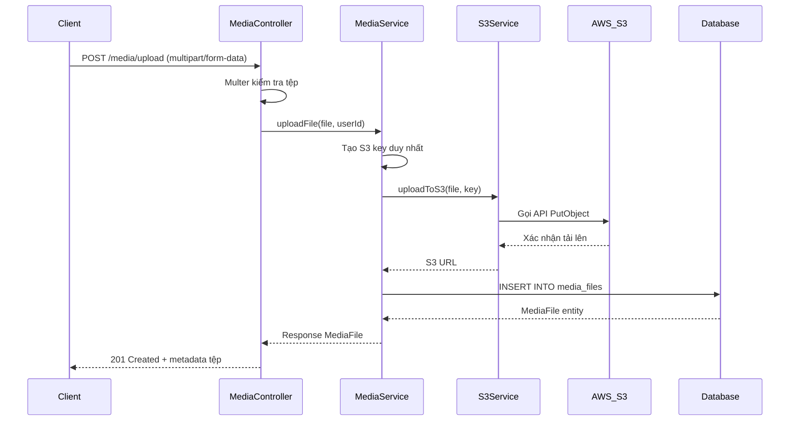
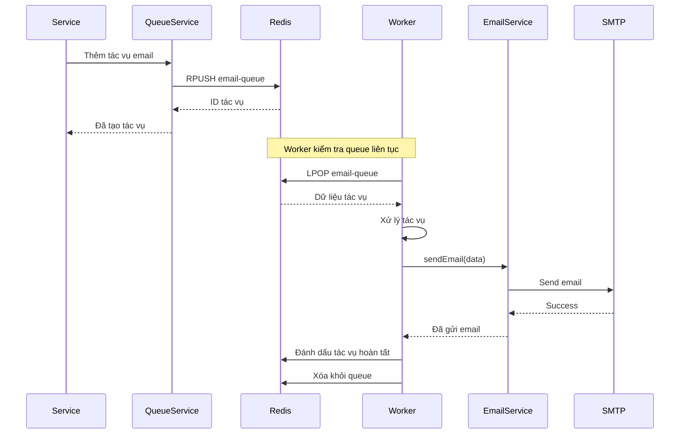
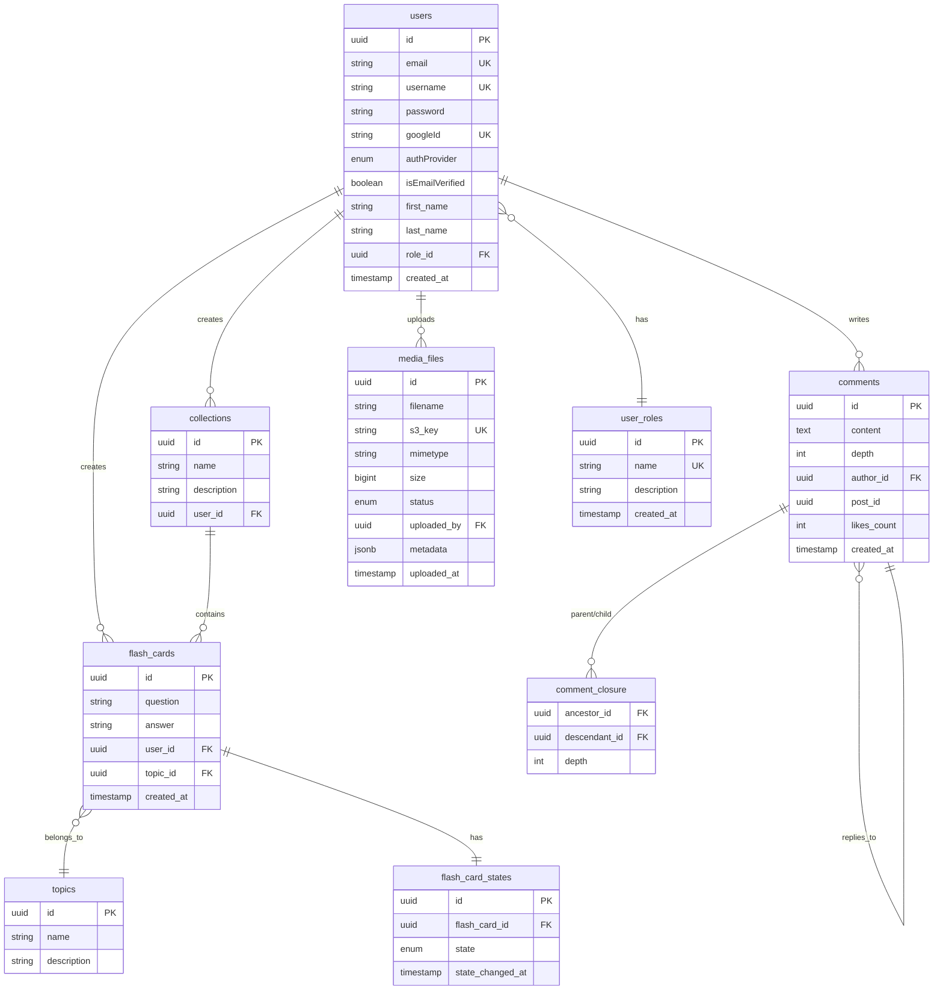
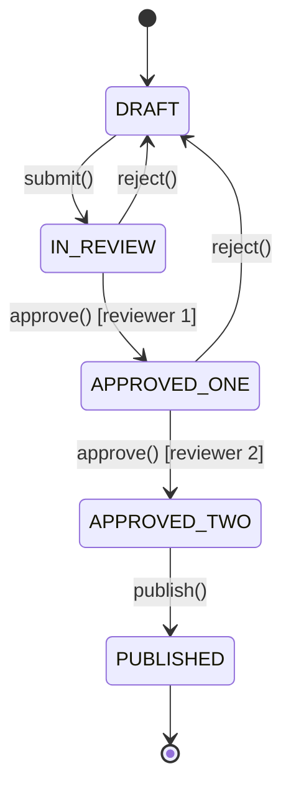

# TÀI LIỆU KIẾN TRÚC

**Phiên bản:** 1.0.0  
**Cập nhật lần cuối:** 2024-01-20  
**Thời gian đọc:** 60 phút

---

## Mục lục

1. [Kiến trúc hệ thống](#1-kiến-trúc-hệ-thống)
2. [Kiến trúc module](#2-kiến-trúc-module)
3. [Luồng dữ liệu](#3-luồng-dữ-liệu)
4. [Schema database](#4-schema-database)
5. [Mẫu thiết kế](#5-mẫu-thiết-kế)
6. [Kiến trúc bảo mật](#6-kiến-trúc-bảo-mật)
7. [Các cân nhắc về khả năng mở rộng](#7-các-cân-nhắc-về-khả-năng-mở-rộng)
8. [Quyết định về công nghệ](#8-quyết-định-về-công-nghệ)

---

## 1. Kiến trúc hệ thống

### 1.1 Tổng quan Clean Architecture

Boilerplate này áp dụng các nguyên tắc **Clean Architecture**, phân tách rõ
trách nhiệm qua nhiều tầng. Kiến trúc hướng tới khả năng bảo trì, kiểm thử và
mở rộng, đồng thời tuân theo các nguyên tắc SOLID.



### 1.2 Trách nhiệm của từng tầng

**🎯 Tầng trình bày (Controller + DTO)**
- Tiếp nhận và xử lý HTTP request/response.
- Kiểm tra dữ liệu đầu vào bằng `class-validator`.
- Khai báo route và tài liệu API (Swagger).
- Thực thi xác thực và phân quyền.
- Chuyển đổi request.

**🔄 Tầng ứng dụng (Service)**
- Triển khai logic nghiệp vụ.
- Điều phối ca sử dụng.
- Quản lý transaction.
- Tích hợp dịch vụ bên ngoài (S3, queue, email).
- Xử lý domain event.

**🏗️ Tầng domain (Entity + interface)**
- Entity và quy tắc nghiệp vụ cốt lõi.
- Interface repository (hợp đồng).
- Mô hình domain dùng decorator TypeORM.
- Quan hệ và ràng buộc giữa các entity.

**🗄️ Tầng hạ tầng (Repository + dịch vụ bên ngoài)**
- Lưu dữ liệu bằng TypeORM.
- Triển khai tích hợp dịch vụ ngoài (AWS S3, Redis, BullMQ).
- Tối ưu truy vấn database.
- Quản lý cache.
- Thao tác lưu trữ tệp.

### 1.3 Công nghệ sử dụng

| Thành phần | Công nghệ | Phiên bản | Mục đích |
|-----------|-----------|---------|---------|
| **Framework** | NestJS | 10.x | Framework ứng dụng Node.js |
| **Runtime** | Node.js | 18+ | Môi trường chạy JavaScript |
| **Ngôn ngữ** | TypeScript | 5.x | Phát triển có kiểm tra kiểu |
| **Database** | PostgreSQL | 15+ | Database quan hệ |
| **ORM** | TypeORM | 0.3.x | Lớp trừu tượng truy cập database |
| **Cache** | Redis | 7+ | Bộ nhớ đệm và lưu phiên |
| **Queue** | BullMQ | 5.x | Xử lý tác vụ nền |
| **Lưu trữ** | AWS S3 | - | Lưu trữ đối tượng cho tệp media |
| **Xác thực** | JWT + Passport | - | Xác thực và phân quyền |
| **Validation** | class-validator | - | Kiểm tra DTO |
| **Tài liệu API** | Swagger | - | Tạo tài liệu API |
| **Container** | Docker | - | Đóng gói ứng dụng |

### 1.4 Cấu trúc thư mục

```
src/
├── configs/                 # Quản lý cấu hình
│   ├── configuration.config.ts
│   ├── validation.schema.ts
│   └── typed-config.service.ts
├── decorators/             # Decorator tùy chỉnh
│   ├── current-user.decorator.ts
│   ├── auth.decorator.ts
│   └── roles.decorator.ts
├── guards/                 # Guard xác thực và phân quyền
│   ├── jwt-access-token.guard.ts
│   └── roles.guard.ts
├── modules/                # Module tính năng
│   ├── auth/              # Module xác thực
│   ├── users/             # Quản lý người dùng
│   ├── user-roles/        # Phân quyền theo vai trò
│   ├── media/             # Tải lên và lưu trữ tệp
│   ├── queue/              # Xử lý tác vụ nền
│   ├── comments/          # Bình luận phân cấp
│   ├── checkin/           # Theo dõi điểm danh hằng ngày
│   ├── flash-cards/       # Quản lý flash card
│   ├── flash-cards-state/ # Máy trạng thái flash card
│   ├── collections/       # Quản lý bộ sưu tập
│   ├── topics/            # Quản lý chủ đề
│   └── shared/            # Tiện ích dùng chung
├── database/              # Cấu hình database
│   └── migrations/        # Migration TypeORM
├── types/                 # Khai báo kiểu TypeScript
└── app.module.ts          # Module gốc của ứng dụng
```

---

## 2. Kiến trúc module

### 2.1 Đồ thị phụ thuộc giữa các module



**Phân loại module:**

**🔐 Module cốt lõi (bắt buộc)**
- `auth` - Xác thực và phân quyền.
- `users` - Quản lý người dùng.
- `user-roles` - Phân quyền theo vai trò.

**📦 Module tùy chọn**
- `media` - Tải lên và lưu trữ tệp (AWS S3).
- `queue` - Xử lý tác vụ nền (BullMQ).
- `comments` - Hệ thống bình luận phân cấp.
- `checkin` - Theo dõi điểm danh hằng ngày.
- `flash-cards` - Các thao tác CRUD flash card.
- `flash-cards-state` - Máy trạng thái cho flash card.
- `collections` - Quản lý bộ sưu tập.
- `topics` - Quản lý chủ đề.

### 2.2 Cấu trúc tiêu chuẩn của module

Các module tuân theo cấu trúc thống nhất:

```
module-name/
├── dto/                    # Đối tượng truyền dữ liệu
│   ├── create-*.dto.ts
│   ├── update-*.dto.ts
│   └── response-*.dto.ts
├── entities/              # Entity TypeORM
│   └── *.entity.ts
├── repositories/          # Triển khai mẫu Repository
│   └── *.repository.ts
├── interfaces/            # Interface TypeScript
│   └── *.interface.ts
├── guards/               # Guard riêng của module (tùy chọn)
├── decorators/           # Decorator riêng của module (tùy chọn)
├── *.controller.ts       # Controller REST API
├── *.service.ts          # Logic nghiệp vụ
├── *.module.ts           # Khai báo module NestJS
└── *.spec.ts             # Unit test
```

### 2.3 Dependency injection

NestJS dùng **dependency injection qua constructor**:

```typescript
@Injectable()
export class UsersService {
  constructor(
    @InjectRepository(User)
    private readonly usersRepository: Repository<User>,
    private readonly userRolesService: UserRolesService,
    private readonly configService: ConfigService,
  ) {}
}
```

**Lợi ích:**
- ✅ Giảm phụ thuộc chặt giữa các thành phần.
- ✅ Dễ unit test bằng dependency giả lập.
- ✅ Tăng khả năng bảo trì.
- ✅ Thể hiện rõ các quan hệ phụ thuộc.

---

## 3. Luồng dữ liệu

### 3.1 Vòng đời request



### 3.2 Luồng xác thực



### 3.3 Luồng OAuth2 Google



### 3.4 Luồng tải tệp lên



### 3.5 Luồng xử lý tác vụ nền



---

## 4. Schema database

### 4.1 Sơ đồ quan hệ entity



### 4.2 Các bảng chính

**👤 users**
- Bảng người dùng chính, chứa thông tin xác thực.
- Hỗ trợ đăng nhập nội bộ (email/mật khẩu) và OAuth (Google).
- Quan hệ: user_roles (nhiều-một), flash_cards, collections, comments, media_files.

**🔐 user_roles**
- Quản lý phân quyền theo vai trò.
- Vai trò mặc định: Admin, User, Moderator.
- Được RolesGuard sử dụng để phân quyền.

**🎴 flash_cards**
- Nội dung flash card (cặp câu hỏi/câu trả lời).
- Thuộc về người dùng và chủ đề.
- Có quan hệ một-một với flash_card_states.

**🎴 flash_card_states**
- Triển khai mẫu State.
- Các trạng thái: DRAFT, IN_REVIEW, APPROVED_ONE, APPROVED_TWO, PUBLISHED.
- Theo dõi chuyển trạng thái trong quy trình phê duyệt.

**💬 comments**
- Hệ thống bình luận phân cấp.
- Dùng mẫu Closure Table để truy vấn cây hiệu quả.
- Lưu tác giả, nội dung, độ sâu và liên kết bài viết.

**💬 comment_closure**
- Triển khai mẫu Closure Table.
- Lưu tất cả quan hệ tổ tiên-hậu duệ.
- Hỗ trợ truy vấn nhánh con hiệu quả (O(1) để lấy toàn bộ hậu duệ).

**📁 media_files**
- Metadata của tệp được lưu trên AWS S3.
- Theo dõi trạng thái tải lên (pending, processing, completed, failed).
- Lưu S3 key, bucket và metadata tệp (JSONB).

### 4.3 Chiến lược đánh chỉ mục

```sql
-- Users table
CREATE INDEX idx_users_email ON users(email);
CREATE INDEX idx_users_username ON users(username);
CREATE INDEX idx_users_google_id ON users(googleId);

-- Comments table
CREATE INDEX idx_comments_post_id ON comments(post_id);
CREATE INDEX idx_comments_author_id ON comments(author_id);

-- Comment closure (critical for performance)
CREATE INDEX idx_comment_closure_ancestor ON comment_closure(ancestor_id);
CREATE INDEX idx_comment_closure_descendant ON comment_closure(descendant_id);
CREATE INDEX idx_comment_closure_depth ON comment_closure(depth);

-- Media files
CREATE INDEX idx_media_files_uploaded_by ON media_files(uploaded_by);
CREATE INDEX idx_media_files_status ON media_files(status);

-- Flash cards
CREATE INDEX idx_flash_cards_user_id ON flash_cards(user_id);
CREATE INDEX idx_flash_cards_topic_id ON flash_cards(topic_id);
```

---

## 5. Mẫu thiết kế

### 5.1 Mẫu Repository

**Mục đích:** Tách logic truy cập dữ liệu khỏi logic nghiệp vụ.

```typescript
// Interface repository
export interface IUsersRepository {
  findById(id: string): Promise<User | null>;
  findByEmail(email: string): Promise<User | null>;
  create(userData: Partial<User>): Promise<User>;
  update(id: string, userData: Partial<User>): Promise<User>;
  delete(id: string): Promise<boolean>;
}

// Triển khai repository
@Injectable()
export class UsersRepository implements IUsersRepository {
  constructor(
    @InjectRepository(User)
    private readonly repository: Repository<User>,
  ) {}

  async findById(id: string): Promise<User | null> {
    return this.repository.findOne({ where: { id } });
  }

  async findByEmail(email: string): Promise<User | null> {
    return this.repository.findOne({ where: { email } });
  }

  async create(userData: Partial<User>): Promise<User> {
    const user = this.repository.create(userData);
    return this.repository.save(user);
  }
}
```

**Lợi ích:**
- ✅ Phân tách trách nhiệm.
- ✅ Dễ unit test hơn (giả lập repository).
- ✅ Tập trung logic truy cập dữ liệu.
- ✅ Linh hoạt thay đổi nguồn dữ liệu.

### 5.2 Mẫu State (Flash Card)

**Mục đích:** Quản lý chuyển đổi trạng thái phức tạp kèm kiểm tra hợp lệ.

```typescript
// Interface trạng thái
export interface IFlashCardState {
  canTransitionTo(targetState: FlashCardStateEnum, userRoles: string[]): boolean;
  submit(context: IFlashCardStateContext, userId: string, comment?: string): Promise<void>;
  approve(context: IFlashCardStateContext, userId: string, comment?: string): Promise<void>;
  reject(context: IFlashCardStateContext, userId: string, comment?: string): Promise<void>;
  publish(context: IFlashCardStateContext, userId: string, comment?: string): Promise<void>;
  getStateName(): FlashCardStateEnum;
  getAllowedTransitions(userRoles: string[]): FlashCardStateEnum[];
}

// Ví dụ triển khai trạng thái
@Injectable()
export class DraftState implements IFlashCardState {
  canTransitionTo(targetState: FlashCardStateEnum, userRoles: string[]): boolean {
    return targetState === FlashCardStateEnum.IN_REVIEW;
  }

  async submit(context: IFlashCardStateContext, userId: string): Promise<void> {
    await context.setState(FlashCardStateEnum.IN_REVIEW);
    await context.saveHistory(userId, 'Submitted for review');
  }

  getStateName(): FlashCardStateEnum {
    return FlashCardStateEnum.DRAFT;
  }

  getAllowedTransitions(userRoles: string[]): FlashCardStateEnum[] {
    return [FlashCardStateEnum.IN_REVIEW];
  }
}
```

**Sơ đồ chuyển trạng thái:**



**Lợi ích:**
- ✅ Đóng gói hành vi riêng theo từng trạng thái.
- ✅ Bảo đảm chỉ cho phép chuyển trạng thái hợp lệ.
- ✅ Kiểm tra chuyển trạng thái dựa trên vai trò.
- ✅ Có thể mở rộng bằng trạng thái mới mà không sửa mã hiện có.

### 5.3 Mẫu Decorator

**Mục đích:** Bổ sung metadata và chức năng cho class, method.

**Decorator `@CurrentUser`**
```typescript
export const CurrentUser = createParamDecorator(
  (data: unknown, ctx: ExecutionContext) => {
    const request = ctx.switchToHttp().getRequest<RequestWithUser>();
    return request.user;
  },
);

// Sử dụng trong controller
@Get('profile')
@UseGuards(JwtAccessTokenGuard)
async getProfile(@CurrentUser() user: User) {
  return user;
}
```

**Decorator `@Public`**
```typescript
export const IS_PUBLIC_KEY = 'isPublic';
export const Public = () => SetMetadata(IS_PUBLIC_KEY, true);

// Sử dụng trong controller
@Public()
@Get('health')
async healthCheck() {
  return { status: 'ok' };
}
```

**Decorator `@Roles`**
```typescript
export const ROLES_KEY = 'roles';
export const Roles = (...roles: string[]) => SetMetadata(ROLES_KEY, roles);

// Usage in controller
@Roles('admin', 'moderator')
@Delete(':id')
async deleteUser(@Param('id') id: string) {
  return this.usersService.delete(id);
}
```

**Lợi ích:**
- ✅ Mã controller rõ ràng, dễ đọc.
- ✅ Tái sử dụng trên nhiều endpoint.
- ✅ Khai báo tường minh phân quyền và metadata.

### 5.4 Mẫu Strategy (dự kiến bổ sung)

Boilerplate có thể mở rộng để áp dụng mẫu Strategy, thường dùng cho:
- Nhiều cổng thanh toán (Stripe, PayPal, v.v.).
- Các kênh thông báo khác nhau (email, SMS, push).
- Nhiều nhà cung cấp xác thực (nội bộ, Google, GitHub, v.v.).

### 5.5 Mẫu Closure Table (bình luận)

**Mục đích:** Truy vấn dữ liệu phân cấp hiệu quả.

```typescript
// Tạo bình luận trả lời kèm các bản ghi Closure Table
async createReply(parentId: string, content: string, authorId: string): Promise<Comment> {
  return this.dataSource.transaction(async (manager) => {
    // 1. Tạo bình luận
    const comment = manager.create(Comment, { content, author: { id: authorId } });
    await manager.save(comment);

    // 2. Sao chép các tổ tiên của bình luận cha
    await manager.query(`
      INSERT INTO comment_closure (ancestor_id, descendant_id, depth)
      SELECT ancestor_id, $1, depth + 1
      FROM comment_closure
      WHERE descendant_id = $2
    `, [comment.id, parentId]);

    // 3. Thêm tham chiếu đến chính nó
    await manager.query(`
      INSERT INTO comment_closure (ancestor_id, descendant_id, depth)
      VALUES ($1, $1, 0)
    `, [comment.id]);

    return comment;
  });
}

// Lấy toàn bộ hậu duệ (các trả lời) của bình luận - truy vấn O(1)
async getCommentTree(commentId: string): Promise<Comment[]> {
  return this.repository
    .createQueryBuilder('comment')
    .innerJoin('comment_closure', 'cc', 'cc.descendant_id = comment.id')
    .where('cc.ancestor_id = :commentId', { commentId })
    .orderBy('cc.depth', 'ASC')
    .getMany();
}
```

**Lợi ích:**
- ✅ Truy vấn O(1) để lấy toàn bộ nhánh con.
- ✅ Hiệu quả với chuỗi bình luận sâu.
- ✅ Không cần truy vấn đệ quy.
- ✅ Nhanh hơn Adjacency List hoặc Nested Sets.

---

## 6. Kiến trúc bảo mật

### 6.1 Xác thực

**Chiến lược token JWT**
- **Access Token:** Thời hạn ngắn (15 phút), dùng cho request API.
- **Refresh Token:** Thời hạn dài (7 ngày), dùng để lấy access token mới.
- Token được ký bằng RS256 (mã hóa bất đối xứng).

```typescript
// Tạo token
generateAccessToken(payload: TokenPayload): string {
  return this.jwtService.sign(payload, {
    secret: access_token_private_key,
    expiresIn: '15m',
  });
}

generateRefreshToken(payload: TokenPayload): string {
  return this.jwtService.sign(payload, {
    secret: refresh_token_private_key,
    expiresIn: '7d',
  });
}
```

**Bảo mật mật khẩu**
- Mật khẩu được băm bằng bcrypt (11 vòng salt).
- Không lưu mật khẩu dưới dạng văn bản thuần.
- Loại mật khẩu khỏi response API bằng decorator `@Exclude()`.

### 6.2 Phân quyền

**Phân quyền theo vai trò (RBAC)**
```typescript
@Injectable()
export class RolesGuard implements CanActivate {
  constructor(private reflector: Reflector) {}

  canActivate(context: ExecutionContext): boolean {
    const requiredRoles = this.reflector.get<string[]>('roles', context.getHandler());
    if (!requiredRoles) return true;

    const request = context.switchToHttp().getRequest();
    const user = request.user;

    return requiredRoles.some((role) => user.role?.name === role);
  }
}
```

### 6.3 Kiểm tra dữ liệu đầu vào

**Kiểm tra DTO bằng class-validator**
```typescript
export class SignUpDto {
  @IsEmail()
  @IsNotEmpty()
  email: string;

  @IsString()
  @MinLength(8)
  @Matches(/^(?=.*[A-Z])(?=.*[a-z])(?=.*\d)/, {
    message: 'Mật khẩu phải có chữ hoa, chữ thường và chữ số',
  })
  password: string;

  @IsString()
  @MinLength(2)
  @MaxLength(60)
  first_name: string;
}
```

### 6.4 Ngăn chặn SQL injection

- TypeORM tự động dùng tham số cho các truy vấn.
- Không ghép dữ liệu người dùng vào chuỗi SQL thô.
- Dùng query builder cho truy vấn phức tạp.

### 6.5 Cấu hình CORS

```typescript
app.enableCors({
  origin: process.env.FRONTEND_URL,
  credentials: true,
  methods: ['GET', 'POST', 'PUT', 'PATCH', 'DELETE'],
});
```

---

## 7. Các cân nhắc về khả năng mở rộng

### 7.1 Mở rộng theo chiều ngang

**Thiết kế stateless**
- Không lưu dữ liệu phiên trong bộ nhớ tiến trình.
- JWT loại bỏ nhu cầu lưu phiên phía máy chủ.
- Redis cung cấp cache dùng chung giữa các instance.

**Sẵn sàng cân bằng tải**
- Có thể chạy nhiều instance ứng dụng phía sau NGINX hoặc AWS ALB.
- Đã cấu hình connection pool cho database.

### 7.2 Chiến lược cache

**Cache Redis**
- Cache hồ sơ người dùng để giảm tải database.
- Cache response API cho endpoint có nhiều lượt đọc.
- Cache phân tán dùng chung giữa các instance.

### 7.3 Xử lý tác vụ nền

**Dùng BullMQ cho tác vụ bất đồng bộ**
- Gửi email (tránh chặn request).
- Xử lý ảnh (thay đổi kích thước, tối ưu).
- Gửi thông báo.
- Xuất dữ liệu và tạo báo cáo.

**Lợi ích:**
- ✅ Response API không bị chặn.
- ✅ Tự động thử lại khi thất bại.
- ✅ Xử lý tác vụ phân tán.
- ✅ Hàng đợi có độ ưu tiên.

### 7.4 Tối ưu database

**Connection pool**
```typescript
TypeOrmModule.forRoot({
  type: 'postgres',
  // ...
  poolSize: 10, // Tối đa 10 kết nối đồng thời
});
```

**Tối ưu truy vấn**
- Đánh chỉ mục cho khóa ngoại.
- Chỉ eager load dữ liệu cần thiết.
- Phân trang với tập dữ liệu lớn.

### 7.5 Lưu trữ tệp

**Dùng AWS S3 cho media**
- Không lưu tệp trên máy chủ ứng dụng.
- Sẵn sàng tích hợp CDN (có thể dùng CloudFront).
- Dùng URL ký trước để tải xuống an toàn.
- Tự động mở rộng.

---

## 8. Quyết định về công nghệ

### 8.1 Vì sao chọn NestJS?

✅ **Framework phù hợp cho hệ thống doanh nghiệp**, hỗ trợ TypeScript  
✅ **Kiến trúc module** giúp tổ chức mã nguồn  
✅ **Dependency injection tích hợp sẵn**, thuận tiện kiểm thử  
✅ **Hệ sinh thái phong phú** (Passport, TypeORM, Swagger)  
✅ **Cộng đồng năng động** và tài liệu tốt  

### 8.2 Vì sao chọn PostgreSQL?

✅ **Tuân thủ ACID**, bảo đảm toàn vẹn dữ liệu  
✅ **Tính năng nâng cao** (JSONB, tìm kiếm toàn văn)  
✅ **Ổn định và đã được kiểm chứng** trong môi trường production  
✅ **Tích hợp tốt với TypeORM**  

### 8.3 Vì sao chọn Redis?

✅ **Kho dữ liệu trong bộ nhớ hiệu năng cao**  
✅ **Hỗ trợ nhiều mục đích** (cache, phiên, queue)  
✅ **Tích hợp BullMQ** cho hàng đợi tác vụ  
✅ **Mở rộng theo chiều ngang** bằng Redis Cluster  

### 8.4 Vì sao chọn TypeORM?

✅ ORM ưu tiên **TypeScript**, hỗ trợ decorator  
✅ Hỗ trợ mẫu **Active Record và Data Mapper**  
✅ Có hệ thống migration để thay đổi schema  
✅ Hỗ trợ mẫu Repository  

**Đánh đổi:**
- Dùng nhiều cơ chế ẩn hơn Prisma (dựa trên reflection).
- Các tính năng nâng cao có đường cong học tập.

### 8.5 Vì sao chọn BullMQ?

✅ Queue tác vụ dựa trên **Redis**, có độ tin cậy cao  
✅ **Tính năng nâng cao** (độ ưu tiên, tác vụ trì hoãn, thử lại)  
✅ **Giám sát tốt** bằng Bull Board  
✅ Hỗ trợ **TypeScript** và tích hợp NestJS  

### 8.6 Vì sao chọn AWS S3?

✅ **Lưu trữ đối tượng có thể mở rộng**, không cần tự dự trù dung lượng  
✅ **Tiết kiệm chi phí** với tệp lớn  
✅ Độ bền dữ liệu **99.999999999%** (11 số 9)  
✅ **Tích hợp CDN** với CloudFront  

**Các lựa chọn thay thế:**
- MinIO (tự vận hành, tương thích S3).
- Google Cloud Storage.
- Azure Blob Storage.

---

## Điều hướng

**📚 Tài liệu liên quan:**
- [Tổng quan hệ thống](./SYSTEM_OVERVIEW.md) - Giải thích kiến trúc tổng quan.
- [Hướng dẫn module](./MODULE_GUIDE.md) - Tài liệu chi tiết về module.
- [Hướng dẫn cấu hình](./CONFIGURATION_GUIDE.md) - Thiết lập môi trường.
- [Thêm tính năng](./ADDING_FEATURES.md) - Quy trình phát triển.
- [Thiết lập database](./DATABASE_SETUP.md) - Hướng dẫn migration database.
- [Hướng dẫn triển khai](./DEPLOYMENT.md) - Triển khai production.

**🔗 Liên kết nhanh:**
- [Bắt đầu nhanh](./QUICK_START.md) - Khởi chạy ứng dụng.
- [Hướng dẫn Boilerplate](../BOILERPLATE_GUIDE.md) - Mục lục tài liệu chính.

---

**[Trước: Tổng quan hệ thống](./SYSTEM_OVERVIEW.md)** | **[Tiếp: Hướng dẫn module](./MODULE_GUIDE.md)**

---

*Cập nhật lần cuối: 2024-01-20 | Phiên bản 1.0.0*
