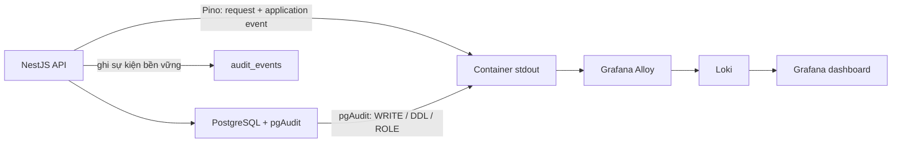

# Audit log và dashboard Grafana

Audit được chia thành ba luồng để không ghi mọi request hoặc câu SQL vào bảng
application:

| Lớp | Nguồn và nơi lưu | Dữ liệu |
| --- | --- | --- |
| Database | pgAudit → log container PostgreSQL → Alloy → Loki | SQL `WRITE`, `DDL`, `ROLE`; tắt ghi SQL parameters |
| Application / event | `AuditLogService` → bảng `audit_events` trong PostgreSQL và Pino JSON → Alloy → Loki | Sự kiện bảo mật/nghiệp vụ có ý nghĩa như đăng nhập, thay đổi tài khoản, user, role hoặc nghiệp vụ domain |
| Request / API | `nestjs-pino` → stdout container API → Alloy → Loki | Method, route (không gồm query string), status, thời gian, request ID, IP và user ID nếu đã xác thực |



## Build, deploy và bật dashboard

Lệnh build/deploy khởi động toàn bộ service cùng dashboard và hướng dẫn truy cập
Grafana được tập trung ở [Grafana Guide](GRAFANA_GUIDE.md). Phần dưới đây ghi chú
vận hành trên production và cách tích hợp audit event.

Grafana/Loki/Alloy/Prometheus là stack trong profile `audit-ui`; chỉ ghép file
`docker-compose.audit.yml` nhưng thiếu `--profile audit-ui` sẽ không khởi động chúng.
GitLab CI build/push image API và PostgreSQL có pgAudit,
sau đó copy `docker-compose.audit.yml` cùng thư mục `observability/` lên host.
Job deploy hiện chạy `docker-compose.prod.yml` nên API và database được cập nhật,
nhưng cần bật profile dashboard riêng bên dưới.

Trên host deploy, đặt `GRAFANA_ADMIN_PASSWORD` mạnh trong `.env.prod` (không commit
secret), vào thư mục `DEPLOY_PATH` chứa file Compose và cấu hình đã được CI copy,
rồi đặt các biến image/tag đúng với release đang chạy. CI inject các giá trị này
khi deploy nhưng không ghi chúng vào `.env.prod`; có thể xem image hiện tại trên
host bằng `docker ps --filter label=com.docker.compose.service=api --format
'{{.Image}}'`. `APP_VERSION` là bắt buộc do `docker-compose.prod.yml` khai báo.
Ví dụ, đặt các giá trị theo registry/tag thực tế đang chạy:

```sh
export APP_IMAGE=registry.example/group/project
export APP_VERSION=PUT_ACTIVE_COMMIT_SHA_HERE
export POSTGRES_IMAGE=registry.example/group/project/postgres
export POSTGRES_VERSION=PUT_ACTIVE_COMMIT_SHA_HERE
```

Sau đó kiểm tra và bật stack:

```sh
docker compose --env-file .env.prod --profile audit-ui \
  -f docker-compose.prod.yml -f docker-compose.audit.yml up -d
```

Lệnh `up` sẽ pull/chạy các image Grafana, Loki, Alloy và Prometheus được pin phiên
bản trong `docker-compose.audit.yml`. Dùng cùng thư mục triển khai và cùng project
name như Compose ứng dụng để Alloy tìm thấy log của service `api` và `postgres_db`,
còn Prometheus scrape `api:${PORT:-3000}`.

Đặt `ENABLE_METRICS=true` trong `.env.prod`; nếu không, API sẽ không cung cấp
`/metrics`. Dashboard **NestJS Logs, Metrics & Audit** trong folder
**Observability** hiển thị request rate, lỗi HTTP 5xx, độ trễ p95, request theo
route, cache operations, queue jobs, log Pino, application audit events và log
pgAudit. Prometheus scrape mỗi 15 giây; metrics trong ứng dụng là process-local và
được reset khi API khởi động lại.

Dashboard chỉ bind vào `127.0.0.1:3001` trên host, không mở cổng trực tiếp ra
Internet. Khi đăng nhập trực tiếp trên host, mở `http://localhost:3001`, dùng
`GRAFANA_ADMIN_USER` (mặc định `admin`) và `GRAFANA_ADMIN_PASSWORD`, sau đó chọn
dashboard **NestJS Logs, Metrics & Audit** trong folder **Observability**.

Để mở dashboard từ máy cá nhân, tạo SSH tunnel tới host deploy:

```sh
ssh -N -L 3001:127.0.0.1:3001 <deploy-user>@<deploy-host>
```

Giữ phiên SSH này hoạt động rồi mở `http://localhost:3001` trên máy cá nhân.
Nếu cần truy cập ổn định cho nhiều người, đặt reverse proxy có TLS và xác thực
trước Grafana; không đổi bind address thành `0.0.0.0` và không public Loki hay
Alloy.

Kiểm tra trạng thái và log khi vận hành:

```sh
docker compose --env-file .env.prod \
  -f docker-compose.prod.yml -f docker-compose.audit.yml \
  --profile audit-ui ps

docker compose --env-file .env.prod \
  -f docker-compose.prod.yml -f docker-compose.audit.yml \
  --profile audit-ui logs --tail=100 grafana loki alloy prometheus
```

Để dừng UI/collector mà giữ lại dữ liệu Loki:

```sh
docker compose --env-file .env.prod \
  -f docker-compose.prod.yml -f docker-compose.audit.yml \
  --profile audit-ui stop grafana alloy loki prometheus
```

Alloy chỉ thu thập các Compose service tên `api` và `postgres_db` bằng Docker
socket; host chạy Alloy và Docker daemon phải được tin cậy. Loki lưu log mặc định
30 ngày trên Docker volume cục bộ. Production cần tự chọn nơi lưu mã hóa, backup,
retention và thời hạn theo yêu cầu vận hành/tuân thủ.

Ở development, đặt `LOG_FORMAT=json` trong `.env.dev` trước khi thu log vào
dashboard; mặc định pretty log dành cho terminal và không phù hợp với truy vấn
JSON của các panel. Production/staging đã xuất log JSON.

## Thêm audit cho module mới

Request/API access log và pgAudit áp dụng ở cấp ứng dụng/database: route HTTP của
module được import vào `AppModule` sẽ tự có access log; SQL của module chạy trên
PostgreSQL đã bật pgAudit cũng được thu theo các nhóm `WRITE`, `DDL`, `ROLE`.
Không cần thêm controller/interceptor hay cấu hình Grafana để thu hai luồng này.
Chúng không thay thế application event: access log không ghi ý nghĩa nghiệp vụ,
còn pgAudit không cung cấp ngữ cảnh actor/subject và lý do nghiệp vụ.

Với thao tác bảo mật hoặc nghiệp vụ cần audit bền vững, import
`AuditLogModule` trong module mới, inject `AuditLogService` vào service/controller
thực hiện nghiệp vụ và gọi `recordEvent()` **sau khi thao tác thành công**:

```ts
import { AuditLogService } from '../../observability/audit-log.service';

constructor(private readonly auditLog: AuditLogService) {}

async createOrder(order: Order, actorUserId: string) {
	const created = await this.ordersRepository.save(order);
	await this.auditLog.recordEvent({
		eventType: 'business',
		action: 'ORDER_CREATED',
		actorUserId,
		subjectUserId: created.userId,
		resourceType: 'order',
		resourceId: created.id,
		metadata: { itemCount: created.items.length },
	});
	return created;
}
```

Trong `orders.module.ts`, thêm `AuditLogModule` vào `imports`; module này cung cấp
`AuditLogService` và TypeORM repository cho `audit_events`. Chọn `eventType:
'security'` cho sự kiện bảo mật, `business` cho sự kiện nghiệp vụ. Dùng action ổn
định, có prefix module (ví dụ `ORDER_CREATED`, `ORDER_CANCELLED`); ghi actor,
subject, loại/ID resource và chỉ metadata không nhạy cảm. Không ghi password,
token, credential, request body, email/phone/address hoặc giá trị cũ/mới. Service
từ chối metadata có tên key nhạy cảm; audit write được `await`, lỗi ghi được báo
lên thay vì giả vờ đã audit thành công.

Khi `recordEvent()` thành công, sự kiện được ghi vào PostgreSQL và phát ra Pino
JSON `event="audit_event"` trong stdout API. Alloy đã theo dõi toàn bộ service
`api`, do đó event của module mới tự xuất hiện trên panel **Application /
security events** mà không cần sửa dashboard/provisioning. Để lọc riêng module,
mở Explore trong Grafana và dùng action prefix, ví dụ:

```logql
{service="api"} | json | event="audit_event" | action="ORDER_CREATED"
```

Có thể tra cứu bền vững qua API Admin `GET /audit/events` với bộ lọc `action`,
`userId`, `resourceType`, `resourceId` và phân trang. API chấp nhận tối đa 100
bản ghi mỗi trang:

```http
GET /audit/events?eventType=business&action=ORDER_CREATED&limit=50&offset=0
Authorization: Bearer <admin-access-token>
```

Không cần thêm panel riêng cho từng module để xem event mới; panel hiện tại hiển
thị mọi application audit event. Chỉ tạo/sửa panel khi cần dashboard tổng hợp
hoặc visualization chuyên biệt cho nghiệp vụ đó.

## Cấu hình database audit

Image PostgreSQL trong Compose cài pgAudit và khởi động PostgreSQL với
`shared_preload_libraries=pgaudit`, `pgaudit.log=write,ddl,role`,
`pgaudit.log_relation=on`, `pgaudit.log_parameter=off`. Migration bật extension
trên database volume hiện có. CI build/push image PostgreSQL tương ứng cùng image
API.

Mặc định không audit `READ`: audit mọi SELECT có thể tạo log volume lớn và lặp
lại access logging thường lệ. Chỉ bật `READ` sau khi đo dung lượng và rà soát
quyền riêng tư/tuân thủ. pgAudit ghi thao tác SQL, không ghi ý nghĩa nghiệp vụ;
PostgreSQL xuất audit qua container log, không ghi chúng vào `audit_events`.

Migration copy các bản ghi `audit_logs` cũ sang `audit_events`. Giá trị old/new
không được copy vì dữ liệu cũ không có bảo đảm redaction; bảng cũ vẫn được giữ
cho rollback. CI/test dùng image PostgreSQL stock cần đặt `ENABLE_PGAUDIT=false`;
Compose development/production dùng image đã cài pgAudit.
