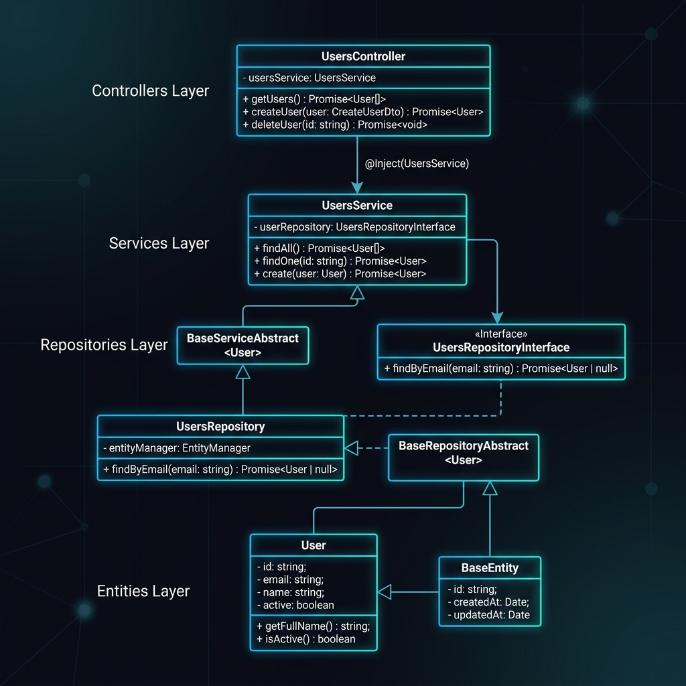
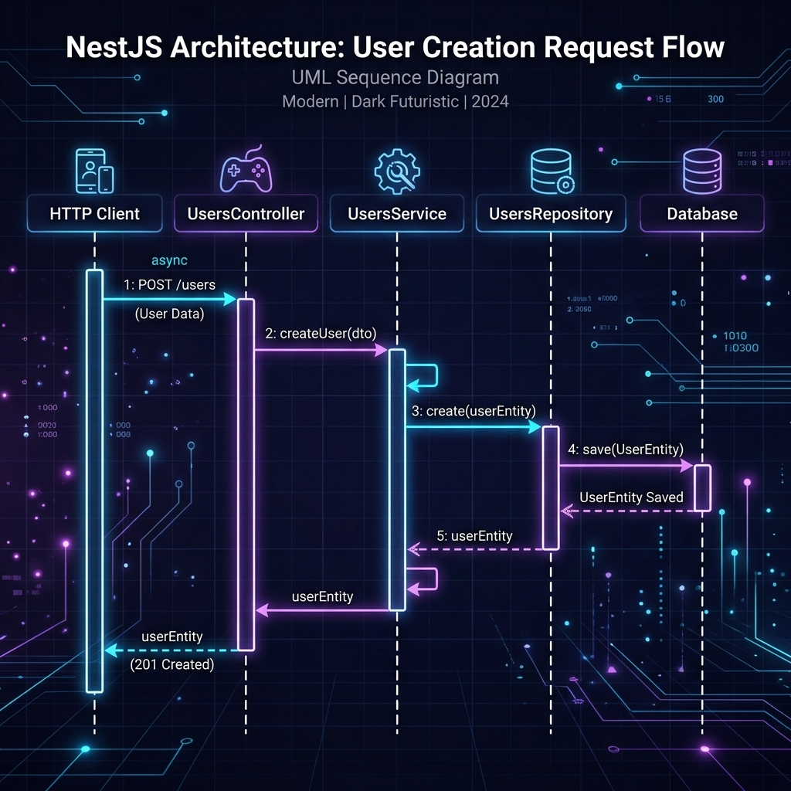
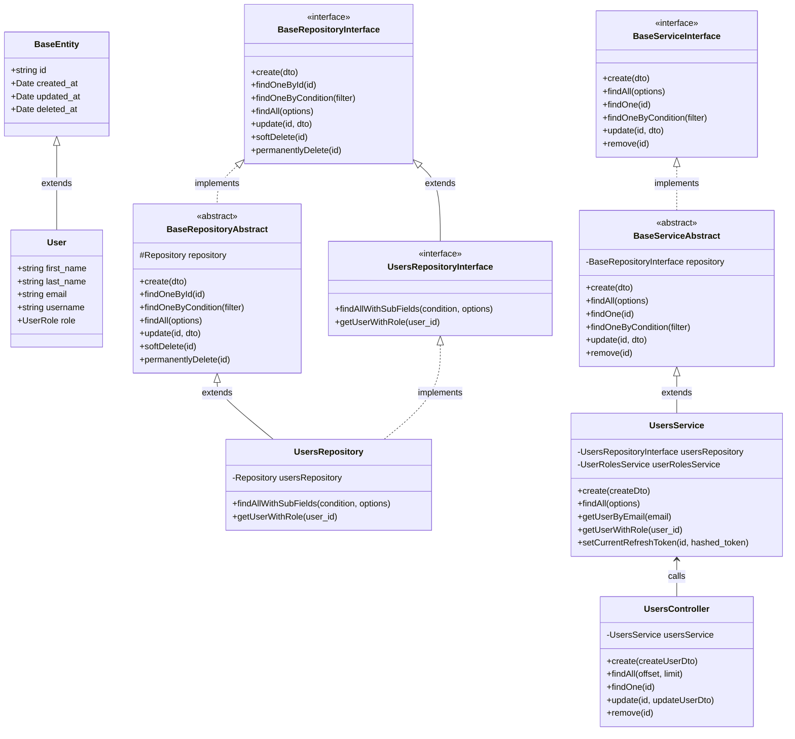

# 📐 Sơ đồ kiến trúc lớp và luồng (các tệp do dự án định nghĩa)

Tài liệu này mô tả sơ đồ lớp và sơ đồ trình tự thực thi dành riêng cho các tệp **do dự án tự định nghĩa** trong repository `Project_Base_NestJS`. Các lớp và interface gốc thuộc NestJS hoặc TypeORM đã được lược bỏ để tập trung vào kiến trúc cốt lõi của dự án.

Ví dụ minh họa được lấy từ luồng **Users Module**:<br>
`UsersController` ➔ `UsersService` ➔ `UsersRepository` ➔ `User Entity`.

---

## 🖼️ 1. Hình minh họa sơ đồ lớp



---

## 🏗️ 2. Sơ đồ cây và cấu trúc quan hệ kế thừa

```
========================================================================================
                                TẦNG 1: CONTROLLER
========================================================================================
  [UsersController] (dự án tự định nghĩa - nhận yêu cầu HTTP)
          │
          ▼ inject và gọi
========================================================================================
                                TẦNG 2: SERVICE
========================================================================================
  [BaseServiceInterface<T>]  ◄─── implements ─── [BaseServiceAbstract<T>]
  (Interface dịch vụ cơ sở)                         (lớp service trừu tượng dùng chung)
                                                             ▲
                                                             │ extends
                                                    [UsersService] (service xử lý nghiệp vụ)
          │
          ▼ injects & calls
========================================================================================
                                TẦNG 3: REPOSITORY
========================================================================================
  [BaseRepositoryInterface<T>] ◄── implements ─── [BaseRepositoryAbstract<T>]
  (Interface repository cơ sở)                     (repository trừu tượng TypeORM dùng chung)
           ▲                                                 ▲
           │ extends                                         │ extends
  [UsersRepositoryInterface]  ◄── implements ────   [UsersRepository] (repository thao tác với cơ sở dữ liệu)
  (Interface repository của User)
          │
          ▼ operates on
========================================================================================
                                TẦNG 4: ENTITY CƠ SỞ DỮ LIỆU
========================================================================================
  [BaseEntity] (Chứa id UUID, created_at, updated_at, deleted_at)
       ▲
       │ extends
  [User Entity] (Bảng users trong cơ sở dữ liệu)
========================================================================================
```

---

## 🖼️ 3. Hình minh họa luồng thực thi



---

## 🔄 4. Chi tiết trình tự thực thi

```
[Client (Postman/Mobile/Web)]
       │
       │  1. POST /users (CreateUserDto)
       ▼
[UsersController]
       │
       │  2. usersService.create(createUserDto)
       ▼
[UsersService]  (extends BaseServiceAbstract)
       │  - Xử lý nghiệp vụ (gán USER_ROLE, hash password, check email trùng)
       │
       │  3. usersRepository.create(userData)
       ▼
[UsersRepository] (extends BaseRepositoryAbstract & implements UsersRepositoryInterface)
       │  - Gọi TypeORM save() để lưu vào PostgreSQL
       │
       │  4. Tạo instance User Entity
       ▼
[User Entity] (extends BaseEntity)
       │  - Tự động sinh id UUID, created_at, updated_at
       │
       └────► [Trả kết quả JSON về Client: Status 201 Created]
```

---

## 5. 💻 Mã nguồn sơ đồ Mermaid (dành cho trình soạn thảo hỗ trợ Mermaid)

<details>
<summary><b>Bấm vào đây để xem mã Mermaid nếu trình soạn thảo có plugin hỗ trợ Mermaid</b></summary>



</details>

---

## 6. 📋 Bảng chi tiết cấu trúc lớp (các tệp do dự án định nghĩa)

| Tầng | Tệp dự án tự tạo | Quan hệ thừa kế / Interface | Mô tả nhiệm vụ |
| :--- | :--- | :--- | :--- |
| **Entity cơ sở** | [base.entity.ts](file:///d:/Project_AI/Project_Base_NestJS/src/modules/shared/base/base.entity.ts) | Lớp cơ sở | Định nghĩa các trường hệ thống chung (`id` UUID, `created_at`, `updated_at`, `deleted_at`). |
| **Entity cụ thể** | [user.entity.ts](file:///d:/Project_AI/Project_Base_NestJS/src/modules/users/entities/user.entity.ts) | `extends BaseEntity` | Khai báo schema dữ liệu riêng cho bảng `users`. |
| **Interface repository cơ sở** | [base.interface.repository.ts](file:///d:/Project_AI/Project_Base_NestJS/src/repositories/base/base.interface.repository.ts) | Interface cơ sở | Khai báo chuẩn CRUD cho tầng Repository (`create`, `findOneById`, `findAll`, `update`, `softDelete`). |
| **Interface repository tùy chỉnh** | [users.interface.ts](file:///d:/Project_AI/Project_Base_NestJS/src/modules/users/interfaces/users.interface.ts) | `extends BaseRepositoryInterface<User>` | Khai báo thêm các hàm truy vấn đặc thù cho User (`findAllWithSubFields`, `getUserWithRole`). |
| **Repository trừu tượng cơ sở** | [base.abstract.repository.ts](file:///d:/Project_AI/Project_Base_NestJS/src/repositories/base/base.abstract.repository.ts) | `implements BaseRepositoryInterface<T>` | Cài đặt logic truy vấn cơ sở dữ liệu dùng chung. |
| **Lớp repository cụ thể** | [users.repository.ts](file:///d:/Project_AI/Project_Base_NestJS/src/repositories/users.repository.ts) | `extends BaseRepositoryAbstract<User>`<br/>`implements UsersRepositoryInterface` | Thực thi chi tiết các hàm thao tác với cơ sở dữ liệu cho `User`. |
| **Interface service cơ sở** | [base.interface.service.ts](file:///d:/Project_AI/Project_Base_NestJS/src/services/base/base.interface.service.ts) | Interface (`Read<T>`, `Write<T>`) | Định nghĩa hợp đồng service chuẩn. |
| **Service trừu tượng cơ sở** | [base.abstract.service.ts](file:///d:/Project_AI/Project_Base_NestJS/src/services/base/base.abstract.service.ts) | `implements BaseServiceInterface<T>` | Cài đặt các hàm CRUD cơ bản thông qua `BaseRepositoryInterface`. |
| **Service cụ thể** | [users.service.ts](file:///d:/Project_AI/Project_Base_NestJS/src/modules/users/users.service.ts) | `extends BaseServiceAbstract<User>` | Chứa logic nghiệp vụ chính (tài khoản, phân quyền, token). |
| **Controller** | [users.controller.ts](file:///d:/Project_AI/Project_Base_NestJS/src/modules/users/users.controller.ts) | Lớp điều hướng độc lập | Định tuyến API HTTP, kiểm tra DTO và gọi `UsersService`. |

---

## 💡 Hướng dẫn mở rộng khi thêm module mới

Khi tạo một module mới (ví dụ: `Products`), hãy tuân thủ đúng pattern sau:

1. **Entity**: `export class Product extends BaseEntity`
2. **Repository Interface**: `export interface ProductsRepositoryInterface extends BaseRepositoryInterface<Product>`
3. **Repository Class**: `export class ProductsRepository extends BaseRepositoryAbstract<Product> implements ProductsRepositoryInterface`
4. **Service Class**: `export class ProductsService extends BaseServiceAbstract<Product>`
5. **Controller Class**: Khai báo `@Controller('products')` và inject `ProductsService`.
