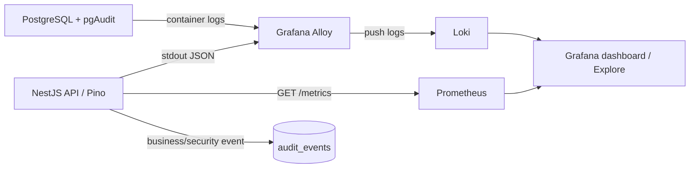

# Hướng dẫn Grafana và observability

Tài liệu này hướng dẫn chạy Grafana cùng API, PostgreSQL, Redis và các collector; tra cứu Pino log, audit log và Prometheus metrics; và hiểu dữ liệu nào được lưu lâu dài.

## Khởi động toàn bộ stack

Grafana, Loki, Alloy và Prometheus nằm trong profile Compose `audit-ui`. Khi chạy chỉ `docker-compose.dev.yml` hoặc `docker-compose.prod.yml`, profile này không tự khởi động. Luôn ghép `docker-compose.audit.yml` và bật `--profile audit-ui` khi muốn toàn bộ stack lên cùng lúc.

### Phát triển trên máy local

1. Tạo `.env.dev` từ `.env.example`, điền credentials local và đặt các giá trị sau:

   ```dotenv
   LOG_FORMAT=json
   ENABLE_METRICS=true
   GRAFANA_ADMIN_USER=admin
   GRAFANA_ADMIN_PASSWORD=<mật-khẩu-mạnh-riêng>
   ```

   Không commit `.env.dev` hoặc mật khẩu Grafana. JSON là cần thiết để Alloy/Loki parse trường Pino nhất quán.

2. Validate, build và chạy toàn bộ service:

   ```powershell
   docker compose --env-file .env.dev --profile audit-ui `
     -f docker-compose.dev.yml -f docker-compose.audit.yml config --quiet

   docker compose --env-file .env.dev --profile audit-ui `
     -f docker-compose.dev.yml -f docker-compose.audit.yml up -d --build
   ```

3. Kiểm tra trạng thái và mở Grafana:

   ```powershell
   docker compose --env-file .env.dev --profile audit-ui `
     -f docker-compose.dev.yml -f docker-compose.audit.yml ps
   ```

   Mở [http://localhost:3001](http://localhost:3001), đăng nhập bằng `GRAFANA_ADMIN_USER` và `GRAFANA_ADMIN_PASSWORD`, rồi chọn **NestJS Logs, Metrics & Audit** trong folder **Observability**. Cổng host của API lấy từ `PORT` (ví dụ `http://localhost:3317`); PostgreSQL lấy từ `DB_PUBLISHED_PORT`.

### Build và deploy production

Trong `.env.prod` bảo vệ trên host, cấu hình các secret bắt buộc của ứng dụng, đặt `ENABLE_METRICS=true` và đặt `GRAFANA_ADMIN_PASSWORD` riêng, mạnh. Không commit `.env.prod`. Từ thư mục chứa cả hai file Compose và thư mục `observability/`, chạy:

```sh
docker compose --env-file .env.prod --profile audit-ui \
  -f docker-compose.prod.yml -f docker-compose.audit.yml config --quiet

docker compose --env-file .env.prod --profile audit-ui \
  -f docker-compose.prod.yml -f docker-compose.audit.yml build

docker compose --env-file .env.prod --profile audit-ui \
  -f docker-compose.prod.yml -f docker-compose.audit.yml up -d --build
```

Lệnh cuối chạy API, migration, PostgreSQL, Redis, Grafana, Loki, Alloy và Prometheus. Nếu deploy API bằng image registry, cung cấp `APP_IMAGE`, `APP_VERSION`, `POSTGRES_IMAGE` và `POSTGRES_VERSION` như quy trình release; chạy cùng Compose overlay và profile để bật observability. Dashboard bind vào `127.0.0.1:3001`, không public thẳng ra Internet. Truy cập từ máy khác bằng SSH tunnel hoặc reverse proxy TLS có xác thực.

**Lưu ý GitLab CI:** pipeline hiện tại deploy bằng `docker-compose.prod.yml` đơn lẻ nên **không** tự khởi động profile Grafana. Pipeline build image trước và host deploy chỉ nhận Compose/config, không có source/Dockerfile để build lại. Sau deploy CI, trên host chạy `docker compose --env-file .env.prod --profile audit-ui -f docker-compose.prod.yml -f docker-compose.audit.yml up -d`; hoặc cập nhật job CI để dùng cùng overlay/profile. Phần hướng dẫn deploy chung nằm ở [DEPLOYMENT.md](DEPLOYMENT.md).

## Luồng hoạt động



- **Pino request log:** `nestjs-pino` ghi request/response có cấu trúc ra stdout API. Alloy đọc log container API, gắn nhãn `service`/`container` và chuyển đến Loki.
- **Application audit event:** `AuditLogService.recordEvent()` ghi event bền vững vào PostgreSQL `audit_events`, đồng thời phát sự kiện Pino JSON để tìm kiếm nhanh trên Loki.
- **Database audit:** PostgreSQL với pgAudit ghi nhóm SQL `WRITE`, `DDL`, `ROLE` vào log container. Alloy chuyển log này sang Loki. Mặc định không audit `READ` và không ghi SQL parameters.
- **Metrics:** Prometheus gọi endpoint API `/metrics` mỗi 15 giây. Metrics nằm trong process API, reset khi API khởi động lại; Prometheus giữ chuỗi thời gian tối đa 15 ngày theo cấu hình hiện tại.
- **Dashboard:** provisioning tự đăng ký datasource Loki và Prometheus cùng dashboard; không cần tạo datasource/panel thủ công.

## Xem dashboard và log

Dashboard **NestJS Logs, Metrics & Audit** có các panel:

| Panel | Nội dung |
| --- | --- |
| HTTP request rate | Số request theo thời gian |
| HTTP server errors | Tỷ lệ response lỗi 5xx |
| HTTP latency p95 | Độ trễ request phân vị 95 |
| Queue jobs by state | Số job queue theo trạng thái |
| Cache operations | Hoạt động cache theo loại |
| Request rate by route | Request theo route đã chuẩn hóa |
| All API logs | Log API tổng quát |
| Pino HTTP access logs | Access log HTTP của Pino |
| Application audit events | Audit event bảo mật/nghiệp vụ từ ứng dụng |
| Database audit events (pgAudit) | Log SQL audit từ PostgreSQL |

Chọn khoảng thời gian ở góc phải trên, nhấn **Refresh** để cập nhật. Với log cần điều tra chi tiết, mở **Explore**, chọn datasource Loki và thử LogQL:

```logql
{service="api"}
```

```logql
{service="api"} | json | context="HTTP"
```

```logql
{service="api"} | json | event="audit_event"
```

```logql
{service="api"} | json | event="audit_event" | action="USER_LOGIN"
```

```logql
{service="postgres_db"} |~ "AUDIT:"
```

Trong **Explore**, chọn datasource Prometheus để chạy PromQL, ví dụ:

```promql
sum(rate(http_server_requests_total[5m]))
```

```promql
histogram_quantile(0.95, sum by (le) (rate(http_server_request_duration_seconds_bucket[5m])))
```

Endpoint `http://localhost:<PORT>/metrics` có thể xem trực tiếp để xác nhận API xuất metric. Prometheus không publish cổng ra host theo mặc định, chỉ truy cập trong mạng Compose; khuyến nghị xem qua Grafana.

## Phân biệt audit log và Pino log

Access log Pino là dấu vết request kỹ thuật, không tự mô tả đầy đủ ý nghĩa nghiệp vụ. Application audit event chỉ xuất hiện nếu code của thao tác gọi `AuditLogService.recordEvent()` sau khi thao tác thành công. Event được lưu bền vững ở `audit_events`; Loki phù hợp để tìm kiếm/quan sát nhưng retention log mặc định là 30 ngày. Có thể truy vấn lịch sử bền vững qua API admin `GET /audit/events`.

pgAudit là dấu vết thao tác SQL, không cho biết ý nghĩa hay actor nghiệp vụ như application audit. Cấu hình mặc định audit `WRITE`, `DDL`, `ROLE`, tắt parameters và không audit `SELECT/READ` để tránh log quá lớn hoặc thu thập dư thừa dữ liệu.

Không ghi mật khẩu, token, credential, request body hoặc dữ liệu cá nhân nhạy cảm vào log/metadata audit. Cân nhắc quyền truy cập, retention, mã hóa và backup theo yêu cầu bảo mật/tuân thủ của môi trường.

## Vận hành

Xem trạng thái, log và dừng stack mà không xóa volume:

```powershell
docker compose --env-file .env.dev --profile audit-ui `
  -f docker-compose.dev.yml -f docker-compose.audit.yml ps

docker compose --env-file .env.dev --profile audit-ui `
  -f docker-compose.dev.yml -f docker-compose.audit.yml logs -f grafana loki alloy prometheus api postgres_db

docker compose --env-file .env.dev --profile audit-ui `
  -f docker-compose.dev.yml -f docker-compose.audit.yml down
```

Đổi `--env-file .env.dev` thành `.env.prod` và file `docker-compose.dev.yml` thành `docker-compose.prod.yml` khi thao tác production. `down` giữ dữ liệu volume. Tránh `down -v` nếu cần giữ dữ liệu; lệnh đó xóa cả volume gồm PostgreSQL, Loki, Prometheus và Grafana. Xem log Docker trực tiếp không cần Grafana bằng `docker compose ... logs -f api postgres_db`.

Nếu không có metric: xác nhận `ENABLE_METRICS=true`, API healthy và `/metrics` trả HTTP 200; sau đó kiểm tra Prometheus target `nestjs-api` ở trạng thái **UP**. Nếu không có log: xác nhận `LOG_FORMAT=json` trên development, Alloy/Loki đang chạy, rồi kiểm tra Explore với selector `{service="api"}`. Nếu không có application audit event, xác nhận luồng nghiệp vụ đã gọi `recordEvent()`; dashboard không tự tạo audit nghiệp vụ.

Xem thêm [AUDIT_GUIDE.md](AUDIT_GUIDE.md) để tích hợp `AuditLogService`, và [LOGGING_GUIDE.md](LOGGING_GUIDE.md) về logging ứng dụng.
