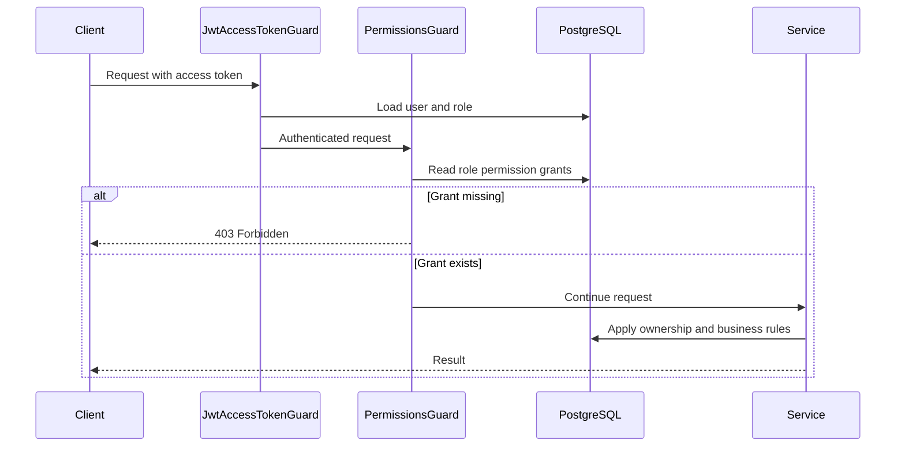

# Permission-Based Authorization

The base keeps coarse role checks (`@Roles`) and adds permission checks (`@RequirePermissions`).
Roles group grants; permissions represent individual actions. A permission-protected route still
requires authentication, and resource ownership checks in the service remain in force.

## Request flow

1. `JwtAccessTokenGuard` authenticates the request and loads the current user and role.
2. `PermissionsGuard` reads permission codes from route metadata.
3. The guard queries the current grants for the user's role. It does not trust permissions copied
   into a JWT, so a role change takes effect on the next request.
4. Missing grants return HTTP `403`. If granted, the controller/service continues and performs
   resource-level ownership checks.



## Data model and defaults

`permissions` stores a unique `code` and description. `permission_roles` is the many-to-many
grant table between permissions and roles. The permissions migration seeds these demo codes:

| Code                 | Meaning                                              |
| -------------------- | ---------------------------------------------------- |
| `flash-cards:read`   | Read flash cards allowed by resource ownership rules |
| `flash-cards:create` | Create a flash card                                  |
| `flash-cards:update` | Update flash cards allowed by ownership rules        |
| `flash-cards:delete` | Delete flash cards allowed by ownership rules        |

Default grants: Admin receives all four; User receives read/create. These are demo defaults.
Other roles receive no grants until an Admin configures them. The migration does not overwrite
grants later.

## Protecting a route

Import `PermissionsModule` into the Nest module that declares the controller, then add the guard
and metadata to each endpoint:

```typescript
@UseGuards(JwtAccessTokenGuard, PermissionsGuard)
@RequirePermissions('reports:export')
@Post('export')
exportReport() {
  // Business logic and resource-level checks still belong in a service.
}
```

`@RequirePermissions()` currently requires **all** listed codes. Use `@Roles()` separately when
an endpoint is role-administration-only, such as managing role grants. Do not use a role name as
a substitute for a permission code.

## Demo with Flash Cards

Flash Card create/read/update/delete routes require the corresponding permission and continue to
enforce per-user ownership. The feature must be enabled with `ENABLE_FLASH_CARDS=true`; run the
database migrations first. Authenticate as Admin, then:

1. `GET /permissions` to inspect the available codes.
2. `GET /permissions/roles` to find the User or TeamLeader role ID and current grants.
3. `PUT /permissions/roles/{roleId}` with the exact grant list to replace that role's grants.

Example body to allow a role to read and create cards, but not update or delete them:

```json
{
	"codes": ["flash-cards:read", "flash-cards:create"]
}
```

Then sign in as a user assigned that role. Creating/reading cards succeeds; update/delete returns
403 before business logic. Add `flash-cards:update` and retry an update to demonstrate the grant
change. A user still cannot update another user's card: permission grants do not bypass ownership.

Role grant administration is restricted to Admin through `JwtAccessTokenGuard` + `RolesGuard`.
Permission checks read grants from PostgreSQL on each protected request, favoring immediate
revocation and simplicity for a reusable base. If profiling later shows this query is material,
add a bounded cache with explicit invalidation when grants change.

## Adding permissions

1. Add the stable code and description through a migration.
2. Seed only deliberate default role grants in that migration.
3. Protect route handlers with `@RequirePermissions(code)` and `PermissionsGuard`.
4. Keep ownership, tenant boundaries, and domain rules in the service layer.
5. Add guard/service tests for allowed and denied access, plus an integration test for the route.

Avoid adding a permission for every route if several routes represent the same domain action. Keep
codes stable because project data and role grants refer to them.
