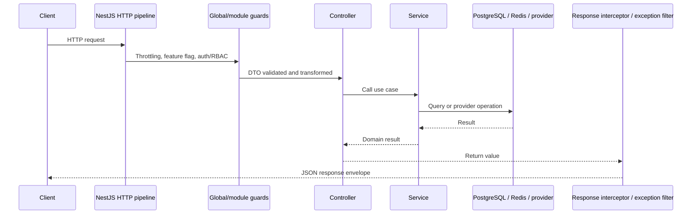

# Hướng dẫn dự án

Tài liệu tổng quan cho người nhận base: mô tả các năng lực đang có, luồng chính,
điểm mở rộng và tài liệu chi tiết. Route/schema API đầy đủ hơn nằm ở
[API Summary](API_SUMMARY.md); cấu hình deploy ở [Deployment Guide](DEPLOYMENT.md).

## Tổng quan dự án

Đây là NestJS REST API base, không phải một ứng dụng Flash Cards thuần và cũng
không phải hạ tầng cloud đã được cấp phát. Lõi dùng NestJS 12, Node.js >=24.15,
TypeScript 6, PostgreSQL/TypeORM và Redis/BullMQ. Chạy các module domain cùng một
ứng dụng; hiện chưa phải microservices hay cơ chế gỡ module vật lý bằng cấu hình.

### Năng lực base

- Authentication bằng local email/password, JWT access/refresh, refresh rotation,
  logout và RBAC.
- User/role, request DTO validation, serialization và ownership checks.
- API response envelope, success/error catalogs, exception handling.
- Cấu hình Joi fail-fast, CORS allowlist, Helmet, rate limiting.
- PostgreSQL migrations, health/readiness checks, production multi-stage Docker image.
- Structured request logging, tùy chọn Prometheus metrics và persistent audit events.
- Tùy chọn account lifecycle (email verification/password reset) qua SMTP.

### Module/domain mẫu

| Module                                 | Nội dung                                    | Trạng thái khi khởi tạo                                              |
| -------------------------------------- | ------------------------------------------- | -------------------------------------------------------------------- |
| `flash-cards`, `collections`, `topics` | Nội dung flash-card và taxonomy             | Source giữ lại; route tắt mặc định, có thể bật bằng feature flag     |
| `flash-cards-state`                    | Workflow duyệt card theo state              | Source giữ lại; route tắt mặc định                                   |
| `comments`                             | Cây comment/closure-table                   | Source giữ lại; route tắt mặc định                                   |
| `checkin`                              | Check-in/streak/reward mẫu                  | Source giữ lại; route tắt mặc định                                   |
| `media`                                | Metadata/upload abstraction; S3 integration | Module được nạp; provider S3 off mặc định                            |
| `queue`                                | BullMQ queues/processors và monitoring      | Redis cần cho queue; processors mẫu không thực hiện side effect thật |
| `users/student-cards`                  | Ví dụ upload chưa hoàn thiện                | Feature off mặc định; bật lên vẫn trả 501                            |

Google OAuth, S3, SMTP account flows và metrics đều opt-in. Không cấu hình
credentials cloud cho dự án nếu chưa chọn provider. Xem
[Configuration Guide](CONFIGURATION_GUIDE.md).

## Cấu trúc mã nguồn

```text
src/
  app.module.ts                 # Module composition và global providers
  main.ts                       # Bootstrap, security middleware, validation
  configs/                      # Joi validation và mapping environment
  database/                     # TypeORM DataSource và migrations
  decorators/                   # Metadata/decorators dùng chung
  filters/                      # API exception envelope
  guards/                       # Feature gating/RBAC/auth policy
  health/                       # Liveness/readiness
  modules/<domain>/             # Controller, service, entity, DTO, module
  observability/                # Metrics registry/interceptor và audit log
  repositories/                 # Data access abstractions
  shared/                       # API errors/success, formatters, helpers
test/                            # HTTP end-to-end suites
docs/                            # Hướng dẫn và contracts
```

Trong domain module, controller nhận HTTP input và gọi service; service chứa use
case/business rules; repository/TypeORM xử lý persistence. DTO xác nhận dữ liệu
đầu vào. Dùng pattern cụ thể gần nhất thay vì tạo abstraction dùng chung khi chưa
có nhu cầu.

## Luồng xử lý request



`ValidationPipe` toàn cục dùng `whitelist`, `forbidNonWhitelisted` và `transform`.
Response interceptor tự đóng gói JSON success; exception filter chuẩn hóa HTTP
errors. Endpoint tự dùng `@Res()` (ví dụ OAuth redirect) và Prometheus text endpoint
không theo JSON envelope mặc định. Chi tiết:
[API Response Contract](API_RESPONSE_CONTRACT.md).

## Luồng xác thực/tài khoản

1. Sign-up validate DTO, tạo user và hash password trong entity lifecycle; role mặc
   định được tra từ user roles.
2. Sign-in xác minh credentials, phát access/refresh tokens và lưu hash refresh
   token; auth endpoints được rate limited.
3. Refresh guard kiểm tra chữ ký/expiry và so khớp token hiện tại; sign-in/refresh
   tạo token mới, logout thu hồi token và xóa cookies.
4. Khi account email flows bật, request reset/verification sinh token ngẫu nhiên,
   DB chỉ lưu hash, token có TTL và consume một lần. Reset password thu hồi refresh
   token.
5. `REQUIRE_VERIFIED_EMAIL=true` buộc account email flows đã bật và chặn đăng nhập/
   access cho email chưa xác minh.

Google OAuth là flow riêng cần provider credentials và callback URL; hiện không
bật mặc định. API route: [API Summary](API_SUMMARY.md#authentication).

## Tải media và tác vụ nền

- Upload đi qua transport limits, MIME/signature validation và media ownership
  checks trước khi thao tác storage.
- S3 config/provider bị tắt mặc định. Khi chưa cấu hình provider thật, không coi
  upload/download như một năng lực storage production đã nghiệm thu.
- BullMQ sử dụng Redis. Queue settings có retry/backoff và retention giới hạn;
  mock processors fail rõ ở production thay vì giả xử lý thành công.
- Thêm provider thật cần idempotency, timeout, retry policy theo side effect, secret
  management và integration tests.

## Khả năng quan sát và health check

- `GET /health/live`: process liveness.
- `GET /health/ready`: kiểm tra PostgreSQL và Redis; Compose dùng cho container health.
- `GET /metrics`: opt-in, Prometheus counters/histograms process-local; giới hạn
  endpoint vào private network hoặc bảo vệ ở proxy.
- Application/security/business events được lưu trong `audit_events`, gồm
  authentication/account lifecycle, quản trị user/role và check-in; API `/audit/events`
  chỉ dành cho Admin.
- pgAudit ghi SQL write/DDL/role vào PostgreSQL logs; Pino ghi HTTP access logs ra
  stdout, không ghi query string. Grafana/Loki/Alloy dashboard là profile tùy chọn;
  xem [Audit Guide](AUDIT_GUIDE.md).

## Build, test và quy trình database

```powershell
npm ci
npm run build
npm test -- --runInBand
npm run lint
npm run test:e2e
npm audit
```

E2E cần PostgreSQL/Redis và environment phù hợp. Schema thay đổi phải đi qua
TypeORM migration; production Compose chạy migration job trước API. Đọc
[Database Setup](DATABASE_SETUP.md) trước khi tạo schema mới.

## Cách thêm feature cho dự án mới

1. Chọn tên domain và contract; tránh sửa trực tiếp hành vi của module mẫu khi dự án
   cần giữ upstream base dễ merge.
2. Sinh hoặc tạo `src/modules/<domain>` gồm DTO, entity, controller, service, module.
3. Gắn module ở `src/app.module.ts`; TypeORM tự nhận entities từ registered modules.
4. Xác định access policy trước khi viết CRUD: public/authenticated/admin/owner.
   Kiểm tra ownership ở service/repository, không chỉ dựa vào việc UUID khó đoán.
5. Dùng global validation và response envelope; đặt lỗi lặp lại trong error catalog.
6. Sinh/review migration, unit-test business rules và e2e-test HTTP/authorization.
7. Domain source ví dụ vẫn nằm trong repo để có thể tái sử dụng; feature flag chỉ ẩn
   routes, không tháo module/schema. Nếu bỏ domain khỏi fork, xử lý cả entity relation
   và migration liên quan.
8. Cập nhật API Summary, module/project guide, cấu hình nếu thêm biến môi trường.

## Tài liệu theo công việc

- Chạy lần đầu: [Quick Start](QUICK_START.md)
- Tạo/chỉnh schema: [Database Setup](DATABASE_SETUP.md)
- Route/API: [API Summary](API_SUMMARY.md)
- Env/providers: [Configuration Guide](CONFIGURATION_GUIDE.md)
- Structured logs và request ID: [Logging Guide](LOGGING_GUIDE.md)
- Build/deploy: [Deployment Guide](DEPLOYMENT.md)
- Backup/restore: [Operations Backup/Restore](OPERATIONS_BACKUP_RESTORE.md)
- Response/errors: [API Response Contract](API_RESPONSE_CONTRACT.md)
- Application scope/readiness: [Production Readiness Plan](PRODUCTION_READINESS_PLAN.md)

## Phạm vi chưa được cung cấp sẵn

Không có SMTP/email provider, queue side-effect provider, OAuth/S3 cloud credentials,
distributed tracing/dashboards/alerting, deploy target, restore drill hoặc SLA nào
được tạo sẵn. Student-card upload là endpoint mẫu chưa implement và vẫn trả 501 nếu
flag được bật. Mỗi dự án phải thay domain, cấu hình platform secrets, rà soát dữ
liệu/policy, kiểm thử provider thật và nghiệm thu staging, backup/restore, capacity
và rollback trước production.
