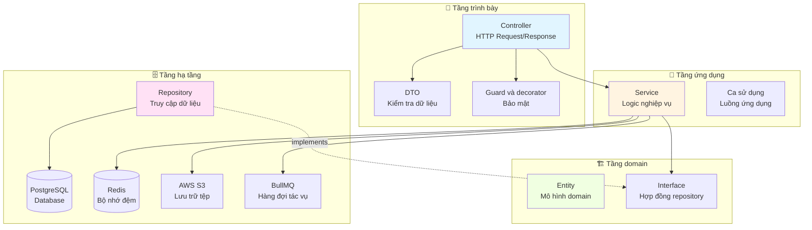
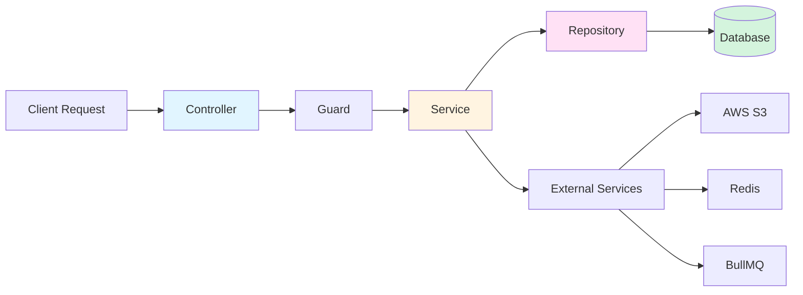
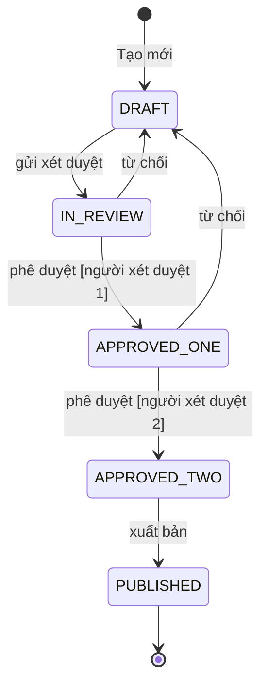
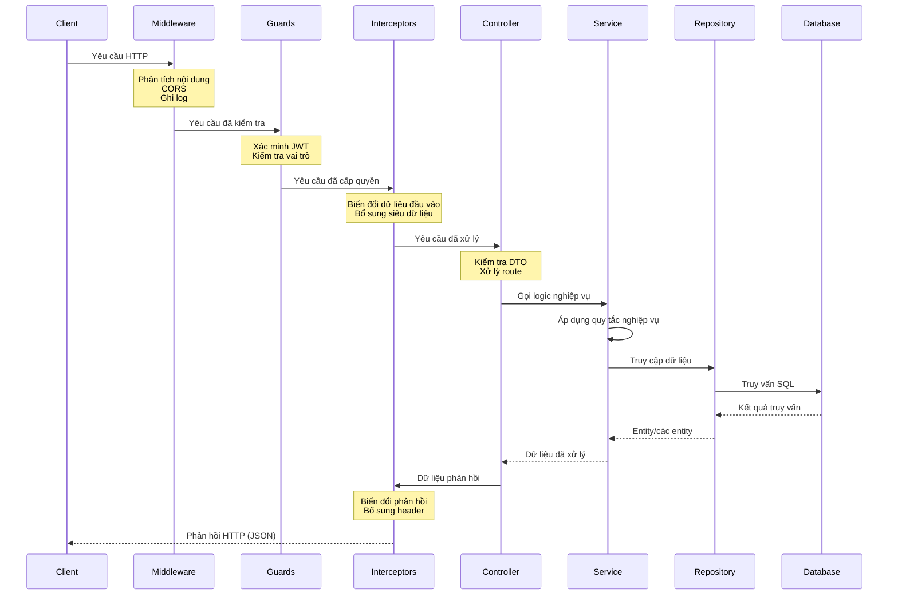

# TỔNG QUAN HỆ THỐNG - NestJS Boilerplate

**Phiên bản:** 1.0.0  
**Cập nhật lần cuối:** 2026-09-05  
**Thời gian đọc:** 40 phút

---

## 📚 Mục lục

1. [Giới thiệu](#1-giới-thiệu)
2. [Tổng quan kiến trúc](#2-tổng-quan-kiến-trúc)
3. [Mẫu thiết kế](#3-mẫu-thiết-kế)
4. [Vòng đời request](#4-vòng-đời-request)
5. [Xác thực và phân quyền](#5-xác-thực-và-phân-quyền)
6. [Luồng tải tệp lên](#6-luồng-tải-tệp-lên)
7. [Tác vụ nền](#7-tác-vụ-nền)
8. [Dữ liệu phân cấp (bình luận)](#8-dữ-liệu-phân-cấp-bình-luận)
9. [Quản lý cấu hình](#9-quản-lý-cấu-hình)
10. [Biện pháp bảo mật](#10-biện-pháp-bảo-mật)

---

## 1. Giới thiệu

### 1.1 Boilerplate này là gì?

Boilerplate NestJS này cung cấp **nền tảng sẵn sàng cho môi trường production** để xây dựng ứng dụng web có khả năng mở rộng và dễ bảo trì. Dự án áp dụng các thực hành tốt, nguyên tắc Clean Architecture và những tính năng phổ biến của ứng dụng hiện đại, giúp bạn tập trung vào nghiệp vụ thay vì thiết lập hạ tầng.
dựng ứng dụng web có khả năng mở rộng và dễ bảo trì. Dự án áp dụng các thực
hành tốt, nguyên tắc Clean Architecture và những tính năng phổ biến của ứng dụng
hiện đại, giúp bạn tập trung vào nghiệp vụ thay vì thiết lập hạ tầng.

**🎯 Điểm nổi bật:**
- ✅ **Clean Architecture** - Tách biệt trách nhiệm với ranh giới tầng rõ ràng.
- ✅ **Ưu tiên TypeScript** - Kiểm tra kiểu trên toàn bộ hệ thống.
- ✅ **Tích hợp xác thực** - Có sẵn JWT và OAuth2 (Google).
- ✅ **Tích hợp cơ sở dữ liệu** - PostgreSQL, TypeORM và migration.
- ✅ **Tác vụ nền** - BullMQ cùng Redis để xử lý bất đồng bộ.
- ✅ **Lưu trữ tệp** - Tích hợp AWS S3 để tải tệp đa phương tiện lên.
- ✅ **Sẵn sàng với Docker** - Cấu hình container đầy đủ.
- ✅ **Thiết lập kiểm thử** - Hạ tầng kiểm thử đơn vị và E2E.
- ✅ **Tài liệu API** - Tích hợp Swagger/OpenAPI.

### 1.2 Khi nào nên sử dụng?

**✅ Phù hợp với:**
- Xây dựng REST API có nghiệp vụ phức tạp.
- Ứng dụng cần xác thực và phân quyền.
- Dự án cần tải lên/quản lý tệp.
- Hệ thống xử lý tác vụ nền.
- Ứng dụng có dữ liệu phân cấp (bình luận, danh mục).
- Ứng dụng nhiều tenant, phân quyền theo vai trò.

**⚠️ Không phù hợp nhất với:**
- Ứng dụng CRUD đơn giản (có thể dư thừa kiến trúc).
- Ứng dụng ưu tiên GraphQL (nên dùng bộ khởi tạo GraphQL của NestJS).
- Triển khai chỉ dùng serverless (cần điều chỉnh).
- Ứng dụng thời gian thực (cần tích hợp WebSocket).

### 1.3 Những gì được tích hợp

**🔐 Module cốt lõi (bắt buộc)**
- **auth** - Xác thực JWT và Google OAuth2.
- **users** - Quản lý người dùng với các thao tác CRUD.
- **user-roles** - Phân quyền theo vai trò (RBAC).

**📦 Module tùy chọn (có thể gỡ nếu không cần)**
- **media** - Tải tệp lên AWS S3 bằng URL ký trước.
- **queue** - Xử lý tác vụ nền (email, xử lý ảnh, thông báo).
- **comments** - Hệ thống bình luận phân cấp dùng Closure Table.
- **checkin** - Theo dõi điểm danh hằng ngày và chuỗi ngày liên tiếp.
- **flash-cards** - Các thao tác CRUD flash card.
- **flash-cards-state** - Máy trạng thái cho quy trình flash card.
- **collections** - Quản lý bộ sưu tập.
- **topics** - Tổ chức chủ đề.

### 1.4 Công nghệ sử dụng

| Thành phần | Công nghệ | Phiên bản | Mục đích |
|-----------|-----------|---------|---------|
| 🚀 **Framework** | NestJS | 10.x | Nền tảng ứng dụng Node.js |
| 💻 **Môi trường chạy** | Node.js | 18+ | Môi trường thực thi JavaScript |
| 📘 **Ngôn ngữ** | TypeScript | 5.x | Phát triển có kiểm tra kiểu |
| 🗄️ **Cơ sở dữ liệu** | PostgreSQL | 15+ | Cơ sở dữ liệu quan hệ |
| 🔄 **ORM** | TypeORM | 0.3.x | Lớp trừu tượng cơ sở dữ liệu |
| 🔴 **Bộ nhớ đệm** | Redis | 7+ | Bộ nhớ đệm và lưu trữ phiên |
| 📬 **Hàng đợi** | BullMQ | 5.x | Xử lý tác vụ nền |
| ☁️ **Lưu trữ** | AWS S3 | Mới nhất | Lưu trữ đối tượng cho tệp đa phương tiện |
| 🔐 **Xác thực** | JWT + Passport | Mới nhất | Xác thực và phân quyền |
| ✅ **Kiểm tra dữ liệu** | class-validator | Mới nhất | Kiểm tra DTO |
| 📝 **Tài liệu** | Swagger | Mới nhất | Tài liệu API |
| 🐳 **Container** | Docker | Mới nhất | Đóng gói ứng dụng trong container |

---

## 2. Tổng quan kiến trúc

### 2.1 Các tầng Clean Architecture

Boilerplate áp dụng **Clean Architecture** (còn gọi là Onion Architecture hoặc
Hexagonal Architecture) nhằm bảo đảm:
- 🎯 **Phân tách trách nhiệm** - Mỗi tầng có nhiệm vụ riêng.
- 🔄 **Quy tắc phụ thuộc** - Phụ thuộc hướng vào trong (tầng ngoài phụ thuộc tầng trong).
- 🧪 **Khả năng kiểm thử** - Tách nghiệp vụ khỏi hạ tầng.
- 📦 **Khả năng bảo trì** - Thay đổi ở một tầng không lan truyền khắp hệ thống.



**🎯 Tầng trình bày (Controller + DTO + Guard)**

Trách nhiệm:
- Tiếp nhận HTTP request và tạo response.
- Kiểm tra dữ liệu đầu vào bằng DTO và class-validator.
- Khai báo route và tài liệu API (Swagger).
- Thực thi xác thực và phân quyền.
- Chuyển đổi dữ liệu để trình bày.

Ví dụ:
```typescript
@Controller('users')
@ApiTags('Users')
export class UsersController {
  constructor(private readonly usersService: UsersService) {}

  @Get('me')
  @UseGuards(JwtAccessTokenGuard) // 🔐 Authentication
  @ApiOperation({ summary: 'Lấy hồ sơ người dùng hiện tại' })
  async getProfile(@CurrentUser() user: User) {
    return user; // Dữ liệu được chuyển đổi sang DTO tự động
  }
}
```

**🔄 Tầng ứng dụng (Service)**

Trách nhiệm:
- Triển khai logic và quy tắc nghiệp vụ.
- Điều phối ca sử dụng qua nhiều repository.
- Xử lý transaction và tình huống lỗi.
- Tích hợp dịch vụ bên ngoài (S3, queue, email).
- Phát và xử lý domain event.

Ví dụ:
```typescript
@Injectable()
export class UsersService {
  constructor(
    @InjectRepository(User)
    private readonly usersRepository: Repository<User>,
    private readonly queueService: QueueService,
  ) {}

  async createUser(createUserDto: CreateUserDto): Promise<User> {
    // Logic nghiệp vụ
    const hashedPassword = await bcrypt.hash(createUserDto.password, 11);
    
    const user = this.usersRepository.create({
      ...createUserDto,
      password: hashedPassword,
    });
    
    await this.usersRepository.save(user);
    
    // Kích hoạt tác vụ nền
    await this.queueService.addEmailJob({
      to: user.email,
      subject: 'Welcome!',
      template: 'welcome',
    });
    
    return user;
  }
}
```

**🏗️ Tầng domain (Entity + Interface)**

Trách nhiệm:
- Định nghĩa các entity nghiệp vụ cốt lõi
- Khai báo interface repository (hợp đồng)
- Đảm bảo các ràng buộc và quan hệ của entity
- Không chứa mã hạ tầng

Ví dụ:
```typescript
@Entity('users')
export class User {
  @PrimaryGeneratedColumn('uuid')
  id: string;

  @Column({ unique: true })
  @Index()
  email: string;

  @Column()
  @Exclude() // Never expose in responses
  password: string;

  @ManyToOne(() => UserRole)
  @JoinColumn({ name: 'role_id' })
  role: UserRole;

  @CreateDateColumn()
  created_at: Date;
}
```

**🗄️ Tầng hạ tầng (Repository + dịch vụ bên ngoài)**

Trách nhiệm:
- Triển khai lưu trữ dữ liệu (TypeORM)
- Tích hợp dịch vụ bên ngoài (AWS S3, Redis, BullMQ)
- Tối ưu hóa truy vấn cơ sở dữ liệu
- Quản lý thao tác bộ nhớ đệm
- Triển khai logic lưu trữ tệp

Ví dụ:
```typescript
@Injectable()
export class UsersRepository {
  constructor(
    @InjectRepository(User)
    private readonly repository: Repository<User>,
  ) {}

  async findByEmail(email: string): Promise<User | null> {
    return this.repository.findOne({
      where: { email },
      relations: ['role'],
    });
  }

  async createWithTransaction(userData: Partial<User>): Promise<User> {
    return this.repository.manager.transaction(async (manager) => {
      const user = manager.create(User, userData);
      return manager.save(user);
    });
  }
}
```

### 2.2 Cấu trúc thư mục

```
src/
├── configs/                    # ⚙️ Configuration management
│   ├── configuration.config.ts  # Centralized config
│   ├── validation.schema.ts     # Joi validation schema
│   └── typed-config.service.ts  # Type-safe config access
│
├── decorators/                 # 🎨 Custom decorators
│   ├── current-user.decorator.ts
│   ├── auth.decorator.ts
│   └── roles.decorator.ts
│
├── guards/                     # 🔐 Authentication & authorization
│   ├── jwt-access-token.guard.ts
│   └── roles.guard.ts
│
├── modules/                    # 📦 Feature modules
│   ├── auth/                   # Authentication & OAuth
│   ├── users/                  # User management
│   ├── user-roles/             # RBAC
│   ├── media/                  # File upload (S3)
│   ├── queue/                  # Background jobs
│   ├── comments/               # Hierarchical comments
│   ├── checkin/                # Check-in tracking
│   ├── flash-cards/            # Flash cards CRUD
│   ├── flash-cards-state/      # State machine
│   ├── collections/            # Collections
│   ├── topics/                 # Topics
│   └── shared/                 # Shared utilities
│
├── database/                   # 🗄️ Database configuration
│   ├── data-source.ts          # TypeORM config
│   └── migrations/             # Migration files
│
├── types/                      # 📘 TypeScript type definitions
│   └── express.d.ts            # Extended Express types
│
├── app.module.ts               # 🚀 Root module
└── main.ts                     # 🎯 Application entry point
```

### 2.3 Luồng phụ thuộc



**Quy tắc phụ thuộc:**
1. ✅ Tầng bên ngoài có thể phụ thuộc vào tầng bên trong
2. ❌ Tầng bên trong không bao giờ phụ thuộc vào tầng bên ngoài
3. ✅ Logic nghiệp vụ (service) độc lập với hạ tầng
4. ✅ Entity domain không phụ thuộc vào framework

---

## 3. Mẫu thiết kế

### 3.1 Mẫu Repository

**🎯 Mục đích:** Trừu tượng hóa logic truy cập dữ liệu, giúp logic nghiệp vụ độc lập với cách triển khai cơ sở dữ liệu.

**✅ Lợi ích:**
- Tập trung logic truy cập dữ liệu
- Dễ kiểm thử đơn vị hơn (giả lập repository)
- Linh hoạt thay đổi nguồn dữ liệu
- Tách biệt rõ ràng tầng nghiệp vụ và tầng dữ liệu

**Ví dụ triển khai:**

```typescript
// Bước 1: Define repository interface (optional but recommended)
export interface IUsersRepository {
  findById(id: string): Promise<User | null>;
  findByEmail(email: string): Promise<User | null>;
  create(userData: Partial<User>): Promise<User>;
  update(id: string, userData: Partial<User>): Promise<User>;
  delete(id: string): Promise<boolean>;
}

// Bước 2: Implement repository
@Injectable()
export class UsersRepository implements IUsersRepository {
  constructor(
    @InjectRepository(User)
    private readonly repository: Repository<User>,
  ) {}

  async findById(id: string): Promise<User | null> {
    return this.repository.findOne({
      where: { id },
      relations: ['role'], // Tải sẵn các quan hệ
    });
  }

  async findByEmail(email: string): Promise<User | null> {
    return this.repository.findOne({
      where: { email },
      select: ['id', 'email', 'password', 'role'], // Bao gồm mật khẩu để xác thực
    });
  }

  async create(userData: Partial<User>): Promise<User> {
    const user = this.repository.create(userData);
    return this.repository.save(user);
  }

  async update(id: string, userData: Partial<User>): Promise<User> {
    await this.repository.update(id, userData);
    return this.findById(id);
  }

  async delete(id: string): Promise<boolean> {
    const result = await this.repository.delete(id);
    return result.affected > 0;
  }
}

// Bước 3: Sử dụng trong service
@Injectable()
export class UsersService {
  constructor(private readonly usersRepository: UsersRepository) {}

  async getUserProfile(userId: string): Promise<User> {
    const user = await this.usersRepository.findById(userId);
    if (!user) {
      throw new NotFoundException('User not found');
    }
    return user;
  }
}
```

**🧪 Lợi ích khi kiểm thử:**

```typescript
describe('UsersService', () => {
  let service: UsersService;
  let repository: MockType<UsersRepository>;

  beforeEach(() => {
    // Giả lập repository để kiểm thử đơn vị
    repository = {
      findById: jest.fn(),
      findByEmail: jest.fn(),
      create: jest.fn(),
      // ... other methods
    };

    service = new UsersService(repository as any);
  });

  it('should find user by id', async () => {
    const mockUser = { id: '1', email: 'test@example.com' };
    repository.findById.mockResolvedValue(mockUser);

    const result = await service.getUserProfile('1');
    expect(result).toEqual(mockUser);
    expect(repository.findById).toHaveBeenCalledWith('1');
  });
});
```

### 3.2 Mẫu Strategy (trạng thái Flash Card)

**🎯 Mục đích:** Đóng gói hành vi phức tạp theo từng trạng thái, cho phép lựa chọn thuật toán hoặc quy trình khi chạy.

**✅ Lợi ích:**
- Loại bỏ logic điều kiện phức tạp
- Mỗi trạng thái là một lớp riêng, có thể kiểm thử
- Dễ thêm trạng thái mới mà không sửa mã hiện có
- Đảm bảo các chuyển đổi trạng thái hợp lệ

**Ví dụ triển khai:**

```typescript
// Bước 1: Define state interface
export interface IFlashCardState {
  // Kiểm tra có cho phép chuyển trạng thái hay không
  canTransitionTo(
    targetState: FlashCardStateEnum,
    userRoles: string[],
  ): boolean;

  // Các hành động theo trạng thái
  submit(context: IFlashCardStateContext, userId: string): Promise<void>;
  approve(context: IFlashCardStateContext, userId: string): Promise<void>;
  reject(context: IFlashCardStateContext, userId: string): Promise<void>;
  publish(context: IFlashCardStateContext, userId: string): Promise<void>;

  // Siêu dữ liệu
  getStateName(): FlashCardStateEnum;
  getAllowedTransitions(userRoles: string[]): FlashCardStateEnum[];
}

// Bước 2: Implement concrete states
@Injectable()
export class DraftState implements IFlashCardState {
  canTransitionTo(
    targetState: FlashCardStateEnum,
    userRoles: string[],
  ): boolean {
    // Chỉ cho phép chuyển sang IN_REVIEW
    return targetState === FlashCardStateEnum.IN_REVIEW;
  }

  async submit(context: IFlashCardStateContext, userId: string): Promise<void> {
    // Kiểm tra nội dung thẻ trước khi gửi
    if (!context.flashCard.question || !context.flashCard.answer) {
      throw new BadRequestException('Card must have question and answer');
    }

    await context.setState(FlashCardStateEnum.IN_REVIEW);
    await context.saveHistory(userId, 'Submitted for review');
  }

  async approve(): Promise<void> {
    throw new BadRequestException('Cannot approve a draft');
  }

  async reject(): Promise<void> {
    throw new BadRequestException('Cannot reject a draft');
  }

  async publish(): Promise<void> {
    throw new BadRequestException('Cannot publish a draft');
  }

  getStateName(): FlashCardStateEnum {
    return FlashCardStateEnum.DRAFT;
  }

  getAllowedTransitions(userRoles: string[]): FlashCardStateEnum[] {
    return [FlashCardStateEnum.IN_REVIEW];
  }
}

@Injectable()
export class InReviewState implements IFlashCardState {
  canTransitionTo(
    targetState: FlashCardStateEnum,
    userRoles: string[],
  ): boolean {
    const allowedStates = [
      FlashCardStateEnum.APPROVED_ONE,
      FlashCardStateEnum.DRAFT, // Rejection
    ];
    return allowedStates.includes(targetState);
  }

  async approve(context: IFlashCardStateContext, userId: string): Promise<void> {
    await context.setState(FlashCardStateEnum.APPROVED_ONE);
    await context.saveHistory(userId, 'Approved by reviewer 1');
  }

  async reject(context: IFlashCardStateContext, userId: string, comment?: string): Promise<void> {
    await context.setState(FlashCardStateEnum.DRAFT);
    await context.saveHistory(userId, `Rejected: ${comment || 'No reason provided'}`);
  }

  // ... other methods
}

// Bước 3: Context sử dụng các trạng thái
@Injectable()
export class FlashCardStateContext implements IFlashCardStateContext {
  private currentState: IFlashCardState;

  constructor(
    public flashCard: FlashCard,
    private readonly stateFactory: FlashCardStateFactory,
  ) {
    // Khởi tạo trạng thái hiện tại dựa trên trạng thái của thẻ
    this.currentState = this.stateFactory.getState(flashCard.state);
  }

  async setState(newState: FlashCardStateEnum): Promise<void> {
    // Kiểm tra chuyển đổi trạng thái
    if (!this.currentState.canTransitionTo(newState, this.flashCard.author.roles)) {
      throw new BadRequestException(
        `Cannot transition from ${this.currentState.getStateName()} to ${newState}`,
      );
    }

    // Cập nhật trạng thái
    this.flashCard.state = newState;
    this.currentState = this.stateFactory.getState(newState);

    // Lưu vào cơ sở dữ liệu
    await this.saveFlashCard();
  }

  async submit(userId: string): Promise<void> {
    return this.currentState.submit(this, userId);
  }

  async approve(userId: string): Promise<void> {
    return this.currentState.approve(this, userId);
  }

  async reject(userId: string, comment?: string): Promise<void> {
    return this.currentState.reject(this, userId, comment);
  }

  // ... helper methods
}
```

**Sơ đồ chuyển đổi trạng thái:**



### 3.3 Mẫu Decorator

**🎯 Mục đích:** Bổ sung siêu dữ liệu và chức năng cho lớp/phương thức mà không sửa đổi mã của chúng.

**✅ Lợi ích:**
- Cú pháp khai báo rõ ràng, dễ đọc
- Có thể tái sử dụng trên nhiều endpoint
- Dễ kết hợp (xếp chồng nhiều decorator)
- Tra cứu siêu dữ liệu có kiểm tra kiểu

**Các decorator thường dùng:**

**1. @CurrentUser - Lấy người dùng đã xác thực từ request**

```typescript
// Triển khai decorator
export const CurrentUser = createParamDecorator(
  (data: unknown, ctx: ExecutionContext): User => {
    const request = ctx.switchToHttp().getRequest<RequestWithUser>();
    return request.user; // Set by JwtAccessTokenGuard
  },
);

// Cách dùng trong controller
@Get('profile')
@UseGuards(JwtAccessTokenGuard)
async getProfile(@CurrentUser() user: User) {
  // Người dùng được tự động lấy từ JWT
  return {
    id: user.id,
    email: user.email,
    role: user.role.name,
  };
}
```

**2. @Public - Đánh dấu endpoint công khai (không cần xác thực)**

```typescript
// Triển khai decorator
export const IS_PUBLIC_KEY = 'isPublic';
export const Public = () => SetMetadata(IS_PUBLIC_KEY, true);

// Cách dùng trong controller
@Public()
@Get('health')
async healthCheck() {
  return { status: 'ok', timestamp: new Date().toISOString() };
}

// Guard toàn cục kiểm tra siêu dữ liệu này
@Injectable()
export class JwtAccessTokenGuard extends AuthGuard('jwt') {
  constructor(private reflector: Reflector) {
    super();
  }

  canActivate(context: ExecutionContext) {
    const isPublic = this.reflector.getAllAndOverride<boolean>(IS_PUBLIC_KEY, [
      context.getHandler(),
      context.getClass(),
    ]);

    if (isPublic) {
      return true; // Skip authentication
    }

    return super.canActivate(context);
  }
}
```

**3. @Roles - Giới hạn endpoint cho các vai trò cụ thể**

```typescript
// Triển khai decorator
export const ROLES_KEY = 'roles';
export const Roles = (...roles: string[]) => SetMetadata(ROLES_KEY, roles);

// Cách dùng trong controller
@Roles('admin', 'moderator')
@Delete('users/:id')
async deleteUser(@Param('id') id: string) {
  return this.usersService.delete(id);
}

// Triển khai guard
@Injectable()
export class RolesGuard implements CanActivate {
  constructor(private reflector: Reflector) {}

  canActivate(context: ExecutionContext): boolean {
    const requiredRoles = this.reflector.getAllAndOverride<string[]>(ROLES_KEY, [
      context.getHandler(),
      context.getClass(),
    ]);

    if (!requiredRoles) {
      return true; // No roles required
    }

    const request = context.switchToHttp().getRequest();
    const user = request.user;

    return requiredRoles.some((role) => user.role?.name === role);
  }
}
```

**4. @Auth - Kết hợp xác thực và phân quyền**

```typescript
// Decorator tổng hợp
export function Auth(...roles: string[]) {
  return applyDecorators(
    UseGuards(JwtAccessTokenGuard, RolesGuard),
    Roles(...roles),
    ApiBearerAuth(), // Swagger annotation
    ApiUnauthorizedResponse({ description: 'Unauthorized' }),
    ApiForbiddenResponse({ description: 'Forbidden - insufficient permissions' }),
  );
}

// Cách dùng - một decorator thực hiện tất cả!
@Auth('admin')
@Post('users')
async createUser(@Body() createUserDto: CreateUserDto) {
  return this.usersService.create(createUserDto);
}
```

### 3.4 Mẫu State (chi tiết ở mục 3.2)

Nội dung này đã được trình bày đầy đủ ở phần Mẫu Strategy phía trên, vì Module Flash Cards State kết hợp cả mẫu State và Strategy.

---

## 🔗 Điều hướng

**📚 Nội dung nên đọc tiếp:**
- **[Mục 4: Vòng đời request](#4-vòng-đời-request)** - Tìm hiểu cách request đi qua hệ thống
- **[Mục 5: Xác thực và phân quyền](#5-xác-thực-và-phân-quyền)** - Tìm hiểu sâu về bảo mật
- **[Hướng dẫn module](./MODULE_GUIDE.md)** - Tài liệu chi tiết về từng module

**🔙 Tài liệu liên quan:**
- [Bắt đầu nhanh](./QUICK_START.md) - Khởi chạy trong 30 phút
- [Kiến trúc](./ARCHITECTURE.md) - Chi tiết kỹ thuật chuyên sâu về kiến trúc
- [Hướng dẫn cấu hình](./CONFIGURATION_GUIDE.md) - Thiết lập môi trường

---

*Tiếp tục trong cùng tệp...*

## 4. Vòng đời request

### 4.1 Luồng HTTP request

Hiểu vòng đời request là điều quan trọng để gỡ lỗi và mở rộng chức năng. Mỗi request đi qua nhiều tầng trước khi đến logic nghiệp vụ.



**🔄 Diễn giải luồng xử lý:**

**1. Tầng Middleware** (toàn cục)
```typescript
// main.ts
app.use(cors()); // Xử lý CORS
app.use(bodyParser.json()); // Phân tích nội dung JSON
app.use(logger); // Ghi log request
```

**2. Tầng Guard** (theo route)
```typescript
@Get('profile')
@UseGuards(JwtAccessTokenGuard, RolesGuard) // ⬅️ Được thực thi theo thứ tự
async getProfile(@CurrentUser() user: User) {
  return user;
}
```

**3. Tầng Interceptor** (biến đổi dữ liệu)
```typescript
@UseInterceptors(ClassSerializerInterceptor) // Loại trừ các trường nhạy cảm
async getUser(@Param('id') id: string) {
  return this.usersService.findById(id);
}
```

**4. Tầng Controller** (xử lý route và kiểm tra DTO)
```typescript
@Post()
async createUser(@Body() createUserDto: CreateUserDto) {
  // DTO được tự động kiểm tra trước khi đến đây
  return this.usersService.create(createUserDto);
}
```

**5. Tầng Service** (logic nghiệp vụ)
```typescript
async create(createUserDto: CreateUserDto): Promise<User> {
  // Băm mật khẩu
  const hashedPassword = await bcrypt.hash(createUserDto.password, 11);
  
  // Tạo người dùng
  return this.usersRepository.create({
    ...createUserDto,
    password: hashedPassword,
  });
}
```

**6. Tầng Repository** (truy cập dữ liệu)
```typescript
async create(userData: Partial<User>): Promise<User> {
  const user = this.repository.create(userData);
  return this.repository.save(user);
}
```

### 4.2 Xử lý lỗi trong pipeline

NestJS cung cấp sẵn các bộ lọc ngoại lệ để bắt lỗi ở mọi tầng:

```typescript
// Các ngoại lệ HTTP dựng sẵn
throw new NotFoundException('User not found'); // 404
throw new BadRequestException('Invalid input'); // 400
throw new UnauthorizedException('Invalid credentials'); // 401
throw new ForbiddenException('Insufficient permissions'); // 403

// Bộ lọc ngoại lệ tùy chỉnh
@Catch()
export class AllExceptionsFilter implements ExceptionFilter {
  catch(exception: unknown, host: ArgumentsHost) {
    const ctx = host.switchToHttp();
    const response = ctx.getResponse();
    const request = ctx.getRequest();

    const status = exception instanceof HttpException
      ? exception.getStatus()
      : HttpStatus.INTERNAL_SERVER_ERROR;

    response.status(status).json({
      statusCode: status,
      timestamp: new Date().toISOString(),
      path: request.url,
      message: exception instanceof HttpException 
        ? exception.message 
        : 'Internal server error',
    });
  }
}
```

---

## 5. Xác thực và phân quyền

### 5.1 Luồng đăng ký

**Quy trình:**
1. Client gửi dữ liệu đăng ký
2. Kiểm tra DTO (định dạng email, độ mạnh mật khẩu, trường bắt buộc)
3. Kiểm tra email đã tồn tại hay chưa
4. Băm mật khẩu bằng bcrypt
5. Tạo bản ghi người dùng trong cơ sở dữ liệu
6. Tạo access token và refresh token JWT
7. Lưu refresh token (để xoay vòng token)
8. Trả token cho client

**Ví dụ mã nguồn:**

```typescript
// Kiểm tra DTO
export class SignUpDto {
  @IsEmail()
  @IsNotEmpty()
  email: string;

  @IsString()
  @MinLength(8)
  @Matches(/^(?=.*[A-Z])(?=.*[a-z])(?=.*\d)/, {
    message: 'Password must contain uppercase, lowercase, and number',
  })
  password: string;

  @IsString()
  @MinLength(2)
  @MaxLength(60)
  first_name: string;

  @IsString()
  @MinLength(2)
  @MaxLength(60)
  last_name: string;
}

// Controller
@Post('register')
@Public() // No authentication required
@ApiOperation({ summary: 'Register new user' })
async signUp(@Body() signUpDto: SignUpDto) {
  return this.authService.signUp(signUpDto);
}

// Triển khai service
async signUp(signUpDto: SignUpDto): Promise<AuthResponse> {
  // 1. Kiểm tra người dùng đã tồn tại chưa
  const existingUser = await this.usersService.findByEmail(signUpDto.email);
  if (existingUser) {
    throw new ConflictException('Email already registered');
  }

  // 2. Băm mật khẩu (11 vòng salt)
  const hashedPassword = await bcrypt.hash(signUpDto.password, 11);

  // 3. Tạo người dùng
  const user = await this.usersService.create({
    ...signUpDto,
    password: hashedPassword,
    authProvider: AuthProvider.LOCAL, // Not OAuth
    isEmailVerified: false,
  });

  // 4. Tạo token
  const tokens = await this.generateTokens({
    sub: user.id,
    email: user.email,
    role: user.role.name,
  });

  // 5. Lưu refresh token (đã băm)
  await this.storeRefreshToken(user.id, tokens.refresh_token);

  return {
    access_token: tokens.access_token,
    refresh_token: tokens.refresh_token,
    user: {
      id: user.id,
      email: user.email,
      first_name: user.first_name,
      last_name: user.last_name,
    },
  };
}
```

### 5.2 Luồng đăng nhập

**Quy trình:**
1. Client gửi email và mật khẩu
2. Tìm người dùng theo email
3. So sánh giá trị băm của mật khẩu
4. Tạo access token và refresh token mới
5. Vô hiệu hóa refresh token cũ
6. Trả token

```typescript
// Controller
@Post('login')
@Public()
@ApiOperation({ summary: 'Login with email and password' })
async signIn(@Body() signInDto: SignInDto) {
  return this.authService.signIn(signInDto);
}

// Service
async signIn(signInDto: SignInDto): Promise<AuthResponse> {
  // 1. Tìm người dùng (kèm mật khẩu để so sánh)
  const user = await this.usersService.findByEmail(signInDto.email, {
    includePassword: true,
  });

  if (!user) {
    throw new UnauthorizedException('Invalid credentials');
  }

  // 2. So sánh mật khẩu
  const isPasswordValid = await bcrypt.compare(
    signInDto.password,
    user.password,
  );

  if (!isPasswordValid) {
    throw new UnauthorizedException('Invalid credentials');
  }

  // 3. Tạo token
  const tokens = await this.generateTokens({
    sub: user.id,
    email: user.email,
    role: user.role.name,
  });

  // 4. Lưu refresh token mới
  await this.storeRefreshToken(user.id, tokens.refresh_token);

  return {
    access_token: tokens.access_token,
    refresh_token: tokens.refresh_token,
  };
}

// Hàm hỗ trợ tạo token
private async generateTokens(payload: TokenPayload): Promise<Tokens> {
  const [access_token, refresh_token] = await Promise.all([
    this.jwtService.signAsync(payload, {
      secret: this.configService.get('JWT_ACCESS_TOKEN_SECRET'),
      expiresIn: '15m', // Short-lived
    }),
    this.jwtService.signAsync(payload, {
      secret: this.configService.get('JWT_REFRESH_TOKEN_SECRET'),
      expiresIn: '7d', // Long-lived
    }),
  ]);

  return { access_token, refresh_token };
}
```

### 5.3 Luồng Google OAuth

**Quy trình:**
1. Người dùng nhấn "Sign in with Google"
2. Chuyển hướng đến màn hình cấp quyền OAuth của Google
3. Người dùng cấp quyền cho ứng dụng
4. Google chuyển hướng đến URL callback kèm mã ủy quyền
5. Đổi mã lấy hồ sơ người dùng
6. Tìm hoặc tạo người dùng trong cơ sở dữ liệu
7. Tạo token JWT
8. Chuyển hướng về frontend cùng các token

```typescript
// 1. Khởi tạo luồng OAuth
@Get('google')
@Public()
@UseGuards(AuthGuard('google'))
async googleAuth() {
  // Chuyển hướng đến Google
}

// 2. Xử lý callback
@Get('google/callback')
@Public()
@UseGuards(AuthGuard('google'))
async googleAuthCallback(@Req() req, @Res() res) {
  const tokens = await this.authService.validateOAuthLogin(req.user);
  
  // Chuyển hướng về frontend cùng token
  res.redirect(
    `${this.configService.get('FRONTEND_URL')}/auth/callback?` +
    `access_token=${tokens.access_token}&` +
    `refresh_token=${tokens.refresh_token}`
  );
}

// 3. Kiểm tra và tạo/cập nhật người dùng
async validateOAuthLogin(profile: GoogleProfile): Promise<Tokens> {
  // Tìm người dùng theo Google ID
  let user = await this.usersService.findByGoogleId(profile.id);

  if (!user) {
    // Tạo người dùng mới từ hồ sơ Google
    user = await this.usersService.create({
      email: profile.email,
      first_name: profile.given_name,
      last_name: profile.family_name,
      googleId: profile.id,
      authProvider: AuthProvider.GOOGLE,
      isEmailVerified: true, // Google verifies emails
    });
  } else {
    // Cập nhật thông tin người dùng hiện có
    await this.usersService.update(user.id, {
      first_name: profile.given_name,
      last_name: profile.family_name,
    });
  }

  // Tạo token
  return this.generateTokens({
    sub: user.id,
    email: user.email,
    role: user.role.name,
  });
}

// Cấu hình Google Strategy của Passport
@Injectable()
export class GoogleStrategy extends PassportStrategy(Strategy, 'google') {
  constructor(configService: ConfigService) {
    super({
      clientID: configService.get('GOOGLE_CLIENT_ID'),
      clientSecret: configService.get('GOOGLE_CLIENT_SECRET'),
      callbackURL: configService.get('GOOGLE_CALLBACK_URL'),
      scope: ['email', 'profile'],
    });
  }

  async validate(
    accessToken: string,
    refreshToken: string,
    profile: any,
  ): Promise<GoogleProfile> {
    return {
      id: profile.id,
      email: profile.emails[0].value,
      given_name: profile.name.givenName,
      family_name: profile.name.familyName,
      picture: profile.photos[0].value,
    };
  }
}
```

### 5.4 Route được bảo vệ

**JWT Access Token Guard:**

```typescript
// Bảo vệ một route
@Get('profile')
@UseGuards(JwtAccessTokenGuard)
async getProfile(@CurrentUser() user: User) {
  return user;
}

// Triển khai guard extracts user from JWT
@Injectable()
export class JwtAccessTokenGuard extends AuthGuard('jwt') {
  constructor(private reflector: Reflector) {
    super();
  }

  canActivate(context: ExecutionContext) {
    // Kiểm tra route có được đánh dấu @Public() hay không
    const isPublic = this.reflector.getAllAndOverride<boolean>(IS_PUBLIC_KEY, [
      context.getHandler(),
      context.getClass(),
    ]);

    if (isPublic) {
      return true;
    }

    return super.canActivate(context);
  }
}

// Strategy JWT xác minh token
@Injectable()
export class JwtAccessTokenStrategy extends PassportStrategy(Strategy, 'jwt') {
  constructor(
    private configService: ConfigService,
    private usersService: UsersService,
  ) {
    super({
      jwtFromRequest: ExtractJwt.fromAuthHeaderAsBearerToken(),
      secretOrKey: configService.get('JWT_ACCESS_TOKEN_SECRET'),
    });
  }

  async validate(payload: TokenPayload): Promise<User> {
    // Lấy dữ liệu mới nhất của người dùng
    const user = await this.usersService.findById(payload.sub);
    
    if (!user) {
      throw new UnauthorizedException('User not found');
    }

    return user; // Attached to request.user
  }
}
```

**Phân quyền dựa trên vai trò:**

```typescript
// Giới hạn cho các vai trò cụ thể
@Roles('admin', 'moderator')
@Delete(':id')
async deleteUser(@Param('id') id: string) {
  return this.usersService.delete(id);
}

// RolesGuard kiểm tra vai trò của người dùng
@Injectable()
export class RolesGuard implements CanActivate {
  constructor(private reflector: Reflector) {}

  canActivate(context: ExecutionContext): boolean {
    const requiredRoles = this.reflector.getAllAndOverride<string[]>(
      ROLES_KEY,
      [context.getHandler(), context.getClass()],
    );

    if (!requiredRoles) {
      return true;
    }

    const request = context.switchToHttp().getRequest();
    const user = request.user;

    return requiredRoles.some((role) => user.role?.name === role);
  }
}
```

### 5.5 Cơ chế làm mới token

```typescript
@Post('refresh')
@Public()
async refreshTokens(@Body('refresh_token') refreshToken: string) {
  return this.authService.refreshTokens(refreshToken);
}

async refreshTokens(refreshToken: string): Promise<Tokens> {
  // 1. Xác minh refresh token
  let payload: TokenPayload;
  try {
    payload = await this.jwtService.verifyAsync(refreshToken, {
      secret: this.configService.get('JWT_REFRESH_TOKEN_SECRET'),
    });
  } catch {
    throw new UnauthorizedException('Invalid refresh token');
  }

  // 2. Kiểm tra token có được lưu trữ (chưa bị thu hồi) hay không
  const storedToken = await this.getStoredRefreshToken(payload.sub);
  if (!storedToken || storedToken !== refreshToken) {
    throw new UnauthorizedException('Refresh token revoked');
  }

  // 3. Tạo token mới
  const tokens = await this.generateTokens({
    sub: payload.sub,
    email: payload.email,
    role: payload.role,
  });

  // 4. Lưu refresh token mới (invalidate old one)
  await this.storeRefreshToken(payload.sub, tokens.refresh_token);

  return tokens;
}
```

---

## 6. Luồng tải tệp lên

### 6.1 Quy trình tải lên

**Luồng: Client → Multer → Kiểm tra dữ liệu → S3 → Cơ sở dữ liệu**

```typescript
// Controller dùng middleware Multer
@Post('upload')
@UseGuards(JwtAccessTokenGuard)
@UseInterceptors(FileInterceptor('file'))
@ApiConsumes('multipart/form-data')
async uploadFile(
  @UploadedFile() file: Express.Multer.File,
  @CurrentUser() user: User,
) {
  return this.mediaService.uploadFile(file, user.id);
}

// Triển khai service
async uploadFile(
  file: Express.Multer.File,
  userId: string,
): Promise<MediaFile> {
  // 1. Kiểm tra tệp
  this.validateFile(file);

  // 2. Tạo khóa S3 duy nhất
  const s3Key = `uploads/${userId}/${Date.now()}-${file.originalname}`;

  // 3. Tải tệp lên S3
  await this.s3Service.upload({
    bucket: this.configService.get('AWS_S3_BUCKET'),
    key: s3Key,
    body: file.buffer,
    contentType: file.mimetype,
  });

  // 4. Lưu siêu dữ liệu vào cơ sở dữ liệu
  const mediaFile = await this.mediaRepository.create({
    filename: file.originalname,
    s3_key: s3Key,
    mimetype: file.mimetype,
    size: file.size,
    uploaded_by: { id: userId },
    status: MediaFileStatus.COMPLETED,
  });

  return mediaFile;
}

// Kiểm tra tệp
private validateFile(file: Express.Multer.File): void {
  const maxSize = this.configService.get('MAX_FILE_SIZE') || 10 * 1024 * 1024; // 10MB
  const allowedTypes = this.configService.get('ALLOWED_FILE_TYPES') || [
    'image/jpeg',
    'image/png',
    'image/gif',
    'application/pdf',
  ];

  if (file.size > maxSize) {
    throw new BadRequestException(
      `File too large. Max size: ${maxSize / 1024 / 1024}MB`,
    );
  }

  if (!allowedTypes.includes(file.mimetype)) {
    throw new BadRequestException(
      `Invalid file type. Allowed: ${allowedTypes.join(', ')}`,
    );
  }
}
```

### 6.2 Quy trình tải xuống (URL ký trước)

**Vì sao dùng URL ký trước?**
- ✅ An toàn: Cấp quyền truy cập tạm thời mà không để lộ thông tin xác thực AWS
- ✅ Có khả năng mở rộng: Client tải trực tiếp từ S3
- ✅ Hiệu năng tốt: Không cần truyền dữ liệu qua máy chủ API

```typescript
@Get(':id/download-url')
@UseGuards(JwtAccessTokenGuard)
async getDownloadUrl(@Param('id') id: string) {
  return this.mediaService.getDownloadUrl(id);
}

async getDownloadUrl(fileId: string): Promise<{ url: string; expiresIn: number }> {
  // 1. Tìm siêu dữ liệu tệp
  const file = await this.mediaRepository.findById(fileId);
  if (!file) {
    throw new NotFoundException('File not found');
  }

  // 2. Tạo URL ký trước (có hiệu lực trong 1 giờ)
  const url = await this.s3Service.getSignedUrl({
    bucket: this.configService.get('AWS_S3_BUCKET'),
    key: file.s3_key,
    expiresIn: 3600, // 1 hour
  });

  return {
    url,
    expiresIn: 3600,
  };
}
```

---

## 7. Tác vụ nền

### 7.1 Kiến trúc BullMQ

**Các thành phần:**
- **Queue**: Lưu tác vụ trong Redis
- **Worker**: Xử lý tác vụ từ hàng đợi
- **Processor**: Chứa logic nghiệp vụ để xử lý tác vụ

```typescript
// Thiết lập module Queue
@Module({
  imports: [
    BullModule.forRootAsync({
      imports: [ConfigModule],
      useFactory: (configService: ConfigService) => ({
        connection: {
          host: configService.get('REDIS_HOST'),
          port: configService.get('REDIS_PORT'),
          password: configService.get('REDIS_PASSWORD'),
        },
      }),
      inject: [ConfigService],
    }),
    BullModule.registerQueue(
      { name: 'email-queue' },
      { name: 'image-queue' },
      { name: 'notification-queue' },
    ),
  ],
  // ...
})
export class QueueModule {}
```

### 7.2 Các loại tác vụ

**Hàng đợi email:**
```typescript
// Thêm tác vụ vào hàng đợi
async sendWelcomeEmail(userId: string, email: string): Promise<void> {
  await this.emailQueue.add('send-welcome', {
    userId,
    email,
    template: 'welcome',
  }, {
    attempts: 3, // Retry 3 times on failure
    backoff: {
      type: 'exponential',
      delay: 2000, // Start with 2s, then 4s, then 8s
    },
  });
}

// Bộ xử lý
@Processor('email-queue')
export class EmailProcessor {
  @Process('send-welcome')
  async handleWelcomeEmail(job: Job<EmailJobData>) {
    const { email, template } = job.data;

    try {
      await this.emailService.send({
        to: email,
        subject: 'Welcome to our platform!',
        template,
      });

      return { success: true };
    } catch (error) {
      // Tác vụ sẽ tự động được thử lại
      throw error;
    }
  }
}
```

**Hàng đợi xử lý ảnh:**
```typescript
async processImage(fileId: string): Promise<void> {
  await this.imageQueue.add('resize-image', {
    fileId,
    sizes: [
      { width: 200, height: 200, suffix: 'thumb' },
      { width: 800, height: 600, suffix: 'medium' },
    ],
  });
}

@Processor('image-queue')
export class ImageProcessor {
  @Process('resize-image')
  async handleImageResize(job: Job<ImageJobData>) {
    const { fileId, sizes } = job.data;

    // Tải tệp gốc từ S3
    const original = await this.s3Service.download(fileId);

    // Thay đổi kích thước cho từng cỡ
    for (const size of sizes) {
      const resized = await sharp(original)
        .resize(size.width, size.height)
        .toBuffer();

      // Tải phiên bản đã đổi kích thước lên
      await this.s3Service.upload({
        key: `${fileId}-${size.suffix}`,
        body: resized,
      });
    }
  }
}
```

### 7.3 Vòng đời tác vụ

1. **Created** - Tác vụ được thêm vào hàng đợi
2. **Waiting** - Tác vụ đang chờ worker trong hàng đợi
3. **Active** - Worker đang xử lý tác vụ
4. **Completed** - Đã xử lý thành công
5. **Failed** - Đã xảy ra lỗi (sẽ thử lại theo cấu hình)
6. **Delayed** - Được lên lịch để thực thi sau

### 7.4 Thử lại và xử lý lỗi

```typescript
await this.queue.add('critical-job', data, {
  attempts: 5, // Try up to 5 times
  backoff: {
    type: 'exponential', // 2s, 4s, 8s, 16s, 32s
    delay: 2000,
  },
  removeOnComplete: true, // Clean up after success
  removeOnFail: false, // Keep failed jobs for debugging
});
```

---

*Tiếp tục ở phần tiếp theo...*
## 8. Dữ liệu phân cấp (bình luận)

### 8.1 Mẫu Closure Table

**Vấn đề:** Danh sách kề truyền thống truy vấn cây chậm (do dùng CTE đệ quy)

**Giải pháp:** Tính trước tất cả quan hệ tổ tiên–hậu duệ

```typescript
// Entity bình luận
@Entity('comments')
export class Comment {
  @PrimaryGeneratedColumn('uuid')
  id: string;

  @Column('text')
  content: string;

  @Column({ default: 0 })
  depth: number;

  @ManyToOne(() => User)
  @JoinColumn({ name: 'author_id' })
  author: User;

  @Column('uuid', { nullable: true })
  post_id: string; // Tham chiếu đến entity bên ngoài (e.g., blog post)

  @Column({ default: 0 })
  likes_count: number;

  @CreateDateColumn()
  created_at: Date;
}

// Entity Closure Table
@Entity('comment_closure')
export class CommentClosure {
  @PrimaryColumn('uuid')
  ancestor_id: string;

  @PrimaryColumn('uuid')
  descendant_id: string;

  @Column({ default: 0 })
  depth: number;
}
```

### 8.2 Tạo bình luận bằng Closure Table

```typescript
async createComment(
  postId: string,
  content: string,
  authorId: string,
  parentId?: string,
): Promise<Comment> {
  return this.dataSource.transaction(async (manager) => {
    // 1. Tạo bình luận
    const comment = manager.create(Comment, {
      content,
      post_id: postId,
      author: { id: authorId },
      depth: parentId ? undefined : 0, // Will calculate below
    });
    await manager.save(comment);

    if (parentId) {
      // 2. Sao chép các nút tổ tiên của nút cha và thêm chính nút cha
      await manager.query(`
        INSERT INTO comment_closure (ancestor_id, descendant_id, depth)
        SELECT ancestor_id, $1, depth + 1
        FROM comment_closure
        WHERE descendant_id = $2
        UNION ALL
        SELECT $2, $1, 1
      `, [comment.id, parentId]);

      // 3. Cập nhật độ sâu
      const parentDepth = await manager.query(`
        SELECT MAX(depth) as max_depth
        FROM comment_closure
        WHERE descendant_id = $1 AND ancestor_id != $1
      `, [comment.id]);
      comment.depth = (parentDepth[0]?.max_depth || 0) + 1;
      await manager.save(comment);
    }

    // 4. Thêm tham chiếu đến chính nó (mỗi nút là tổ tiên của chính nó với độ sâu 0)
    await manager.query(`
      INSERT INTO comment_closure (ancestor_id, descendant_id, depth)
      VALUES ($1, $1, 0)
    `, [comment.id]);

    return comment;
  });
}
```

### 8.3 Truy vấn cây bình luận

**Lấy toàn bộ cây con (truy vấn O(1)!):**
```typescript
async getCommentTree(commentId: string): Promise<Comment[]> {
  return this.commentRepository
    .createQueryBuilder('comment')
    .innerJoin('comment_closure', 'cc', 'cc.descendant_id = comment.id')
    .where('cc.ancestor_id = :commentId', { commentId })
    .leftJoinAndSelect('comment.author', 'author')
    .orderBy('cc.depth', 'ASC')
    .addOrderBy('comment.created_at', 'ASC')
    .getMany();
}
```

**Chỉ lấy các nút con trực tiếp:**
```typescript
async getDirectReplies(commentId: string): Promise<Comment[]> {
  return this.commentRepository
    .createQueryBuilder('comment')
    .innerJoin('comment_closure', 'cc', 'cc.descendant_id = comment.id')
    .where('cc.ancestor_id = :commentId', { commentId })
    .andWhere('cc.depth = 1') // ⬅️ Only immediate children
    .leftJoinAndSelect('comment.author', 'author')
    .orderBy('comment.created_at', 'ASC')
    .getMany();
}
```

**Lấy toàn bộ nút tổ tiên (đường dẫn đến nút gốc):**
```typescript
async getAncestors(commentId: string): Promise<Comment[]> {
  return this.commentRepository
    .createQueryBuilder('comment')
    .innerJoin('comment_closure', 'cc', 'cc.ancestor_id = comment.id')
    .where('cc.descendant_id = :commentId', { commentId })
    .andWhere('cc.depth > 0') // Exclude self
    .orderBy('cc.depth', 'DESC')
    .getMany();
}
```

### 8.4 Xóa bình luận (cascade)

```typescript
async deleteCommentTree(commentId: string): Promise<void> {
  await this.dataSource.transaction(async (manager) => {
    // 1. Lấy tất cả nút hậu duệ (bao gồm chính nút đó)
    const descendants = await manager.query(`
      SELECT descendant_id FROM comment_closure
      WHERE ancestor_id = $1
    `, [commentId]);

    const ids = descendants.map((d) => d.descendant_id);

    // 2. Xóa mọi bản ghi trong Closure Table
    await manager.query(`
      DELETE FROM comment_closure
      WHERE descendant_id = ANY($1)
    `, [ids]);

    // 3. Xóa mọi bình luận
    await manager.delete(Comment, ids);
  });
}
```

### 8.5 Lợi ích về hiệu năng

| Thao tác | Danh sách kề | Closure Table |
|-----------|---------------|---------------|
| Lấy cây con | O(n) đệ quy | O(1), một truy vấn |
| Lấy nút tổ tiên | O(n) đệ quy | O(1), một truy vấn |
| Thêm nút | O(1) | O(log n) |
| Xóa cây con | O(n) | O(k), với k là kích thước cây con |
| Dung lượng lưu trữ | O(n) | O(n²) trong trường hợp xấu nhất, thường là O(n log n) |

**Đánh đổi:** Tốn thêm dung lượng để truy vấn nhanh hơn. Phù hợp với hệ thống bình luận có nhiều thao tác đọc.

---

## 9. Quản lý cấu hình

### 9.1 Cấu hình theo môi trường

**Các tệp cấu hình:**
```
.env.dev          # Development
.env.staging      # Staging
.env.prod         # Production
.env.test         # Testing
```

### 9.2 Config service tập trung

**src/configs/configuration.config.ts:**
```typescript
export default () => ({
  // Ứng dụng
  nodeEnv: process.env.NODE_ENV || 'development',
  port: parseInt(process.env.PORT, 10) || 3333,
  
  // Cơ sở dữ liệu
  database: {
    type: 'postgres',
    host: process.env.DB_HOST,
    port: parseInt(process.env.DB_PORT, 10) || 5432,
    username: process.env.DB_USERNAME,
    password: process.env.DB_PASSWORD,
    database: process.env.DB_DATABASE,
    synchronize: process.env.NODE_ENV !== 'production', // ⚠️ Never in prod!
  },
  
  // Redis
  redis: {
    host: process.env.REDIS_HOST || 'localhost',
    port: parseInt(process.env.REDIS_PORT, 10) || 6379,
    password: process.env.REDIS_PASSWORD || undefined,
  },
  
  // JWT
  jwt: {
    accessTokenSecret: process.env.JWT_ACCESS_TOKEN_SECRET,
    accessTokenExpiry: '15m',
    refreshTokenSecret: process.env.JWT_REFRESH_TOKEN_SECRET,
    refreshTokenExpiry: '7d',
  },
  
  // AWS
  aws: {
    region: process.env.AWS_REGION,
    accessKeyId: process.env.AWS_ACCESS_KEY_ID,
    secretAccessKey: process.env.AWS_SECRET_ACCESS_KEY,
    s3Bucket: process.env.AWS_S3_BUCKET,
  },
  
  // OAuth
  google: {
    clientId: process.env.GOOGLE_CLIENT_ID,
    clientSecret: process.env.GOOGLE_CLIENT_SECRET,
    callbackURL: process.env.GOOGLE_CALLBACK_URL,
  },
  
  // Frontend
  frontendUrl: process.env.FRONTEND_URL || 'http://localhost:4200',
  
  // Tải tệp lên
  upload: {
    maxFileSize: parseInt(process.env.MAX_FILE_SIZE, 10) || 10 * 1024 * 1024, // 10MB
    allowedTypes: process.env.ALLOWED_FILE_TYPES?.split(',') || [
      'image/jpeg',
      'image/png',
      'image/gif',
      'application/pdf',
    ],
  },
});
```

### 9.3 Truy cập cấu hình có kiểm tra kiểu

```typescript
@Injectable()
export class TypedConfigService {
  constructor(private configService: ConfigService) {}

  get port(): number {
    return this.configService.get<number>('port');
  }

  get databaseHost(): string {
    return this.configService.get<string>('database.host');
  }

  get jwtAccessSecret(): string {
    return this.configService.get<string>('jwt.accessTokenSecret');
  }

  get awsS3Bucket(): string {
    return this.configService.get<string>('aws.s3Bucket');
  }
}

// Cách dùng trong service
constructor(private readonly config: TypedConfigService) {}

async uploadFile(file: Express.Multer.File) {
  const bucket = this.config.awsS3Bucket; // ✅ Type-safe!
}
```

### 9.4 Schema validation (Joi)

```typescript
import * as Joi from 'joi';

export const validationSchema = Joi.object({
  // Các biến bắt buộc
  NODE_ENV: Joi.string()
    .valid('development', 'staging', 'production', 'test')
    .required(),
  
  PORT: Joi.number().default(3333),
  
  DB_HOST: Joi.string().required(),
  DB_PORT: Joi.number().default(5432),
  DB_USERNAME: Joi.string().required(),
  DB_PASSWORD: Joi.string().required(),
  DB_DATABASE: Joi.string().required(),
  
  JWT_ACCESS_TOKEN_SECRET: Joi.string().min(32).required(),
  JWT_REFRESH_TOKEN_SECRET: Joi.string().min(32).required(),
  
  // Các biến tùy chọn
  REDIS_HOST: Joi.string().default('localhost'),
  REDIS_PORT: Joi.number().default(6379),
  
  AWS_REGION: Joi.string().when('NODE_ENV', {
    is: 'production',
    then: Joi.required(),
    otherwise: Joi.optional(),
  }),
});
```

**Kiểm tra cấu hình khi khởi động ứng dụng:**
```typescript
@Module({
  imports: [
    ConfigModule.forRoot({
      load: [configuration],
      validationSchema: validationSchema,
      validationOptions: {
        abortEarly: true, // Stop on first error
      },
    }),
  ],
})
export class AppModule {}
```

**Nếu kiểm tra thất bại, ứng dụng sẽ không khởi động:**
```
Error: Config validation error: "JWT_ACCESS_TOKEN_SECRET" is required
```

---

## 10. Biện pháp bảo mật

### 10.1 Bảo mật mật khẩu

**Băm bằng bcrypt (11 vòng salt):**
```typescript
import * as bcrypt from 'bcrypt';

// Băm mật khẩu
const hashedPassword = await bcrypt.hash(password, 11);

// Xác minh mật khẩu
const isValid = await bcrypt.compare(plainPassword, hashedPassword);
```

**Vì sao dùng 11 vòng?**
- Cân bằng giữa bảo mật và hiệu năng
- Khoảng 10 ms cho mỗi lần băm (trải nghiệm chấp nhận được)
- Làm tăng độ khó dò mật khẩu theo cấp số nhân

### 10.2 Bảo mật token JWT

**Mẫu access token và refresh token:**
```typescript
{
  access_token: "eyJ...", // Short-lived (15m)
  refresh_token: "eyJ..." // Long-lived (7d)
}
```

**Lợi ích:**
- ✅ Access token hết hạn nhanh (hạn chế thiệt hại nếu bị đánh cắp)
- ✅ Refresh token cho phép xác thực lại mà không cần mật khẩu
- ✅ Có thể thu hồi refresh token ở phía máy chủ

**Lưu trữ token:**
- ❌ Không lưu token trong localStorage (dễ bị tấn công XSS)
- ✅ Lưu trong cookie httpOnly (giảm nguy cơ XSS)
- ✅ Hoặc lưu trong bộ nhớ (mất khi tải lại trang, cần refresh token)

### 10.3 Ngăn chặn SQL injection

**TypeORM tự động tham số hóa truy vấn:**
```typescript
// ✅ An toàn - đã tham số hóa
this.repository.findOne({ where: { email } });

// ✅ An toàn - dùng query builder
this.repository
  .createQueryBuilder('user')
  .where('user.email = :email', { email })
  .getOne();

// ❌ Nguy hiểm - SQL thô bằng cách nối chuỗi
this.repository.query(`SELECT * FROM users WHERE email = '${email}'`);

// ✅ An toàn - SQL thô có tham số
this.repository.query(`SELECT * FROM users WHERE email = $1`, [email]);
```

### 10.4 Cấu hình CORS

```typescript
app.enableCors({
  origin: process.env.FRONTEND_URL, // Whitelist only your frontend
  credentials: true, // Allow cookies
  methods: ['GET', 'POST', 'PUT', 'PATCH', 'DELETE'],
  allowedHeaders: ['Content-Type', 'Authorization'],
});
```

### 10.5 Giới hạn tốc độ request (tùy chọn)

```typescript
import { ThrottlerModule } from '@nestjs/throttler';

@Module({
  imports: [
    ThrottlerModule.forRoot({
      ttl: 60, // Time window (seconds)
      limit: 10, // Max requests per window
    }),
  ],
})
export class AppModule {}

// Áp dụng cho các route cụ thể
@Throttle(5, 60) // 5 requests per minute
@Post('login')
async login(@Body() loginDto: LoginDto) {
  // ...
}
```

### 10.6 Kiểm tra dữ liệu đầu vào

**Kiểm tra DTO bằng class-validator:**
```typescript
export class CreateUserDto {
  @IsEmail()
  @IsNotEmpty()
  email: string;

  @IsString()
  @MinLength(8)
  @MaxLength(128)
  @Matches(/^(?=.*[A-Z])(?=.*[a-z])(?=.*\d)(?=.*[@$!%*?&])/, {
    message: 'Password must contain uppercase, lowercase, number, and special character',
  })
  password: string;

  @IsString()
  @MinLength(2)
  @MaxLength(60)
  @Matches(/^[a-zA-Z\s]+$/, {
    message: 'Name can only contain letters and spaces',
  })
  first_name: string;
}
```

**Dữ liệu được kiểm tra tự động trước khi vào controller:**
```typescript
@Post()
async create(@Body() dto: CreateUserDto) {
  // Nếu kiểm tra DTO thất bại, đoạn mã này sẽ không chạy
  // NestJS tự động trả về 400 Bad Request
}
```

### 10.7 Helmet (header bảo mật HTTP)

```typescript
import helmet from 'helmet';

async function bootstrap() {
  const app = await NestFactory.create(AppModule);
  
  app.use(helmet()); // Adds security headers
  
  await app.listen(3333);
}
```

**Các header được thêm:**
- `X-Content-Type-Options: nosniff`
- `X-Frame-Options: DENY`
- `X-XSS-Protection: 1; mode=block`
- `Strict-Transport-Security: max-age=31536000`

---

## 🔗 Điều hướng

**📚 Danh mục tài liệu đầy đủ:**

1. **[Bắt đầu nhanh](./QUICK_START.md)** - Khởi chạy trong 30 phút
2. **[Tổng quan hệ thống](./SYSTEM_OVERVIEW.md)** - Bạn đang ở đây ✅
3. **[Kiến trúc](./ARCHITECTURE.md)** - Tìm hiểu kỹ thuật chuyên sâu
4. **[Hướng dẫn module](./MODULE_GUIDE.md)** - Tài liệu chi tiết về các module
5. **[Hướng dẫn cấu hình](./CONFIGURATION_GUIDE.md)** - Thiết lập môi trường
6. **[Thêm tính năng](./ADDING_FEATURES.md)** - Quy trình phát triển
7. **[Thiết lập cơ sở dữ liệu](./DATABASE_SETUP.md)** - Hướng dẫn migration
8. **[Triển khai](./DEPLOYMENT.md)** - Triển khai production

**🔙 Tài liệu chính:**
- [Hướng dẫn Boilerplate](../BOILERPLATE_GUIDE.md) - Danh mục tài liệu

---

## 📝 Summary

### Điểm chính cần ghi nhớ

✅ **Clean Architecture** - Tách biệt rõ trách nhiệm giữa 4 tầng
✅ **Mẫu Repository** - Trừu tượng hóa truy cập dữ liệu để dễ kiểm thử
✅ **Mẫu State** - Đóng gói hành vi theo từng trạng thái
✅ **Closure Table** - Truy vấn dữ liệu phân cấp hiệu quả
✅ **Xác thực JWT** - Xác thực an toàn bằng refresh token
✅ **BullMQ** - Xử lý tác vụ nền đáng tin cậy
✅ **An toàn kiểu dữ liệu** - Bao phủ đầy đủ bằng TypeScript
✅ **Bảo mật** - Nhiều lớp bảo vệ

### Nội dung đã tìm hiểu

1. Cách request đi qua hệ thống
2. Trách nhiệm của các tầng trong Clean Architecture
3. Các mẫu thiết kế thường dùng
4. Luồng xác thực và phân quyền
5. Tải tệp lên AWS S3
6. Xử lý tác vụ nền
7. Dữ liệu phân cấp bằng Closure Table
8. Quản lý cấu hình
9. Các thực hành bảo mật tốt nhất

### Các bước tiếp theo

1. **Đọc [Hướng dẫn module](./MODULE_GUIDE.md)** - Tìm hiểu chi tiết từng module
2. **Đọc [Thêm tính năng](./ADDING_FEATURES.md)** - Tìm hiểu quy trình phát triển
3. **Xây dựng tính năng đầu tiên** - Thực hành sẽ giúp bạn thành thạo!

---

**Cập nhật lần cuối:** 2026-09-05
**Phiên bản:** 1.0.0
**Thời gian đọc:** 40 phút
**Tác giả:** Tạo từ NestJS Boilerplate

---

*Hết tài liệu tổng quan hệ thống*
